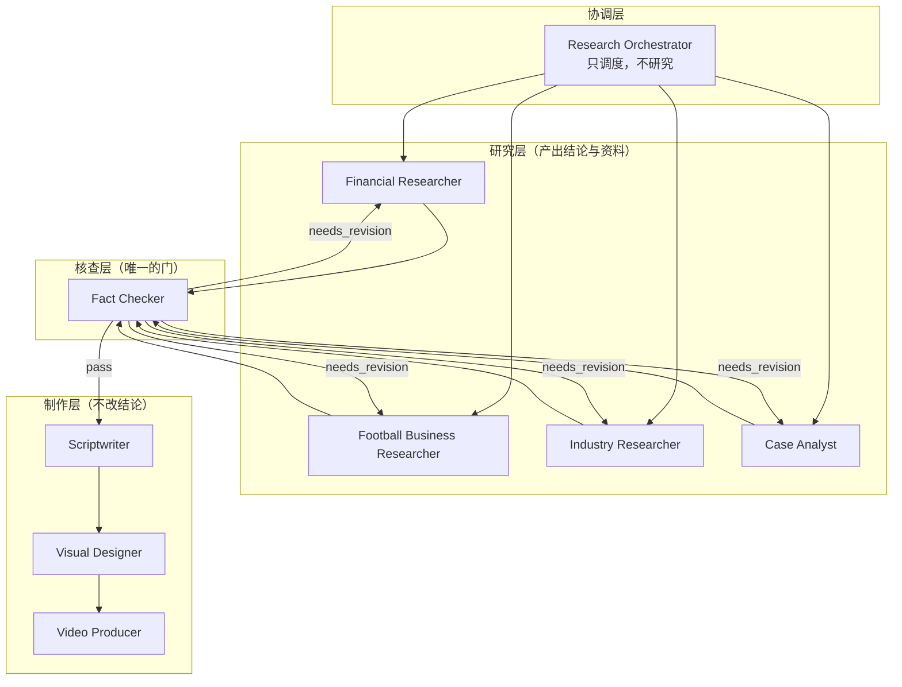

# Agent 架构：9 个角色的能力边界与编排机制

> 本文档定义**目标架构**。现状是：9 份 Prompt + 统一协议 + 只登记不执行的 `RecordingDispatcher`（见 [`current_state_audit.md`](current_state_audit.md)）。
> 本文档中的"工具白名单""写库权限"是**必须由代码强制**的约束，不是 Prompt 里的自我声明。

---

## 1. 四类角色，各司其职



**核心原则**：

1. **研究层只产出"带证据的主张"，不产出"成品文案"**；
2. **核查层是单向门**：报告不经 Fact Checker 不得进入知识库与内容层；
3. **制作层对研究结论只读**：脚本可以改写表达，不可以改数字、不可以改档位（`tier`）；
4. **协调层不生产内容**：Orchestrator 若开始写分析，就是越权，必须由代码拒绝。

---

## 2. 能力矩阵（谁负责什么，一眼看完）

| 能力 | Orchestrator | Financial | Football | Industry | Case | FactChecker | Scriptwriter | Visual | Video |
|---|---|---|---|---|---|---|---|---|---|
| 拆解研究问题 | **主** | 建议 | 建议 | 建议 | 建议 | — | — | — | — |
| 网络搜索/抓取 | — | **主** | **主** | **主** | **主** | 复核（受限） | — | — | — |
| 解析文档 | — | **主** | **主** | **主** | **主** | 复核（受限） | — | — | — |
| 提取事实/证据 | — | **主** | **主** | **主** | **主** | 校验 | — | — | — |
| 机制/定价/风险分析 | — | **主** | 部分 | 部分 | 部分 | — | — | — | — |
| 产业链与利润分配 | — | 部分 | — | **主** | 部分 | — | — | — | — |
| 足球类比（含边界） | — | 部分 | **主** | — | — | 审边界 | 使用 | — | — |
| 资金流向/案例复盘 | — | 部分 | 部分 | — | **主** | — | — | — | — |
| 事实/数字/公式核查 | — | — | — | — | — | **主（唯一）** | — | — | — |
| 定档（五档结论） | — | 提议 | 提议 | 提议 | 提议 | **裁定** | 不得修改 | — | — |
| 写脚本 | — | — | — | — | — | 审 | **主** | 参与 | — |
| 分镜/图表设计 | — | — | — | — | — | — | 参与 | **主** | 参与 |
| 配音字幕/质检 | — | — | — | — | — | — | — | — | **主** |
| 写数据库（业务表） | 任务/子任务/事件 | 证据/摘要 | 证据/摘要 | 证据/摘要 | 证据/摘要 | 审核记录/档位 | 脚本/段落链接 | 素材/分镜 | 质检记录 |

> "建议"= 可以提出但无权定稿；"部分"= 只在自身领域内；"—"= 不参与。
> **禁止**：任何研究 Agent 写 `scripts`/`publications`；任何制作 Agent 写 `evidence`/`report_findings.tier`。

---

## 3. 九个角色的完整定义

> 每个角色包含：定位 / 边界（做与不做）/ 输入 / 输出 / 工具白名单 / 数据库权限 / 可否调用其他 Agent / 失败处理 / 质检 / 成本控制。
> 输入输出字段与 `agents/PROTOCOL.md` 的 10 字段协议一致（`task_id`/`agent_name`/`task_type`/`input`/`context`/`sources`/`evidence`/`output`/`status`/`errors`）。

### 3.1 Research Orchestrator（`orchestrator`）

| 项 | 内容 |
|---|---|
| 定位 | 研究任务的**项目经理**：拆问题、排顺序、派活、汇总、卡预算、卡闸门 |
| 做 | 生成 `research_subtasks` 与依赖；按 `task_type` 路由 Agent；监控进度；在预算/失败阈值处停机；汇总子任务输出为报告骨架 |
| **不做** | 不写事实性分析；不抓资料；不改证据档位；不做最终审核（审核是人） |
| 输入 | `research_task`（objective/scope/budget）+ 选题卡 + 知识库已有条目摘要 + 可用 Agent 列表与工具清单 |
| 输出 | `plan`（子任务 DAG）+ 进度决策 + `report_outline`（骨架，不含结论） |
| 工具白名单 | `llm_complete`（仅 `purpose=plan`）、`task_update`、`db_query`（只读：topics/knowledge/历史任务） |
| 写库权限 | `research_tasks`、`research_subtasks`、`research_subtask_dependencies`、`task_events` |
| 可调用 Agent | **是**（唯一有权派活的角色）：只按 `routing.py` 的白名单派，不得自由发明 Agent |
| 失败处理 | 拆解失败→重试 1 次→模板兜底（标 `planner=template`）；子任务连续失败≥2 → 任务 `paused` 等人工 |
| 质检 | 每个子任务必须有 `question`、`task_type`、`assignee`、验收口径（`acceptance` 字段落在 `input`）；DAG 无环；子任务数 5–12 |
| 成本控制 | 自身最多 2 次模型调用；为整个任务设定 `budget_max_calls/tokens/cost`；每完成一个子任务累加并在超 80% 时预警事件 |

### 3.2 Financial Researcher（`financial_researcher`）

| 项 | 内容 |
|---|---|
| 定位 | 金融工具、市场机制、产品结构、风险结构、监管框架的研究者 |
| 做 | 搜集一手资料（监管文件/年报/统计）；解释机制（钱从谁流向谁、风险怎么转移）；提取证据；提出五档结论的**建议** |
| **不做** | 不下买卖结论；不做个股推荐；不编造数据；不越界做产业链成本分析（交 Industry） |
| 输入 | 子任务问题、上游结论引用、资料清单/URL、知识库相关条目、合集与受众约束 |
| 输出 | `findings[]`（statement + tier 建议 + evidence_ids + rationale）、`sources[]`、`open_questions[]`、`limitations[]` |
| 工具白名单 | `web_search`、`fetch_url`、`parse_pdf`、`parse_xlsx`、`db_query`、`db_write(evidence|source_summary)`、`llm_complete`、`handoff` |
| 写库权限 | `sources`(仅新建)、`source_snapshots`(通过工具)、`evidence`、`source_summaries`、`research_task_sources` |
| 可调用 Agent | **否**（只能 `handoff` 建议，由 Orchestrator 决定） |
| 失败处理 | 资料不足 → 输出 `insufficient_evidence` 标档 `unconfirmed`，绝不编数；工具连续失败 3 次 → 子任务 `failed(reason=tool_failure)` |
| 质检 | 每条 `verified_fact` ≥2 独立来源（≥1 一级）；每条结论必须有 `evidence_ids`；显式写"不知道" |
| 成本控制 | 单子任务 ≤ 8 次调用；单份资料入上下文 ≤ 6000 字（超出先摘要）；先规则筛选再调模型 |

### 3.3 Football Business Researcher（`football_researcher`）

| 项 | 内容 |
|---|---|
| 定位 | 双职责：①足球产业本身的商业研究；②用足球做**金融教学类比**（必须说明成立与不成立） |
| 做 | 转会费与球员资产定价、俱乐部财务（FFP/工资帽/摊销）、版权与赞助收入、足球产业链；产出 `analogy_material.holds[] / breaks_down[]` |
| **不做** | 不把足球写成账号边界；不做球迷情绪内容；不省略类比边界 |
| 输入 | 同上 + `football_analogy_required` 标志 + 品牌类比占比上限（≤35%） |
| 输出 | findings + `analogy_material`（`holds`、`breaks_down`、`limits` 三件套必填） |
| 工具白名单 | 同 Financial + `db_query`（football_cases/institutions） |
| 写库权限 | `evidence`、`football_cases`、`source_summaries` |
| 可调用 Agent | 否 |
| 失败处理 | 类比找不到严格对应 → 输出 `analogy_rejected`（宁可不类比）；数据缺失 → 标 `unconfirmed` |
| 质检 | `holds` 与 `breaks_down` 均非空；类比不得替代机制解释；占比不超限 |
| 成本控制 | 同 Financial；类比部分单独 1 次调用，避免与机制分析混在一次长调用里 |

### 3.4 Industry Researcher（`industry_researcher`）

| 项 | 内容 |
|---|---|
| 定位 | 产业链结构、上下游议价、成本拆解、利润分配、竞争格局与周期 |
| 做 | 画产业链（谁是上游/中游/下游）、算成本与毛利分配、识别壁垒与集中度、找周期拐点 |
| **不做** | 不做公司层面的估值判断（交 Case/Financial）；不写财务预测 |
| 输入 | 子任务 + 行业档案（`industries`）+ 公司清单（`companies`）+ 统计数据 |
| 输出 | findings + `chain_map`（节点与资金/货物流向）+ `margin_split`（利润分配） |
| 工具白名单 | 同 Financial + `db_query`（industries/companies/financial_instruments） |
| 写库权限 | `evidence`、`industries`(仅更新 `key_metrics`)、`companies`(仅更新结构化字段) |
| 可调用 Agent | 否 |
| 失败处理 | 产业链数据不全 → 输出部分链路并标 `partial_chain=true`；不得虚构节点 |
| 质检 | 每个节点要有来源；利润分配必须说明口径（毛利/净利/EBITDA） |
| 成本控制 | 大表类资料先解析成结构化 JSON 再入上下文，禁止整表塞 prompt |

### 3.5 Case Analyst（`case_analyst`）

| 项 | 内容 |
|---|---|
| 定位 | 金融事件、骗局、企业兴衰、资本运作的资金流向与因果复盘 |
| 做 | 时间线重建、资金流路径、关键决策点、因果链与反事实讨论 |
| **不做** | 不做道德审判式结论；不把传闻当事实；不预测同类事件必然发生 |
| 输入 | 子任务 + 事件资料（多为新闻/公告/判决书）+ 时间线要求 |
| 输出 | findings + `timeline[]` + `fund_flow[]`（主体、方向、金额、依据）+ `open_questions[]` |
| 工具白名单 | 同 Financial + `parse_pdf`（判决书/公告） |
| 写库权限 | `evidence`、`financial_cases`、`football_cases`（若为足球案例） |
| 可调用 Agent | 否 |
| 失败处理 | 关键金额无一手来源 → 降档 `unconfirmed`；时间线冲突 → 标 `disputed` 并双列口径 |
| 质检 | 每个金额带币种/单位/时点；每条因果至少一条证据；区分"已判决"与"指控" |
| 成本控制 | 长判决书先分段摘要，再逐段抽取；单份 >50 页必须走分段 |

### 3.6 Fact Checker（`fact_checker`）

| 项 | 内容 |
|---|---|
| 定位 | **唯一的门**：核查事实、数字、公式、来源、类比边界与合规红线，并**裁定**五档结论 |
| 做 | 逐条回查 `finding_evidence` 的引文与原文是否一致；复算公式（如 NIM、ROE、CIR）；检查来源等级与时效；检查类比边界与合规关键词；给出 pass/needs_revision/reject 与缺陷清单 |
| **不做** | 不改写报告正文（只给缺陷与建议）；不放行自己无法验证的 `verified_fact`；不因为"看起来合理"而通过 |
| 输入 | `report_findings[]`（含 tier 与证据）、`evidence[]`（含快照与片段）、风格与合规规则 |
| 输出 | `verdict` + `findings[]`（缺陷：`id/severity/problem/required_fix`）+ `tier_overrides[]` |
| 工具白名单 | `db_query`、`fetch_url`（只用于复核指定 URL，**不得扩展搜索**）、`llm_complete`（`purpose=verify`） |
| 写库权限 | `review_records`、`report_findings.tier`（仅下调/标 disputed）、`evidence.verification_status`、`evidence.quote_mismatch` |
| 可调用 Agent | 否（但可发 `handoff` 退回给指定研究 Agent） |
| 失败处理 | 自己的复核调用失败 → 该条不得通过（保守失败）；工具不可用 → `blocked` 并明确写出"未能复核" |
| 质检 | 100% 覆盖 `verified_fact`；抽检 ≥30% 的 `supported_judgment`；阻断任意 `blocker` 级缺陷 |
| 成本控制 | 每条结论 ≤1 次复核调用；批量送入（一次 5–10 条）而非逐条调用 |

**判据（与 `agents/fact_checker/PROMPT.md` 一致）**：

- 任一 `blocker`（数字错误、来源伪造、合规风险）→ 整体 **reject**；
- 缺证据但结论合理 → **needs_revision**，并把 tier 降为 `unconfirmed`/`reasonable_speculation`；
- 只有措辞/结构问题 → needs_revision（非阻塞）。

#### 3.6.1 引文一致性闸门（P0-1 配套，M1.2 新增）

`quote_mismatch` **不是提示，是硬阻断**：

```text
对每条 evidence：
  1. 用 extraction_id + char_start/char_end 从 source_extractions.text_content 重新切出片段
  2. normalize_quote(切片) 与 normalize_quote(evidence.original_excerpt) 比较
  3. 计算 quote_hash 并与 evidence.quote_hash 比对
  任一不一致：
     evidence.quote_mismatch = true
     evidence.verification_status = 'disputed'
     依赖该 evidence 的 finding：
        若 tier 为 verified_fact → 强制下调为 unconfirmed（tier_overrides）
        若该 finding 无其它 supports 证据 → 该 finding 不得通过（blocker）
     review_records(verdict='needs_revision', findings=[{id:'Q-1', severity:'blocker', ...}])
```

> 为什么这么严：证据链的价值全在"能回到原文那一段"。如果引文与原文对不上，
> 那么整份报告的可信度就无从谈起——这种错误必须在代码里被挡住，而不是靠人肉眼比对。

#### 3.6.2 `claim_nature` → `FindingTier` 的映射（避免两套"事实/推断/观点"并存）

现状 `evidence.claim_nature` 只有 `fact`/`inference`/`opinion` 三档，而
`report_findings.tier` 有五档。两者不是重复设计，而是**粒度不同**：前者描述单条证据的主张性质，
后者描述整条结论的可信档位。Fact Checker 的定档规则（写进 PROMPT 与代码常量）：

| 证据侧事实 | 可给的最高 tier |
|---|---|
| 至少 1 条 `claim_nature=fact` + `verification_status=verified` + `support_type=supports`，且来源≥2 独立 | `verified_fact` |
| 全部为 `fact` 但来源只有 1 个 | `supported_judgment` |
| 含 `inference`，且有 `invalid_if` | `reasonable_speculation` |
| 只有 `opinion`（本人观点） | `supported_judgment`（并必须标注"这是观点"） |
| 存在 `support_type=refutes` 且未解决 | 最高 `disputed` |

> 该表是**代码常量 + 测试**（`tests/test_tier_rules.py`，2.5 阶段），不是自由心证。
> 表与 `docs/research_hub/module_design.md` 的"FindingTier 五档最低证据要求"必须逐字一致。

### 3.7 Scriptwriter（`scriptwriter`）

| 项 | 内容 |
|---|---|
| 定位 | 把**已审核报告**转成可拍摄脚本；不产生新事实 |
| 做 | 按模板结构（hook/机制/案例/风险/收尾）改写；控字数与语速（3.5–4.5 字/秒）；为每段挂 `finding_id` 依据；写免责声明 |
| **不做** | 不加新数字；不改变结论档位；不做投资建议；不删免责声明；不做标题党 |
| 输入 | 报告（只读）+ 目标形式/时长 + 品牌与风格规则 + 类比材料 |
| 输出 | `script`（hook/segments/body/disclaimer）+ `segment_links[]`（段落→finding）+ `word_count` |
| 工具白名单 | `llm_complete`（`purpose=script`）、`db_query`（只读报告与 findings） |
| 写库权限 | `scripts`、`script_evidence_links`、`content_items`(状态推进) |
| 可调用 Agent | 否（可 `handoff` 请求 Visual Designer 补图，由编排层执行） |
| 失败处理 | 段落找不到依据 → 该段必须标 `background` 并降级，不得强行引用 |
| 质检 | 每段有依据或明确标为背景；时长匹配模板；免责声明齐全；无投资建议句式 |
| 成本控制 | 一次生成 + 一次润色；长报告先压缩为"事实清单"再写脚本 |

### 3.8 Visual Designer（`visual_designer`）

| 项 | 内容 |
|---|---|
| 定位 | 图解设计师：把机制/产业链/资金流画成可渲染的结构化描述 |
| 做 | 输出 `diagram_spec`（类型、节点、连线、标注、数据点来源）；输出分镜表 `storyboard[]`（画面/字幕/时长/素材需求） |
| **不做** | 不直接生成视频；不编造图中数字（数字必须引用 finding/evidence） |
| 输入 | 脚本 segments + findings + 品牌视觉规范 |
| 输出 | `diagram_spec[]` + `storyboard[]` + `asset_requests[]` |
| 工具白名单 | `llm_complete`、`db_query`（只读） |
| 写库权限 | `media_assets`（登记图表定义/生成文件）、`scripts.segments` 的结构化扩展字段 |
| 可调用 Agent | 否 |
| 失败处理 | 图形无法表达 → 降级为"字幕 + 口播说明"，并说明原因 |
| 质检 | 每个图中数字有来源；图例与单位齐全；竖屏 1080×1920 安全区 |
| 成本控制 | 一次生成 spec；图片生成（若启用）按张计费，必须先人工确认数量 |

### 3.9 Video Producer（`video_producer`）

| 项 | 内容 |
|---|---|
| 定位 | 制作流水线：配音、字幕、合成、质检（**第二阶段只到质检规范，不实现渲染**） |
| 做 | 生成 `render_spec`（画布/时长/素材清单/字幕轨）；执行 12 项 QC 检查；产出报废原因 |
| **不做** | 不修改脚本文字；不在未审批时启动合成；**不得声称已渲染**（没有渲染器就报 NOT IMPLEMENTED） |
| 输入 | 已审批脚本 + storyboard + assets + `video_engine/quality_control/qc_checks.yaml` |
| 输出 | `render_spec` + `qc_report[]`（逐项 pass/fail + 证据） |
| 工具白名单 | `db_query`、`task_update`；（未来）`render_video`、`tts_synthesize` |
| 写库权限 | `media_assets`（成品与字幕）、`review_records`（QC 记录） |
| 可调用 Agent | 否 |
| 失败处理 | QC 不通过 → 输出 `rejected` + 具体项；渲染器缺失 → `DependencyUnavailableError`（503） |
| 质检 | 12 项全覆盖；字幕行宽 ≤14 字；安全区 180px；响度 -14 LUFS |
| 成本控制 | TTS/渲染按分钟计费，必须先算成本再执行 |

---

## 4. Orchestrator 调度机制（重点）

### 4.0 task_type 单一注册表（P1-5 修订，决策 D8）

M1.1 审查发现 `module_design.md:45` 使用了 `topic.discover`，而本文件的九种 task_type
与 routing 白名单里都没有它 → 编排层会直接拒绝该任务。M1.2 的处理是**建立唯一注册表**，
而不是在别处补一句说明。

#### 4.0.1 唯一来源与三处同步

| 位置 | 角色 | 谁改 |
|---|---|---|
| `config/agent_routing.yaml`（`task_types:` 段） | **唯一权威**：task_type 名称、说明、允许的 Agent、默认工具集、是否人工闸门 | 人（改配置） |
| `backend/app/execution/task_types.py` | 代码侧枚举/常量，**必须与 YAML 逐项相等**（启动时校验，不等则拒绝启动） | 代码生成/手写，配同步测试 |
| `agents/*/PROMPT.md` 的"接受的 task_type"表 | 角色视图，必须 ⊆ 注册表 | 人（写提示词） |

**数据库侧不做枚举约束**：`research_subtasks.task_type` 是 `String(64)`，只加
`CHECK (length(task_type) BETWEEN 3 AND 64 AND task_type GLOB '*.*')`（形如 `domain.action`）。
理由：task_type 会随业务增长（本次就新增了第 10 种），把它写进 CHECK 意味着**每加一种就要迁移一次库**，
而注册表本来就该是可配置的。校验发生在服务层与编排层（白名单），不是在 CHECK 里。

#### 4.0.2 注册表内容（十种，含本轮新增）

| task_type | 说明 | 候选 Agent（按优先级） | 默认工具集 | 人工闸门 |
|---|---|---|---|---|
| `topic.discover` | **新增**：从 RSS / 财经时事 / 知识缺口扫描发现候选选题 | orchestrator（发现）+ 领域 Agent（初判归属合集） | search, db_query, db_write(topics:候选) | 否（候选需人工立项） |
| `research.plan` | 拆解问题 | orchestrator | llm, db_query | 否 |
| `research.collect` | 搜集资料（搜集即产出 sources/snapshots） | 由合集决定：`financial_knowledge`/`market_briefing`→financial；`football_finance`→football；`industry_research`→industry；`company_teardown`→industry+case；`business_cases`→case | search, fetch, parse_* | 否 |
| `research.extract` | 从资料抽取事实与证据 | 与 collect 同域 Agent | parse_*, db_write(evidence), llm | 否 |
| `research.analyze` | 领域机制/结构分析 | 同上 | db_query, llm | 否 |
| `research.synthesize` | 汇总为报告骨架与五档建议 | lead_agent（通常 financial/industry/case） | db_query, db_write(findings), llm | 否 |
| `verify.claims` | 事实核查与定档 | fact_checker（唯一） | db_query, fetch(受限), llm | **是（唯一强制门）** |
| `content.script` | 脚本 | scriptwriter | llm, db_write(scripts:草案) | 是（人工审批脚本） |
| `content.visual` | 分镜与图解 | visual_designer | llm, db_write(media_assets) | 否 |
| `content.produce` | 制作与质检 | video_producer | qc, db_write(media_assets) | 是（发布前终审） |

#### 4.0.3 同步保障（三处校验，缺一即视为设计未落地）

```text
C1 启动校验：yaml 的 task_types 键集合 == task_types.py 的枚举值集合，否则 RuntimeError 拒绝启动
C2 测试校验：tests/test_task_type_registry.py
   - 键集合相等
   - 每个 task_type 的 allowed_agents ⊆ roster.yaml 的 9 个 key
   - 每个 Agent 的 PROMPT.md 里声明的 task_type ⊆ 注册表
   - module_design.md / api_design.md 里出现的 task_type 字面量 ⊆ 注册表（正则扫描文档）
C3 运行校验：编排层派发前查白名单，命中不到 → 422 domain_validation_error + details.reason=unknown_task_type
```

> C2 的"文档正则扫描"是刻意加的：M1.1 的 `topic.discover` 冲突正是**文档先行、代码没跟上**造成的。
> 让测试去读文档，才能防止下一份文档再引入不存在的 task_type。

#### 4.0.4 新增 task_type 的流程

1. 在 `config/agent_routing.yaml` 增一条（含 allowed_agents、tools、human_gate）；
2. 在 `backend/app/execution/task_types.py` 增同名常量；
3. 在相关 `agents/*/PROMPT.md` 里声明；
4. 跑 `tests/test_task_type_registry.py`；
5. 若要落库约束（不建议）才考虑迁移。

### 4.1 路由表（由 4.0 的注册表派生，不再单独维护）

| task_type | 候选 Agent（按优先级） |
|---|---|
| `topic.discover` | orchestrator → financial/football/industry/case（按合集初判） |
| `research.plan` | orchestrator |
| `research.collect` | 域 Agent（按合集，见 4.0.2） |
| `research.extract` | 域 Agent |
| `research.analyze` | 域 Agent |
| `research.synthesize` | lead_agent（financial / industry / case） |
| `verify.claims` | fact_checker（唯一） |
| `content.script` | scriptwriter |
| `content.visual` | visual_designer |
| `content.produce` | video_producer |

> 路由来源：`config/agent_routing.yaml`（与 `agents/roster.yaml` 的 `collections` 对齐），
> 代码里 `backend/app/execution/routing.py` 读它并做**白名单校验**：
> 编排层只能派 `routing` 里出现的 `(task_type, agent)` 组合，否则 422。

### 4.2 执行循环（伪代码，非实现）

```python
def run_task(task):
    subtasks = load_subtasks(task)
    while not all_done(subtasks):
        if task.status == PAUSED or budget_exceeded(task):
            mark_awaiting_human(task); return
        ready = [s for s in subtasks if s.status == PENDING and deps_done(s)]
        if not ready:
            block_stuck(subtasks); mark_failed(PARALLEL_DEADLOCK); return
        for s in ready[:MAX_PARALLEL]:        # 默认 1
            mark_running(s)
            try:
                result = executor.execute(s)   # 内部：prompt + 工具循环
                mark_succeeded(s, result)
                record_event(SUBTASK_SUCCEEDED, cost=result.cost)
            except BudgetExceeded:
                mark_paused(task, BUDGET_EXCEEDED); return
            except ToolFailure as e:
                if s.attempts < s.max_attempts: retry_later(s)
                else: mark_failed(s, TOOL_FAILURE)
        if any_failed_permanently(subtasks):
            mark_paused(task, SUBTASK_FAILED); return
    mark_succeeded(task)
```

### 4.3 六条编排纪律

| # | 纪律 | 违反后果 |
|---|---|---|
| 1 | 子任务粒度对齐"一个可回答问题" | 太大 → 上下文爆炸；太小 → 调用成本失控 |
| 2 | 每个子任务必须声明 `acceptance`（怎么算做完） | 无法判定完成 → 无限重试 |
| 3 | 依赖必须成 DAG，创建时拓扑校验 | 死锁 |
| 4 | 重试上限 `max_attempts=2`，指数退避 | 同一个错误烧钱 |
| 5 | 人工闸门不可绕过：`verify.claims` 与最终发布 | 内容事故 |
| 6 | 每个状态变更写 `task_events` | 崩溃后无法恢复/审计 |

### 4.4 人工介入点

| 介入点 | 触发 | 系统行为 |
|---|---|---|
| 选题立项 | 评分完成 | `awaiting_review`，等人 `approve` |
| 方向修正 | 人主动 | `POST /api/research-tasks/{id}/revise` → 生成新 `plan` 版本，已完成子任务保留 |
| 预算追加 | `budget_exceeded` | `paused` + 事件，等人 `PATCH budget` 后 `resume` |
| 报告审核 | Fact Checker pass 后 | `awaiting_human`，人给 `review_records(final)` |
| 脚本审批 | 脚本生成后 | `content_items.status=in_review` |
| 发布 | 终审后 | **只能人工填 `publications`** |

---

## 5. Agent 之间的交接协议（handoff）

`handoff` 不是"直接调用"，而是**写入一条结构化请求**，由编排层决定是否执行：

```json
{
  "handoff_type": "request_subtask",
  "from_agent": "financial_researcher",
  "to_agent": "fact_checker",
  "reason": "3 条 verified_fact 需要独立复核",
  "payload": {"finding_ids": [12, 14, 19]},
  "blocking": true
}
```

| handoff_type | 用途 | 谁可以发起 |
|---|---|---|
| `request_subtask` | 请求追加一个子任务 | 研究层、核查层 |
| `request_revision` | 退回重做（带缺陷清单） | fact_checker |
| `need_human` | 我判断不了，请人决定 | 任意 Agent |
| `insufficient_evidence` | 资料不足，建议终止或换角度 | 研究层 |
| `request_asset` | 需要配图/数据表 | scriptwriter |

**禁止**：Agent 之间直接互调 API；所有交接必须落 `task_events(payload=handoff)`，可审计。

---

## 6. 失败处理矩阵

| 失败类型 | 判定 | 处理 | 用户可见 |
|---|---|---|---|
| 模型不可用（无密钥/网络） | `DependencyUnavailableError` | 子任务 `failed(model_unavailable)`，任务 `paused` | 明确"未配置模型，任务未执行" |
| 模型返回非法 JSON | 校验失败 | 重试 1 次（temperature 降低）→ 仍失败则 `failed(schema_invalid)` | 缺陷详情 |
| 预算超限 | 调用前拦截 | 任务 `paused(budget_exceeded)` | 已花费 + 剩余步骤 |
| 工具不可用（无搜索密钥） | `tool_calls.status=denied` | 降级路径（用已有 URL）或 `skipped` | "未启用搜索" |
| 解析失败 | `source_extractions.status=failed` | 该源不进证据链 | 资料卡片显示"不可解析" |
| 引文与原文不符 | `quote_mismatch=true` | 证据 `unverified`；结论降档 | 核查报告列出 |
| 死循环/互相依赖 | DAG 拓扑校验 | 创建即拒绝（422） | 明确指出形成环的节点 |
| 进程崩溃 | 租约过期 | 自动重新领取；已 completed 的子任务跳过 | 事件里有"重新领取"记录 |

---

## 7. 成本控制的角色分工

| 角色 | 手段 |
|---|---|
| Orchestrator | 设定任务总预算；子任务数控制；超 80% 预警 |
| 研究 Agent | 先规则筛选再调模型；单份资料 ≤6000 字；分段摘要；≤8 次/子任务 |
| Fact Checker | 批量复核（5–10 条/次）；只对高风险结论做二次抓取 |
| Scriptwriter | 一次生成 + 一次润色；用"事实清单"而非全文报告 |
| Visual/Video | 图形规格用文本，不调图像模型；TTS/渲染前先算价 |
| 全部 | 每个调用写 `model_calls`；**价目缺失时调用会被拒绝（Q8=B）**——Agent 不得绕过网关直接请求，也不得把"没调通"写成"已分析"（必须返回 `budget_blocked` 并上报） |

---

## 8. 与现有资产的衔接（不推倒重来）

| 现有 | 第二阶段怎么用 |
|---|---|
| `agents/roster.yaml`（v2，含 `collections`） | 继续作为角色主数据；`load_roster()` 已忽略未知键，可加 `tools:` / `db_scopes:` 而不破坏测试 |
| `agents/*/PROMPT.md` | 作为各 Agent 的 system prompt 主体；新增"工具清单"与"输出 schema"两节 |
| `agents/PROTOCOL.md`（10 字段 + §6 品牌规则） | 保持；新增 §7「工具调用协议」（见 [`tooling_architecture.md`](tooling_architecture.md)） |
| `AgentTaskEnvelope` | 扩展为 `input/context/sources/evidence/output/tool_trace`；保持向后兼容（新增字段可选） |
| `RecordingDispatcher` | **保留**作为 `dry_run` 模式（登记不执行），用于测试与排演 |
| `TaskDispatcher` 抽象 | 新增 `OrchestratingDispatcher`（真实执行），`get_dispatcher()` 按配置返回；**接口不变** |
| `agent_runs` | 继续记录每次 Agent 执行，新增 `subtask_id` 关联 |

> 演进顺序：先有 `ModelGateway` → 再有 `ToolRegistry` → 再改 `get_dispatcher()` 返回真实执行器 → 最后接编排。
> 每一小步都能单独跑测试，不需要一次性切换。
