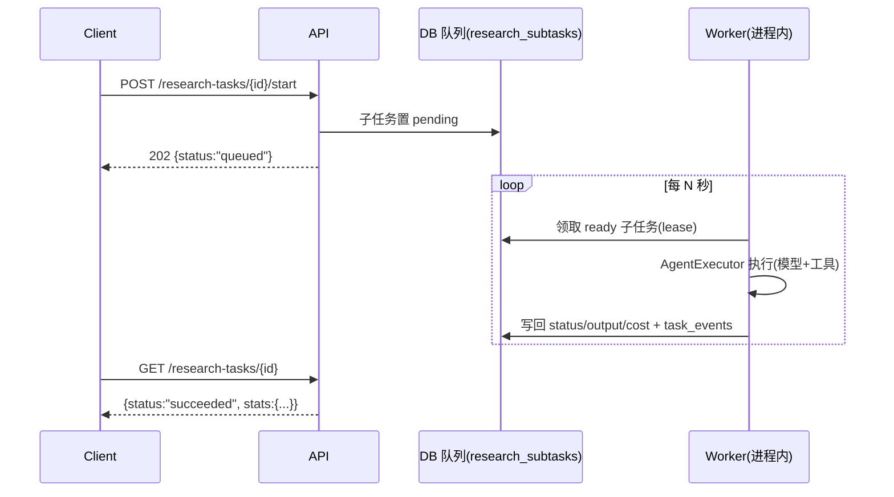

# API 设计：端点清单、请求响应与约定

> 现状：21 个端点已实现（见 [`current_state_audit.md`](current_state_audit.md)）。
> 本文档定义**目标**端点。标注 `P2.x` 表示计划在该小阶段实现；**未标注的不要现在动手**。

---

## 1. 全局约定（与现有代码一致，不推翻）

| 项 | 约定 |
|---|---|
| 前缀 | 业务端点 `/api/*`；探针 `/health` 不带前缀 |
| 版本 | **不加 `/v2`**。采用"只增不改"：新端点新增、已有字段只加不删、行为变更用新参数/新端点并存 |
| 错误信封 | `{"error": {"code": "...", "message": "...", "details": {...}}}`（现有 `backend/app/core/errors.py`） |
| 状态码 | 200 查询/更新、201 创建、404 读不存在、422 校验或引用不存在、409 冲突、503 依赖不可用 |
| 分页 | `?limit=&offset=`，响应 `{items, total, limit, offset}`（现有 `Page[T]`）；上限 100 |
| 时间 | 全部 UTC ISO8601 带 `Z`；金额 `Numeric(20,2)` 字符串化 |
| 幂等 | 写端点支持 `Idempotency-Key` 头（可选）；重放返回首次结果 + `"replayed": true` |
| 鉴权 | **第二阶段仍无鉴权**（仅本机）。风险已登记于 [`acceptance_criteria.md`](acceptance_criteria.md)；`API_HOST` 保持 `127.0.0.1` |
| 文档 | FastAPI 自动生成 `/docs`、`/openapi.json`；每个端点必须有 tag + summary + 示例 |
| 长任务 | 一律**异步受理**：POST 返回 202 + 资源 id，进度靠 GET 轮询；**不做 WebSocket** |

---

## 2. 端点总览

### 2.1 已实现（只读参考，P2 期间不改行为）

| 方法 | 路径 | 说明 |
|---|---|---|
| GET | `/health` | 存活探针，不碰数据库 |
| GET | `/api/system/status` | 版本/数据库/迁移/features/agents |
| POST GET | `/api/topics` | 创建/列表选题 |
| GET | `/api/topics/columns` | 合集（栏目）列表 |
| GET PATCH | `/api/topics/{topic_id}` | 详情/部分更新 |
| POST GET | `/api/knowledge` | 创建/列表知识条目 |
| GET | `/api/knowledge/search` | 关键词检索（LIKE，非语义） |
| POST | `/api/knowledge/relations` | 建立知识关联 |
| GET | `/api/knowledge/{item_id}/relations` | 关联列表 |
| GET PATCH | `/api/knowledge/{item_id}` | 详情/更新（version+1） |
| POST GET | `/api/sources` | 创建/列表资料 |
| POST | `/api/evidence` | 创建证据 |
| GET | `/api/evidence?knowledge_item_id=` | 证据列表（必须给一个目标） |
| POST GET | `/api/research-reports` | 创建/列表报告 |
| GET | `/api/research-reports/{report_id}` | 报告详情 |

### 2.2 计划新增（按模块分组）

**A. 分类与标签（P2.1）**

| 方法 | 路径 | 说明 |
|---|---|---|
| GET | `/api/collections` | 六大合集（读 `topic_columns`，含 id/code/name/display_order） |
| GET | `/api/collections/{code}/topics` | 某合集下的选题（分页） |
| PUT | `/api/topics/{topic_id}/collections` | **整体替换**选题的合集关联（1–3 个，含唯一 primary） |
| GET | `/api/topics/{topic_id}/collections` | 读选题合集关联 |
| GET | `/api/tags?namespace=` | 标签列表/联想（分页 + 前缀过滤） |
| PUT | `/api/topics/{topic_id}/tags` | 整体替换选题标签（≤6，按 namespace 去重） |

**B. 选题中心（P2.7）**

| 方法 | 路径 | 说明 |
|---|---|---|
| POST | `/api/topics/discover` | 提交"候选选题发现"任务（异步），返回 `research_task_id`；**不直接建选题** |
| POST | `/api/topics/candidates` | 人工/Agent 提交候选选题（含来源链接），进 `awaiting_review` |
| POST | `/api/topics/{topic_id}/score` | 重算评分（规则 + 可选模型），写快照 |
| GET | `/api/topics/{topic_id}/scores` | 评分历史快照 |
| POST | `/api/topics/{topic_id}/approve` | 人工确认立项（`idea → approved`） |
| POST | `/api/topics/{topic_id}/merge` | 合并到目标选题（`merged_into_topic_id`，原选题 `archived`） |
| POST | `/api/topics/{topic_id}/split` | 拆分为多个新选题（保留来源引用） |
| GET | `/api/topics/duplicates?dedupe_key=` | 去重预检 |

**C. 研究任务中心（P2.4）**

| 方法 | 路径 | 说明 |
|---|---|---|
| POST | `/api/research-tasks` | 由选题创建任务（`{topic_id, objective, scope, budget_*}`）→ 201 |
| GET | `/api/research-tasks` | 列表（按 status/topic 过滤） |
| GET | `/api/research-tasks/{task_id}` | 详情（含预算使用、统计） |
| POST | `/api/research-tasks/{task_id}/plan` | 生成/重生成子任务 DAG（202） |
| POST | `/api/research-tasks/{task_id}/start` | 开始执行（202；`execution.enabled=false` 时返回 409 并提示 tick） |
| POST | `/api/research-tasks/{task_id}/pause` | 暂停 |
| POST | `/api/research-tasks/{task_id}/resume` | 恢复 |
| POST | `/api/research-tasks/{task_id}/cancel` | 取消 |
| POST | `/api/research-tasks/{task_id}/revise` | 人工修正研究方向（生成新 plan 版本） |
| GET | `/api/research-tasks/{task_id}/subtasks` | 子任务列表（含依赖与状态） |
| GET | `/api/research-tasks/{task_id}/events` | 事件流（含 handoff、预算、失败） |
| GET | `/api/research-tasks/{task_id}/cost` | 成本汇总（模型调用 + 工具调用） |

**D. 资料中心（P2.2 / P2.3）**

| 方法 | 路径 | 说明 |
|---|---|---|
| POST | `/api/sources/{source_id}/fetch` | 抓取并生成快照；返回 `snapshot_id` |
| GET | `/api/sources/{source_id}/snapshots` | 快照历史（多版本） |
| POST | `/api/snapshots/{snapshot_id}/extract` | 解析（pdf/xlsx/html）→ `extraction_id` |
| GET | `/api/extractions/{extraction_id}` | 解析结果（分页取文本/行） |
| POST | `/api/sources/{source_id}/summary` | 生成 AI 摘要（**明确标记 `generated_by=ai`**，不得替代原文） |
| POST | `/api/research-tasks/{task_id}/sources` | 关联资料到任务（含 `purpose`） |
| GET | `/api/research-tasks/{task_id}/sources` | 任务资料清单 |

**E. 证据与发现（P2.5）**

| 方法 | 路径 | 说明 |
|---|---|---|
| POST | `/api/reports/{report_id}/findings` | 新增结论（`statement/tier/rationale`） |
| GET | `/api/reports/{report_id}/findings` | 结论列表（含档位统计） |
| POST | `/api/findings/{finding_id}/evidence` | 绑定证据（`role=supports/refutes/contextual`） |
| GET | `/api/findings/{finding_id}/evidence` | 证据链（含快照引用与引文位置） |
| POST | `/api/evidence/{evidence_id}/verify` | 人工/工具标记核实（`verified/disputed/refuted`） |
| POST | `/api/evidence/{evidence_id}/invalidate` | 标记失效（`source_gone|quote_drift|superseded`） |
| POST | `/api/reports/{report_id}/verify` | 触发 Fact Checker 核查（202）→ `review_records` |
| GET | `/api/reviews?target_type=&target_id=` | 审核记录列表（含 findings/verdict） |

**F. 内容生产中心（P2.9）**

| 方法 | 路径 | 说明 |
|---|---|---|
| POST | `/api/content-items` | 由报告创建内容作品（`{report_id, form, collection_ids, plan}`） |
| GET | `/api/content-items` / `{id}` | 列表/详情 |
| PATCH | `/api/content-items/{id}` | 状态推进（受状态机约束） |
| POST | `/api/content-items/{id}/scripts` | 生成脚本（202）；落 `scripts` |
| GET | `/api/scripts/{script_id}` | 脚本详情 |
| POST | `/api/scripts/{script_id}/links` | 段落↔findings 依据绑定 |
| POST | `/api/scripts/{script_id}/approve` | **人工审批**（写 `approved_at/approved_by`） |
| POST | `/api/publications` | 发布记录（仅人工，需已审批脚本） |

**G. 运维与观测（P2.4）**

| 方法 | 路径 | 说明 |
|---|---|---|
| GET | `/api/ops/costs?date=` | 当日成本汇总（模型/工具/按 Agent） |
| POST | `/api/_dev/worker/tick` | 手动推进一轮队列（仅 `execution.enabled=false` 或 `APP_ENV!=production` 可用） |

---

## 3. 关键请求/响应示例

### 3.1 创建研究任务

```http
POST /api/research-tasks
Content-Type: application/json

{
  "topic_id": 12,
  "objective": "解释商业银行的盈利结构与风险来源",
  "scope": {"geography": "CN", "period": "2023-2025", "exclude": ["个股推荐"]},
  "budget_max_calls": 60,
  "budget_max_cost_cny": 2.0
}
```

```json
201 Created
{
  "id": 31,
  "topic_id": 12,
  "status": "draft",
  "objective": "解释商业银行的盈利结构与风险来源",
  "budget_max_calls": 60,
  "budget_used_calls": 0,
  "created_at": "2026-11-09T15:20:31Z"
}
```

错误示例（选题不存在）：

```json
422 Unprocessable Entity
{"error": {"code": "domain_validation_error",
           "message": "topic_id=12 不存在",
           "details": {"field": "topic_id"}}}
```

> 沿用现有约定：**写操作引用不存在的关联对象 = 422**，读取不存在的资源 = 404。

### 3.2 整体替换选题合集（多对多）

```http
PUT /api/topics/12/collections
{"collections": [{"code": "financial_knowledge", "is_primary": true},
                 {"code": "market_briefing"}]}
```

```json
200 OK
{"topic_id": 12, "collections": [
  {"code": "financial_knowledge", "name": "金融知识", "is_primary": true},
  {"code": "market_briefing", "name": "财经时事", "is_primary": false}]}
```

约束（服务层强制）：
- 1–3 个；`is_primary` 恰好 1 个；`code` 必须存在于 `topic_columns`（未知 → 422 `details.field="collections[1].code"`）；
- 首次替换时若 `topics.column_id` 仍存在，同步把 primary 写入 `column_id`（迁移期兼容）。

### 3.3 抓取生成快照

```http
POST /api/sources/7/fetch
{"max_bytes": 5000000, "allow_pdf": true}
```

```json
201 Created
{"snapshot_id": 44, "source_id": 7, "http_status": 200,
 "content_type": "text/html; charset=utf-8", "bytes": 184320,
 "sha256": "9f2c...e1", "fetched_at": "2026-11-09T15:22:02Z",
 "status": "ok", "needs_extraction": true}
```

失败（403 反爬）：

```json
200 OK
{"snapshot_id": 45, "status": "blocked", "http_status": 403,
 "error": {"code": "permission_denied", "message": "站点拒绝抓取"},
 "hint": "请人工确认该来源或改用官方公开文件"}
```

> 注意：抓取"失败但已记录"仍返回 200 + `status=blocked`，因为**快照记录本身是有效事实**（"抓不到"也是证据的一部分）；
> 只有请求本身不合法（无 source_id、URL 非法）才 4xx。

### 3.4 绑定证据到结论

```http
POST /api/findings/88/evidence
{"evidence_id": 301, "role": "supports"}
```

```json
201 Created
{"finding_id": 88, "evidence_id": 301, "role": "supports",
 "quote": "利息净收入占营业收入的 71.4%", "page_number": 12,
 "source": {"title": "某银行 2024 年报", "publisher": "上交所", "url": "https://..."},
 "quote_match": "exact"}
```

### 3.5 触发核查

```http
POST /api/reports/5/verify
{"checks": ["quote_exact", "number_recompute", "source_grade", "compliance"]}
```

```json
202 Accepted
{"review_id": 19, "status": "pending", "message": "已受理；执行需 worker（POST /api/_dev/worker/tick）"}
```

### 3.6 人工审批脚本

```http
POST /api/scripts/14/approve
{"approved_by": "creator", "note": "数据已核对，可拍摄"}
```

```json
200 OK
{"script_id": 14, "status": "approved", "approved_at": "2026-11-09T16:01:00Z",
 "approved_by": "creator"}
```

> 这是**唯一**能把脚本推入制作的动作，且**必须人工发起**。AI 不能调用此端点（无对应工具）。

---

## 4. 异步与执行模型



- `execution.enabled=false`（默认）时 **worker 不自动跑**，必须 `POST /api/_dev/worker/tick` 手动推进 —— 这是"没有模型也能跑通全流程测试"的关键；
- 端点**永不阻塞等待模型**；最坏返回 202 + 提示；
- 所有 POST 触发的长动作都要能在 `GET /{id}/events` 里看到"为什么没动"。

---

## 5. 与现有实现的兼容性检查表

| 检查项 | 结论 |
|---|---|
| 现有 21 端点是否改路径 | **否**，全部保留 |
| 现有响应字段是否删除 | **否**，只新增（如 `TopicOut` 增 `collections`、`status`，字段可选默认 `null`/`[]`） |
| 现有错误码是否改 | **否**，新端点复用同一套 code |
| 现有测试是否会破 | 需要新增断言但**不应改旧断言**；新增字段不得改变旧字段语义 |
| 是否引入新依赖 | P2 需要 `httpx`（已有）、`pypdf`、`openpyxl`（新增可选依赖组 `[research]`） |
| 是否需要鉴权 | 第二阶段否；但 `/api/_dev/*` 必须拒绝非 localhost 且 `APP_ENV=production` 时 404 |
