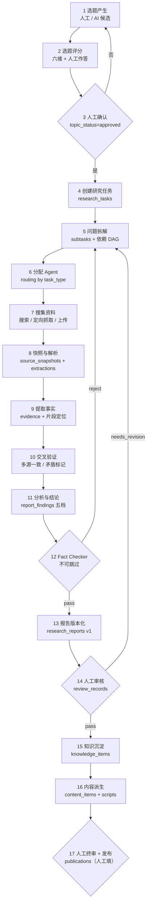
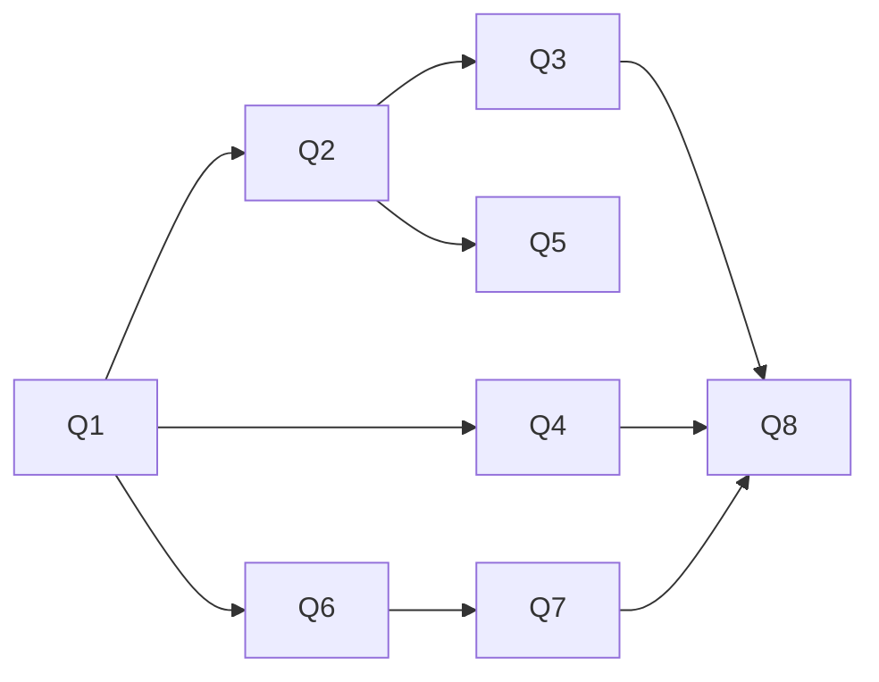

# 业务流程与端到端推演

> **本文档中的全部内容都是架构设计示例，不是真实执行结果。**
> 文中出现的银行数据、金额、结论均为**占位示例**，用于说明数据如何流转；
> 真实数字必须由第二阶段的工具抓取真实资料后产生。
> 任何照抄示例数字的行为都属于内容事故。

---

## 1. 主流程（14 步 → 内容成品）



---

## 2. 端到端推演：《商业银行是如何赚钱的？》

### 2.0 场景设定

| 项 | 值（设计示例） |
|---|---|
| 选题标题 | 商业银行是如何赚钱的？ |
| 合集 | `financial_knowledge`（primary） + `company_teardown`（次），满足"多合集" |
| 标签 | instrument=存贷款、institution_type=commercial_bank、geography=CN、period=2023-2025、mechanism=利差与中间业务 |
| 受众层级 | `learner`（进阶学习者） |
| 形式 | `knowledge_video`（2–5 分钟，默认 180s） |
| 主责 Agent | `financial_researcher` |
| 支持 Agent | `fact_checker`（核查）、`scriptwriter`（脚本） |
| 预算 | 单任务 `max_cost = ¥3.0`、`max_calls = 40`、`max_tokens_total = 600k` |

### 2.1 17 步详细推演

| # | 执行者 | 工具 | 读 | 写 | 输出 | 失败处理 |
|---|---|---|---|---|---|---|
| 1 | 用户 / `TopicDiscoveryService` | API、RSS/搜索（可选） | `knowledge_items`、历史 `research_reports`（找延伸点） | `topics`（`status=candidate`，`origin_type=manual|rss|news|knowledge_gap`） | 选题卡（多合集 + 标签 + 形式） | 无 DAG 影响；发现失败不阻塞人工创建 |
| 2 | `TopicScoringService` + `ModelGateway` | `llm_complete`（评分模板） | 选题卡、同类历史数据、来源可获得性估计 | `topic_score_snapshots`（六维分 + 理由 + 模型） | `score_total=0.74`，各维明细 | 模型不可用 → 用规则基线分（人工可改），标 `scored_by=rule` |
| 3 | 用户 | UI/API | 评分理由 | `topics.status=approved`（+ `topic_events`） | 立项确认 | 用户否决 → `rejected`，不再进入研究 |
| 4 | `ResearchOrchestrator`（模块 2 服务层调用） | `task_update` | 选题、预算、模板配置 | `research_tasks`（`status=queued`） | 研究任务（目标 + 范围 + 预算） | 预算超日上限 → 拒绝启动并说明 |
| 5 | `TaskPlanner`（Orchestrator 子能力） | `llm_complete` | 选题、`config/content_rules.yaml`、知识库已有条目 | `research_subtasks` + `research_subtask_dependencies` | 6–10 个问题节点（见 §2.2） | 拆解结构化失败 → 重试 1 次 → 仍失败则用内置模板兜底（标 `planner=template`） |
| 6 | `routing.py` | 无（纯函数） | `task_type` → agent 映射表 | `research_subtasks.assignee`、`agent_runs` | 每个子任务的执行 Agent | 无可用 Agent → 子任务 `blocked` + `task_events` 说明 |
| 7 | `financial_researcher` | `web_search`（若无密钥→跳过并记录）、`fetch_url`、`parse_pdf` | 已知 URL 列表、公告与年报页面 | `sources`、`source_snapshots`、`research_task_sources` | 12–20 份资料（含监管/年报/行业报告） | 单源失败只标 `snapshot.status=http_error/timeout`，任务继续；全部失败 → 子任务 `failed` |
| 8 | `ExtractionService`（L1，不调模型） | `parse_pdf` / `parse_xlsx` / html 抽取 | `source_snapshots` 字节 | `source_extractions`（文本 + 偏移 + parser 版本） | 可检索的纯文本 | 解析失败 → `extraction.status=failed(reason)`，该源不参与证据 |
| 9 | `financial_researcher` | `llm_complete`（抽取模板）、`db_write`（白名单：evidence） | `source_extractions` | `evidence`（`claim` + `original_excerpt` + `char_start/end` + `quote_hash` + `claim_nature`） | 30–60 条候选事实 | 片段对不上原文 → `verification_status=unverified` 且 `quote_mismatch=true`，不进入结论 |
| 10 | `CrossCheckService`（L1 规则 + 可选模型） | `db_query` | `evidence` 按 `claim` 聚类 | `evidence.verification_status`、`report_findings.counter_evidence` | 一致/矛盾/单一来源 三类标记 | 矛盾未解决 → 结论档位强制降为 `disputed`，报告中必须写出分歧 |
| 11 | `financial_researcher` | `llm_complete`（分析模板）、`db_write`（白名单：report_findings） | 已验证证据 + 知识条目 | `report_findings`（五档）、`research_reports`（草稿） | 结构与结论（见 §2.4） | 生成 JSON 校验失败 → 重试 1 次 → 降级为"提纲 + 未完成标记"，绝不编造 |
| 12 | `fact_checker` | `db_query`、`fetch_url`（复核原文）、`llm_complete` | 全部 `report_findings` 及其 `finding_evidence` | `review_records`（stage=`professional`）、`report_findings.tier` 修正 | pass / needs_revision / reject + 缺陷清单 | reject → 报告不进知识库；记录 blocker 到 `task_events` |
| 13 | `ReportBuilder`（L1） | 无 | 通过核查的 findings | `research_reports`（`version=1`，`verification_status=verified`） | 可发布的报告实体 | 版本冲突 → 新版本号，旧版保留（不覆盖） |
| 14 | 用户 | `review_records` API | 报告、证据链、成本摘要 | `review_records`（stage=`final`，`reviewer_type=human`） | 人工通过 | 退回 → `research_tasks.status=awaiting_human` → 修改后重跑 11–13 |
| 15 | `KnowledgeService` | `llm_complete`（结构化模板）+ 人工确认 | 报告 + 证据 | `knowledge_items`（`knowledge_domain=institutions`，写 `mechanism`/`profit_model`/`risk_structure`）、`knowledge_item` 关联 `sources`（经 evidence） | 可复用的知识条目 v1 | 已存在同名条目 → 走 `version+1` 且旧版 `is_current=false` |
| 16 | `scriptwriter` → `visual_designer` | `llm_complete`、`db_write`（白名单：scripts/segments） | 报告（只读）、`config/brand.yaml`、`content_rules.yaml`、模板时长 | `content_items`、`scripts`（+`segments` JSON + `script_evidence_links`） | 180s 脚本，每段标注依据 `finding_id` | 段落找不到依据 → 该段必须降级为"背景铺垫"并在 `review` 里说明 |
| 17 | 用户 | `publications` API（人工填写） | 已审批脚本版本 | `publications`（脚本版本 + 平台 + 链接） | 发布记录 | 系统**永不自动发布**；缺人工审批时接口直接拒绝 |

### 2.2 问题拆解（第 5 步的输出样例）

```
Q1 银行的收入由哪几类构成？（利息收入 / 非利息收入 / 交易与投资收益）
Q2 净息差（NIM）是怎么形成的？资产端收益 − 负债端成本 − 信用成本
Q3 为什么大行和股份行的收入结构不同？（客户结构 / 负债成本 / 中收能力）
Q4 非利息收入里，哪些是可持续的（银行卡、结算、财富管理），哪些是周期性的（投资收益）？
Q5 成本收入比（CIR）说明了什么？成本控制的上限在哪里？
Q6 风险如何进入利润表？拨备、不良率、资本充足率与 ROE 的关系
Q7 为什么"规模扩张"不等于"利润增长"？（RWA 与资本约束）
Q8 有哪些常见误解需要澄清？（"银行靠存款利息差躺着赚钱"是否成立）
```

依赖关系（DAG 示例）：



> Q8 依赖前三问全部完成 —— 这是"减少幻觉"的结构手段：**结论必须建立在已完成的子问题之上**，
> 而不是让模型一次性写完整篇。

### 2.3 资料与证据示例（设计示例，非真实数据）

| 资料（示例） | 类型 | 可信度 | 用途 |
|---|---|---|---|
| 某上市银行 2024 年年报（PDF，第 45–52 页） | `company_report` | high | 收入结构、净息差、成本收入比 |
| 监管机构统计季报 | `official_statistics` | high | 行业净息差区间 |
| 行业协会年度报告（PDF） | `industry_report` | medium | 中收占比趋势 |
| 财经媒体报道 | `financial_news` | low | 仅作背景，不作数字依据 |
| 用户上传的内部讲义 | 上传文件 | unknown | 需人工确认来源后使用 |

证据片段示例（`evidence` 一行）：

```
claim:            "2024 年该行净息差为 1.xx%"
original_excerpt: "……报告期内本行净息差 1.xx%，同比下降 x 个基点……"
char_start/end:   12034 / 12110      （相对 source_extractions 文本）
page_number:      "47"
support_type:     supports
claim_nature:     fact
verification_status: verified
source_snapshot_id: 3   （指向不可变字节 + sha256）
quote_hash:       sha256("……报告期内本行净息差 1.xx%……")
```

**为什么要有 `char_start/end` 与 `quote_hash`**：半年后网页改版、年报被替换，
只要快照字节还在，就能证明"当时原文确实这么写"；`quote_hash` 让"引文是否被篡改"变成一个可校验的问题。

### 2.4 五档结论示例

| 档位 | 本节示例（设计示例） | 证据要求 |
|---|---|---|
| `verified_fact` 已验证事实 | 该行 2024 年利息净收入占比约 xx%（年报 + 监管统计一致） | ≥2 个独立来源，≥1 个一级来源 |
| `supported_judgment` 有证据的判断 | 该行中收增长主要来自财富管理，而非投行 | 引文支持 + 反方证据已排除 |
| `reasonable_speculation` 合理推测 | 若负债成本继续下行，2025 年 NIM 有望企稳 | 必须写明"推测"与依据、失效条件 |
| `unconfirmed` 未确认 | 某业务条线内部考核口径（无公开资料） | 标注"未获取公开资料，不作结论" |
| `disputed` 存在争议 | 行业净息差统计口径（监管 vs 协会差异 xx bp） | 必须同时列出两方口径 |

**硬规则**：`verified_fact` 缺证据 → 数据库层允许写入但 Fact Checker 必须 `reject`；
`reasonable_speculation` 不得进入脚本的"结论段"，只能出现在"延伸思考"段。

---

## 3. 一次研究的成本与耗时（估算，非实测）

| 阶段 | 模型调用次数（估算） | 输入/输出 token（估算） | 费用（估算，按低价模型） |
|---|---|---|---|
| 拆解问题 | 1 | 4k / 1.5k | ≈ ¥0.01 |
| 资料摘要（15 份 × 分段） | 20–25 | 60k / 12k | ≈ ¥0.15 |
| 事实抽取 | 10–15 | 40k / 10k | ≈ ¥0.10 |
| 交叉验证（可选模型） | 3–5 | 12k / 3k | ≈ ¥0.03 |
| 分析写作 | 4–6 | 30k / 12k | ≈ ¥0.15 |
| 事实核查 | 3–5 | 20k / 4k | ≈ ¥0.06 |
| 脚本转化 | 1–2 | 8k / 3k | ≈ ¥0.03 |
| **合计** | **42–59 次** | **≈175k / 45k** | **≈ ¥0.5–0.9** |

> 说明：以上按"每百万 token 个位数人民币"的廉价模型估算，仅用于说明量级与预算设计方法。
> **真实价格必须以 `config/models.yaml` 的价目表与供应商当期官网为准**，跑之前先用单份资料试算。

耗时（单并发）：抓取 2–5 分钟 + 解析 1 分钟 + 模型阶段 15–30 分钟 ≈ **20–40 分钟/次**。

---

## 4. 失败场景与系统行为（设计约定）

| 场景 | 系统行为 | 用户看到什么 |
|---|---|---|
| 没有搜索密钥 | 检索子任务 `skipped(reason=search_disabled)`，改用用户提供的 URL 清单 | 任务详情里明确写明"未启用搜索，仅使用你提供的 6 个链接" |
| 全部抓取失败 | 任务 `failed(reason=no_sources)`，保留事件链 | 失败原因 + 建议动作（提供 URL / 上传文件） |
| 模型超预算 | 任务 `paused`，`awaiting_human` | 已花费金额 + 剩余步骤 + 是否加预算 |
| 证据片段与原文不符 | 该证据 `unverified` + `quote_mismatch` | 报告中该结论强制降档 |
| Fact Checker reject | 报告不落 `research_reports`，返回缺陷清单 | 缺哪些证据、哪句无来源 |
| 人工长期未审 | 任务 `awaiting_human`，不超时自动通过 | 明确"不会自动发布" |

---

## 5. 与内容中心的交接契约

研究报告 → 脚本的交接必须显式声明：

```json
{
  "report_id": 12,
  "report_version": 1,
  "findings_used": [101, 103, 107],
  "forms": ["knowledge_video"],
  "template": "financial_mechanism",
  "target_duration": 180,
  "brand_constraints": {
    "collections": ["financial_knowledge", "company_teardown"],
    "primary_collection": "financial_knowledge",
    "audience_level": "learner",
    "disclaimer_required": true,
    "football_analogy_allowed": true
  }
}
```

`script_evidence_links` 记录"第 3 段依据 finding 101"，从而在审核时可以直接反问：
**"这一段话，依据哪条证据？"**
