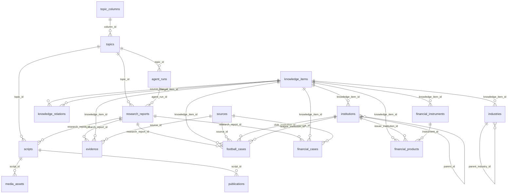
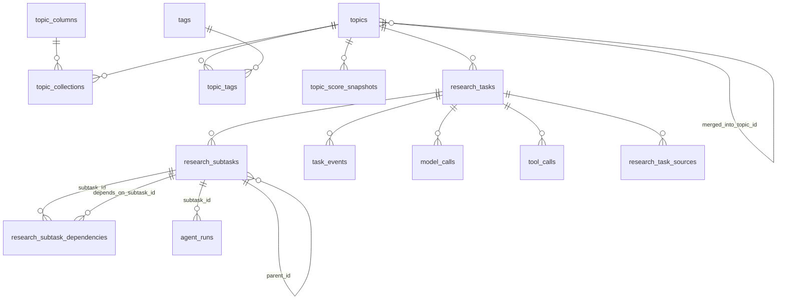
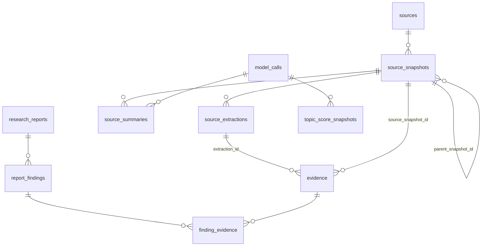
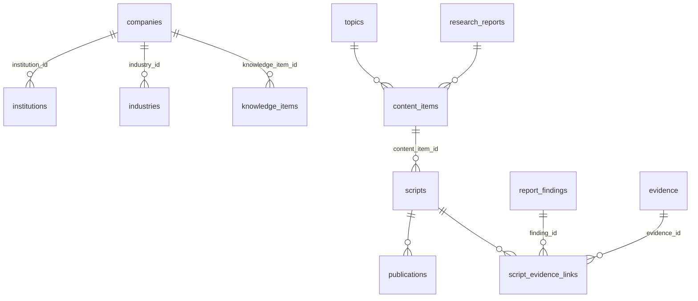
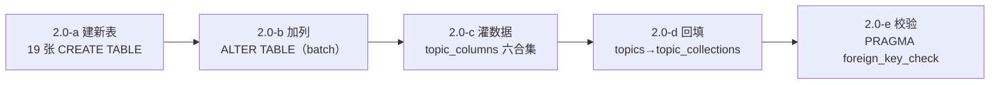

# 数据库设计：从 19 张表到目标架构

> **本文档只做设计，不含任何迁移脚本改动。** 第二阶段 2.0 阶段才会生成 Alembic revision。
> 现有模型事实（列数、外键、约束）来自 `Base.metadata` 实测，不是凭记忆书写。

---

## 0. 三个已定决策（严格执行，不再讨论替代方案）

| 决策 | 内容 | 落地方式 |
|---|---|---|
| **D1** | 选题 ↔ 内容合集 = 多对多 | 新增 `topic_collections`；`topics.column_id` 暂留 |
| **D1'** | 选题 ↔ 标签 = 多对多，标签可复用 | 新增 `tags` + `topic_tags` |
| **D2** | **复用 `topic_columns` 作为合集定义表**，不再造第二张合集表 | 不给合集建新表；只灌数据 + 加注释 |
| **D3** | `knowledge_domain` 暂不增加 `concepts` | 不改枚举；`knowledge/concepts/` 现阶段用 `domain: general` |

---

## 1. 现有数据库 ER 图（实测，19 张表）



**现状缺口（一句话）**：这条链是 `资料 → 证据 → 报告 → 脚本 → 发布`，
但**没有"谁去取资料""资料原件存在哪""报告结论分几档""一次研究花了多少钱"**。

---

## 2. 目标数据库 ER 图（38 张表，分三层看）

### 2.1 选题与研究（Layer A）



### 2.2 资料与证据（Layer B）



### 2.3 知识与内容（Layer C）



---

## 3. 新增表清单（19 张）与"为什么必须有它"

| # | 表 | 引入阶段 | 一句话理由 | 为什么不能用现有表代替 |
|---|---|---|---|---|
| 1 | `tags` | 2.0 | 标签字典，可复用、可统计 | 标签散落在 JSON 里无法去重、无法"点击标签看全部选题" |
| 2 | `topic_collections` | 2.0 | 选题↔合集多对多（D1） | `topics.column_id` 是单值列，物理上放不下第二个合集 |
| 3 | `topic_tags` | 2.0 | 选题↔标签多对多 | 同上；且需要 `tag_id` 外键保证标签归一 |
| 4 | `topic_score_snapshots` | 2.0 | 六维评分的**历史快照** | 分数会随资料变化；只存当前值就无法回答"为什么当初判 0.74" |
| 5 | `research_tasks` | 2.0 | "一次研究"这个业务单元 | `agent_runs` 是**单次 Agent 执行**，粒度太细；预算/进度/暂停都要有归属 |
| 6 | `research_subtasks` | 2.0 | 研究问题的拆解节点 | 没有它就无法"只重跑第 3 问"、无法显示进度条 |
| 7 | `research_subtask_dependencies` | 2.0 | 子任务 DAG 依赖 | 把依赖塞进 JSON 无法做"下一批可执行任务"的 SQL 查询 |
| 8 | `task_events` | 2.0 | 任务事件流水（审计与恢复） | 只有最终状态无法解释"为什么失败/谁改的方向" |
| 9 | `source_snapshots` | 2.0 | **不可变资料快照**（字节 + 哈希） | `sources` 只有 URL；网页改版后原证据消失 |
| 10 | `source_extractions` | 2.0 | 解析结果（与原件分离） | 原件是 PDF 字节，解析文本是可检索层；混在一起无法换解析器重跑 |
| 11 | `source_summaries` | 2.0 | **AI 摘要，显式标记** | 若与原文同表，就会产生"AI 摘要被当成来源"的隐患（明确禁止） |
| 12 | `research_task_sources` | 2.0 | 资料↔研究任务，带用途 | 一份资料在不同任务里用途不同（背景/数据/反证） |
| 13 | `model_calls` | 2.0 | 每次模型调用的计量与留痕 | 没有它就无法控制成本、无法回答"这句话谁写的" |
| 14 | `tool_calls` | 2.0 | 每次工具调用的留痕 | 抓取失败/解析失败必须可复盘 |
| 15 | `report_findings` | 2.5 | **五档结论**逐条结构化 | 现有 `findings` JSON 只有三档且不可查询统计 |
| 16 | `finding_evidence` | 2.5 | 结论↔证据，带支持/反驳角色 | `evidence.research_report_id` 只能到"报告级"，到不了"某句话级" |
| 17 | `companies` | 2.7 | 非金融公司档案（公司商业解剖） | `institutions` 语义是金融机构+足球组织；混用会让枚举失控 |
| 18 | `content_items` | 2.9 | 一个报告可派生多种内容形态 | `scripts` 只是视频脚本；图文/报告/课程没有归属 |
| 19 | `script_evidence_links` | 2.9 | 脚本段落↔研究依据 | 审核时必须能回答"这段话依据哪条证据" |

> **刻意不新增**：
> - 不建 `collections` 表（决策 D2）；
> - 不建 `topics_v2`（在 `topics` 上扩列更安全）；
> - 不建 `knowledge_item_sources`（知识条目到来源可通过 `evidence` 传递，避免冗余）；
> - 不建向量表（D3 与架构原则）；
> - 不建 `review_records` 之外的审核表（现有表够用）。

---

## 4. 新表字段设计

> 约定（沿用第一阶段）：`id INTEGER PK`；每个表都有 `created_at` / `updated_at`（`TimestampMixin`，UTC，带索引）；
> 枚举一律 `str Enum` + `native_enum=False` + `create_constraint=True` + `length=40`；
> 金额 `NUMERIC(20,2)`，费用 `NUMERIC(12,6)`；所有外键显式命名（`fk_<表>_<列>`，走既有 `NAMING_CONVENTION`）。

### 4.1 `tags`

| 列 | 类型 | 约束 | 说明 |
|---|---|---|---|
| id | Integer | PK | |
| namespace | Enum `TagNamespace` | NOT NULL | `instrument`/`institution_type`/`industry`/`geography`/`period`/`mechanism`/`other`（前六项与 `content_taxonomy.yaml:multi_label.tag_dimensions` 一致） |
| name | String(80) | NOT NULL | 展示名，如"可转债" |
| slug | String(80) | NOT NULL, UNIQUE | 归一化键，如 `convertible-bond` |
| description | Text | NULL | |
| usage_count | Integer | NOT NULL default 0 | 冗余计数，写 `topic_tags` 时维护；用 `db_query` 可校验一致性 |
| is_active | Boolean | NOT NULL default true | 停用而不删除，保护历史关联 |

索引：`ix_tags_slug`(unique)、`ix_tags_namespace`；唯一约束 `uq_tag_namespace_name (namespace, name)`。

### 4.2 `topic_collections`

| 列 | 类型 | 约束 | 说明 |
|---|---|---|---|
| id | Integer | PK | |
| topic_id | Integer | FK `topics.id` ON DELETE CASCADE, NOT NULL | |
| column_id | Integer | FK `topic_columns.id` ON DELETE CASCADE, NOT NULL | 合集 = `topic_columns` 的一行（D2） |
| is_primary | Boolean | NOT NULL default false | 主合集，用于标题/标签展示与 Agent 主责判定 |
| rank | Integer | NOT NULL default 0 | 次合集排序 |

约束：
- `uq_topic_collection (topic_id, column_id)`
- **部分唯一索引** `uq_topic_primary_collection (topic_id) WHERE is_primary = 1` —— 保证"每个选题最多一个主合集"。
  SQLite 与 PostgreSQL 都支持 partial unique index；MySQL 不支持（本项目不使用 MySQL）。

### 4.3 `topic_tags`

| 列 | 类型 | 约束 |
|---|---|---|
| id | Integer | PK |
| topic_id | Integer | FK `topics.id` CASCADE, NOT NULL |
| tag_id | Integer | FK `tags.id` CASCADE, NOT NULL |
| weight | Float | NULL，0–1，AI 打标的置信度；人工打标为 NULL |

约束：`uq_topic_tag (topic_id, tag_id)`；CHECK `weight IS NULL OR (weight >= 0 AND weight <= 1)`。
数量上限（每选题 ≤6 个标签、合集 1–3 个）在 **服务层**校验，不用数据库 CHECK（会随策略变化）。

### 4.4 `topic_score_snapshots`

| 列 | 类型 | 约束 | 说明 |
|---|---|---|---|
| id | Integer | PK | |
| topic_id | Integer | FK `topics.id` CASCADE, NOT NULL | |
| profile | String(32) | NOT NULL default `default` | 评分方案名（`config/topic_scoring.yaml`） |
| importance / timeliness / research_value / reach_potential / commercial_value / data_availability | Float | NOT NULL | 六维，0–1 |
| total_score | Float | NOT NULL | 0–1，加权结果 |
| weights | JSON | NOT NULL | 当次使用的权重快照（权重会调，必须留痕） |
| rationale | JSON | NOT NULL | 每维一句话理由 + 依据（如"有 3 份一级来源"） |
| scored_by | Enum `ScoredBy` | NOT NULL | `rule` / `model` / `human` |
| model_call_id | Integer | FK `model_calls.id` SET NULL | `scored_by=model` 时必填 |
| is_current | Boolean | NOT NULL default true | 只有一条 current |

约束：六维与总分各自 `BETWEEN 0 AND 1`；`uq_topic_current_score` 部分唯一索引 `(topic_id) WHERE is_current = 1`。

### 4.5 `research_tasks`

| 列 | 类型 | 约束 | 说明 |
|---|---|---|---|
| id | Integer | PK | |
| topic_id | Integer | FK `topics.id` CASCADE, NOT NULL | |
| title | String(300) | NOT NULL | 可与选题标题不同（如"商业银行盈利模式：2023–2025 数据复核"） |
| objective | Text | NOT NULL | 研究目标（要回答什么） |
| scope | Text | NOT NULL | 研究范围（含/不含） |
| out_of_scope | Text | NULL | 明确不做什么，防跑题 |
| status | Enum `ResearchTaskStatus` | NOT NULL default `created` | 见 `state_machine.md` |
| priority | Integer | NOT NULL default 3, CHECK 1–5 | |
| lead_agent | String(64) | NULL | 主责 Agent key |
| plan | JSON | NULL | 拆解结果快照（含问题、依赖、预估） |
| planner | String(32) | NULL | `model` / `template` |
| budget_max_calls | Integer | NULL | |
| budget_max_tokens | Integer | NULL | |
| budget_max_cost | Numeric(12,4) | NULL | 币种统一记 CNY，列名不写币种但在文档固定 |
| calls_spent / tokens_spent | Integer | NOT NULL default 0 | 由执行器累加 |
| cost_spent | Numeric(12,4) | NOT NULL default 0 | |
| claimed_by | String(64) | NULL | 租约持有者（`hostname:pid`） |
| lease_until | DateTime(tz) | NULL | 租约到期时间 |
| requested_by | String(64) | NOT NULL default `human` | |
| started_at / finished_at / paused_at | DateTime(tz) | NULL | |
| failure_reason | String(64) | NULL | `no_sources` / `budget_exceeded` / `model_unavailable` / `planner_failed` / `human_cancelled` / … |
| failure_detail | Text | NULL | |
| version | Integer | NOT NULL default 1, CHECK ≥1 | |

索引：`ix_research_tasks_status`、`ix_research_tasks_topic_id`、`ix_research_tasks_created_at`、`ix_research_tasks_lease_until`（恢复扫描用）。
CHECK：`budget_max_calls IS NULL OR budget_max_calls > 0`（其余预算列同理）。

### 4.6 `research_subtasks`

| 列 | 类型 | 约束 | 说明 |
|---|---|---|---|
| id | Integer | PK | |
| research_task_id | Integer | FK `research_tasks.id` CASCADE, NOT NULL | |
| parent_id | Integer | FK self SET NULL | 层级（可选） |
| sequence | Integer | NOT NULL | 展示顺序，`uq_subtask_sequence (research_task_id, sequence)` |
| question | Text | NOT NULL | 要回答的问题（自然语言） |
| task_type | String(64) | NOT NULL | 见 `agent_architecture.md` 的 task_type 表 |
| assignee | String(64) | NULL | Agent key；由 routing 决定 |
| status | Enum `SubtaskStatus` | NOT NULL default `pending` | |
| attempts | Integer | NOT NULL default 0 | |
| max_attempts | Integer | NOT NULL default 2 | |
| input | JSON | NULL | 交给 Agent 的输入（含资料清单/上游结果引用） |
| output | JSON | NULL | Agent 的结构化产出 |
| agent_run_id | Integer | FK `agent_runs.id` SET NULL | 最近一次执行记录 |
| error_message | Text | NULL | |
| started_at / finished_at | DateTime(tz) | NULL | |

CHECK：`attempts >= 0`、`max_attempts >= 1`、`parent_id IS NULL OR parent_id <> id`。

### 4.7 `research_subtask_dependencies`

| 列 | 类型 | 约束 |
|---|---|---|
| id | Integer | PK |
| subtask_id | Integer | FK `research_subtasks.id` CASCADE, NOT NULL |
| depends_on_subtask_id | Integer | FK `research_subtasks.id` CASCADE, NOT NULL |

约束：`uq_subtask_dependency (subtask_id, depends_on_subtask_id)`；
CHECK `subtask_id <> depends_on_subtask_id`。
**环检测在服务层做**（拓扑排序时发现环 → 拒绝落库，返回 422）。

### 4.8 `task_events`

| 列 | 类型 | 约束 | 说明 |
|---|---|---|---|
| id | Integer | PK | |
| research_task_id | Integer | FK `research_tasks.id` CASCADE, NOT NULL | |
| subtask_id | Integer | FK `research_subtasks.id` SET NULL | |
| event_type | Enum `TaskEventType` | NOT NULL | `created`/`queued`/`claimed`/`plan_created`/`subtask_started`/`subtask_succeeded`/`subtask_failed`/`retried`/`paused`/`resumed`/`direction_changed`/`budget_exceeded`/`completed`/`failed`/`cancelled` |
| actor | String(64) | NOT NULL | `system` / Agent key / `human` |
| message | Text | NULL | 人读说明 |
| payload | JSON | NULL | 结构化细节 |
| cost_delta | Numeric(12,6) | NOT NULL default 0 | 事件维度的费用增量 |

索引：`ix_task_events_research_task_id`、`ix_task_events_event_type`、`ix_task_events_created_at`。
**只追加，不更新**（由服务层保证；`updated_at` 恒等于 `created_at`）。

### 4.9 `source_snapshots`

| 列 | 类型 | 约束 | 说明 |
|---|---|---|---|
| id | Integer | PK | |
| source_id | Integer | FK `sources.id` CASCADE, NOT NULL | 逻辑来源 |
| storage_path | Text | NOT NULL | `data/raw/shares/ab/abcdef…bin`（相对仓库根） |
| content_hash | String(64) | NOT NULL | 原始字节 sha256 |
| byte_size | Integer | NOT NULL, CHECK ≥0 | |
| mime_type | String(96) | NULL | |
| final_url | Text | NULL | 跟随重定向后的地址 |
| http_status | Integer | NULL | |
| http_headers | JSON | NULL | 只保留 `content-type`/`last-modified`/`etag` 等，不存 cookie |
| fetched_at | DateTime(tz) | NOT NULL | |
| fetch_method | Enum `FetchMethod` | NOT NULL | `http_get`/`upload`/`manual_paste`/`browser_export` |
| snapshot_status | Enum `SnapshotStatus` | NOT NULL | `ok`/`http_error`/`timeout`/`blocked`/`too_large`/`partial` |
| error_detail | Text | NULL | |
| is_current | Boolean | NOT NULL default true | 同一 URL 最新一次成功快照 |
| parent_snapshot_id | Integer | FK self SET NULL | 重新抓取链（旧→新） |

约束：`uq_snapshot_content (source_id, content_hash)` —— 同样字节不重复存；
索引：`ix_source_snapshots_source_id`、`ix_source_snapshots_content_hash`、`ix_source_snapshots_fetched_at`。

**网页变化如何保留历史证据（明确回答需求）**：
同一 URL 再次抓取 → 内容哈希不同 → **新增一行** `source_snapshots`，旧行 `is_current=false`。
旧行的字节文件永不删除、`evidence` 仍指向旧快照。于是：
"2026 年 3 月的报道原文"与"2026 年 9 月改版后的同一 URL"是两条独立记录，
历史证据不会因为网站改版而失效。

### 4.10 `source_extractions`

| 列 | 类型 | 约束 | 说明 |
|---|---|---|---|
| id | Integer | PK | |
| snapshot_id | Integer | FK `source_snapshots.id` CASCADE, NOT NULL | |
| extraction_kind | Enum `ExtractionKind` | NOT NULL | `html_text`/`pdf_text`/`spreadsheet_rows`/`raw_text`/`ocr_text`(预留) |
| parser_name | String(64) | NOT NULL | 如 `beautifulsoup4`、`pypdf` |
| parser_version | String(32) | NOT NULL | 换解析器必须能追溯 |
| language | String(16) | NULL | |
| text_content | Text | NULL | ≤256KB 时直接入库 |
| text_path | Text | NULL | 超过阈值落 `data/processed/` |
| char_count | Integer | NULL | |
| structure | JSON | NULL | 标题层级 / 页数 / sheet 名与表头 |
| span_offset_base | Integer | NOT NULL default 0 | 声明 `evidence.char_start` 的基准 |
| status | Enum `ExtractionStatus` | NOT NULL | `ok`/`partial`/`failed` |
| error_detail | Text | NULL | |

约束：`uq_extraction_variant (snapshot_id, extraction_kind, parser_name, parser_version)`。

### 4.11 `source_summaries`（AI 生成，必须显式标记）

| 列 | 类型 | 约束 | 说明 |
|---|---|---|---|
| id | Integer | PK | |
| snapshot_id | Integer | FK CASCADE, NOT NULL | |
| extraction_id | Integer | FK `source_extractions.id` SET NULL | 摘要基于哪份解析文本 |
| summary | Text | NOT NULL | |
| key_points | JSON | NULL | |
| model_call_id | Integer | FK `model_calls.id` SET NULL | |
| prompt_version | String(32) | NOT NULL | 提示词版本，便于复现 |
| is_ai_generated | Boolean | NOT NULL default true | **恒为 true**；保留字段是为了将来允许"人工摘要"并区分 |
| confidence | Float | NULL（0–1） | |

**硬约束（服务层 + 审核）**：`evidence` 不允许指向 `source_summaries`；
引用 AI 摘要作为证据的请求直接 422。摘要是"导航"，不是"证据"。

### 4.12 `research_task_sources`

| 列 | 类型 | 约束 | 说明 |
|---|---|---|---|
| id | Integer | PK | |
| research_task_id | Integer | FK CASCADE, NOT NULL | |
| source_id | Integer | FK `sources.id` SET NULL | |
| snapshot_id | Integer | FK `source_snapshots.id` SET NULL | 精确到某次抓取 |
| purpose | Enum `SourcePurpose` | NOT NULL | `background`/`data_point`/`cross_check`/`counter_evidence` |
| added_by | String(64) | NOT NULL | Agent key 或 `human` |
| notes | Text | NULL | |

约束：`uq_task_source (research_task_id, source_id, purpose)`；
CHECK `source_id IS NOT NULL OR snapshot_id IS NOT NULL`。

### 4.13 `report_findings`（五档结论）

| 列 | 类型 | 约束 | 说明 |
|---|---|---|---|
| id | Integer | PK | |
| research_report_id | Integer | FK CASCADE, NOT NULL | |
| ordinal | Integer | NOT NULL | 报告内顺序，`uq_finding_ordinal (research_report_id, ordinal)` |
| tier | Enum `FindingTier` | NOT NULL | `verified_fact`/`supported_judgment`/`reasonable_speculation`/`unconfirmed`/`disputed` |
| statement | Text | NOT NULL | 结论句 |
| rationale | Text | NULL | 为什么这样定档 |
| confidence | Float | NULL（0–1） | |
| counter_evidence | JSON | NULL | 反方口径/反证说明（`disputed` 必填） |
| invalid_if | Text | NULL | 失效条件（`reasonable_speculation` 必填） |

索引：`ix_report_findings_report_id`、`ix_report_findings_tier`。
CHECK：`tier = 'disputed' → counter_evidence IS NOT NULL`、`tier = 'reasonable_speculation' → invalid_if IS NOT NULL`
（第一条 SQLite 可用 CHECK 表达；第二条同）。

### 4.14 `finding_evidence`

| 列 | 类型 | 约束 |
|---|---|---|
| id | Integer | PK |
| finding_id | Integer | FK `report_findings.id` CASCADE, NOT NULL |
| evidence_id | Integer | FK `evidence.id` CASCADE, NOT NULL |
| role | Enum `EvidenceRole` | NOT NULL：`supports`/`refutes`/`contextual` |
| weight | Float | NULL（0–1） |

约束：`uq_finding_evidence (finding_id, evidence_id, role)`。
业务规则：`verified_fact` 至少要有一条 `role=supports` 且 `evidence.verification_status=verified`
（服务层校验 + Fact Checker 复核）。

### 4.15 `model_calls`

| 列 | 类型 | 约束 | 说明 |
|---|---|---|---|
| id | Integer | PK | |
| research_task_id | Integer | FK SET NULL | |
| subtask_id | Integer | FK SET NULL | |
| agent_name | String(64) | NULL | |
| purpose | String(64) | NOT NULL | `score`/`plan`/`summarize`/`extract`/`analyze`/`verify`/`script`/`classify` |
| provider | String(32) | NOT NULL | `deepseek`/`openai_compat`/`fake` |
| model | String(64) | NOT NULL | |
| request_hash | String(64) | NOT NULL | 归一化请求的 sha256（缓存键） |
| response_hash | String(64) | NULL | |
| prompt_preview | Text | NULL | 前 2KB，用于排查（不含密钥） |
| prompt_tokens / completion_tokens / total_tokens | Integer | NULL | 由 provider 返回 |
| cost_estimate | Numeric(12,6) | NOT NULL default 0 | 按 `config/models.yaml` 价目估算 |
| pricing_unknown | Boolean | NOT NULL default false | 价目缺失时置 true，**不猜价格** |
| latency_ms | Integer | NULL | |
| cache_hit | Boolean | NOT NULL default false | 命中缓存则不计费 |
| status | Enum `CallStatus` | NOT NULL | `ok`/`error`/`timeout`/`budget_blocked` |
| error_detail | Text | NULL | |

索引：`ix_model_calls_task`、`ix_model_calls_request_hash`、`ix_model_calls_created_at`、`ix_model_calls_provider_model`。

### 4.16 `tool_calls`

| 列 | 类型 | 约束 |
|---|---|---|
| id | Integer | PK |
| research_task_id / subtask_id | Integer | FK SET NULL |
| agent_name | String(64) | NULL |
| tool_name | String(64) | NOT NULL |
| arguments | JSON | NULL（脱敏后；不含密钥/绝对路径可选打码） |
| status | Enum `ToolCallStatus` | NOT NULL：`ok`/`error`/`timeout`/`denied` |
| result_summary | Text | NULL |
| rows_affected | Integer | NULL |
| duration_ms | Integer | NULL |
| cost_estimate | Numeric(12,6) | NOT NULL default 0 |
| error_detail | Text | NULL |

索引：`ix_tool_calls_task`、`ix_tool_calls_tool_name`、`ix_tool_calls_created_at`。

### 4.17 `companies`

| 列 | 类型 | 约束 | 说明 |
|---|---|---|---|
| id | Integer | PK | |
| name | String(200) | NOT NULL | |
| en_name | String(200) | NULL | |
| ticker | String(32) | NULL | |
| exchange | String(64) | NULL | |
| industry_id | Integer | FK `industries.id` SET NULL | 所属行业 |
| institution_id | Integer | FK `institutions.id` SET NULL | 若同时是持牌机构（如券商母公司） |
| country / jurisdiction | String | NULL | |
| business_model | Text | NULL | 商业模式 |
| revenue_segments | JSON | NULL | `[{segment, share, description}]` |
| cost_structure | Text | NULL | |
| moat | Text | NULL | 竞争优势 |
| risks | Text | NULL | |
| founded_year / listed_year | Integer | NULL | CHECK 范围 |
| knowledge_item_id | Integer | FK `knowledge_items.id` SET NULL | 公司档案 = 一条知识条目 |
| as_of_date / currency / unit | | NULL | 与既有金融表一致的数据口径三件套 |

约束：`uq_company_name_country (name, country)`；索引：`ix_companies_industry_id`、`ix_companies_ticker`。

### 4.18 `content_items`

| 列 | 类型 | 约束 | 说明 |
|---|---|---|---|
| id | Integer | PK | |
| topic_id | Integer | FK `topics.id` SET NULL | |
| research_report_id | Integer | FK `research_reports.id` SET NULL | 研究来源 |
| form | Enum `ContentForm` | NOT NULL | `short_news`/`knowledge_video`/`documentary`/`article`/`research_report`/`series`/`member_research`/`course`（与 taxonomy `forms` 一一对应） |
| title | String(300) | NOT NULL | |
| status | Enum `ContentItemStatus` | NOT NULL default `planned` | |
| primary_collection_id | Integer | FK `topic_columns.id` SET NULL | |
| audience_level | Enum `AudienceLevel` | NULL | |
| template | Enum `VideoTemplate` | NULL | 仅视频类 |
| target_duration_seconds | Integer | NULL | |
| approved_at / approved_by | | NULL | 审批留痕 |
| notes | Text | NULL | |

索引：`ix_content_items_topic_id`、`ix_content_items_form`、`ix_content_items_status`。

### 4.19 `script_evidence_links`

| 列 | 类型 | 约束 |
|---|---|---|
| id | Integer | PK |
| script_id | Integer | FK `scripts.id` CASCADE, NOT NULL |
| segment_index | Integer | NOT NULL（与 `scripts.segments` 数组下标一致） |
| finding_id | Integer | FK `report_findings.id` SET NULL |
| evidence_id | Integer | FK `evidence.id` SET NULL |
| note | Text | NULL |

CHECK：`finding_id IS NOT NULL OR evidence_id IS NOT NULL`；
索引：`ix_script_evidence_scripts`、`ix_script_evidence_finding`。

---

## 5. 对现有表的修改（不删列，只加列）

| 表 | 新增列 | 类型/约束 | 为什么 |
|---|---|---|---|
| `topics` | `status` | Enum `TopicStatus` NOT NULL default `candidate` | 需要独立的选题生命周期，不能再用 `research_status`/`content_status` 兼任 |
| | `origin_type` | Enum `TopicOrigin` NOT NULL default `manual` | `manual`/`rss`/`news`/`knowledge_gap`/`ai_suggested` —— 区分人工与 AI 发现 |
| | `discovered_by` | String(64) NULL | Agent key 或 `human` |
| | `dedupe_key` | String(200) NULL, index | 去重键（标题归一 + 主体 + 时间窗），供唯一性提示而非硬唯一 |
| | `merged_into_topic_id` | FK self SET NULL | 合并选题时保留被合并方向 |
| | `score_total` / `score_updated_at` | Float / DateTime | 冗余当前分，便于列表排序（历史在 `topic_score_snapshots`） |
| `evidence` | `source_snapshot_id` | FK `source_snapshots.id` SET NULL, index | 指向不可变快照 |
| | `extraction_id` | FK `source_extractions.id` SET NULL | 指向解析文本（`char_start` 的基准） |
| | `char_start` / `char_end` | Integer NULL | 片段位置 |
| | `quote_hash` | String(64) NULL, index | 引文指纹，可校验是否被篡改 |
| | `strength` | Float NULL (0–1) | 证据强度 |
| | `quote_mismatch` | Boolean NOT NULL default false | 抽取文本与引文不一致的显式标记 |
| | `invalidated_at` / `invalidation_reason` | DateTime / Text | 资料失效后的软失效 |
| `research_reports` | `research_task_id` | FK `research_tasks.id` SET NULL, index | 报告归属哪次研究 |
| | `outline` | JSON NULL | 结构快照（便于增量重写） |
| | `tier_stats` | JSON NULL | 五档计数冗余（列表页展示） |
| `agent_runs` | `research_task_id` / `subtask_id` | FK SET NULL, index | 执行记录挂到任务/子任务 |
| | `cost_estimate` | Numeric(12,6) default 0 | 单次执行成本 |
| `scripts` | `content_item_id` | FK `content_items.id` SET NULL | 脚本属于哪个内容产品 |

**明确不改**：`sources`（逻辑来源保持纯净）、`topic_columns`（D2）、`knowledge_items`、`publications`、`media_assets`、六张金融域表。

---

## 6. 迁移方案（安全、可回滚、无历史包袱）

### 6.1 前置事实

- 当前 head：`de8148733a9b`（唯一 revision）。
- 开发库 `data/finance_media.db`：**除 `alembic_version` 外全部为空表**（已实测）。
- `backend/migrations/env.py` 已配 `render_as_batch=True`（SQLite 改表必需）、`compare_type=True`。

### 6.2 单次 revision，两段式执行



**表创建顺序**（受外键依赖约束）：

```
tags → topic_collections → topic_tags
→ research_tasks → research_subtasks → research_subtask_dependencies → task_events
→ model_calls → tool_calls → topic_score_snapshots
→ source_snapshots → source_extractions → source_summaries → research_task_sources
→ report_findings → finding_evidence
→ companies → content_items → script_evidence_links
→ （ALTER: topics / evidence / research_reports / agent_runs / scripts）
```

### 6.3 数据回填（幂等 SQL）

1. **合集主数据**：`backend/scripts/seed_collections.py`，
   读 `config/content_taxonomy.yaml` 的 6 个 `collections.id`，按 `code` upsert 进 `topic_columns`
   （`code` 已有唯一约束，可安全重复执行）。**不删除**人工建的栏目。
2. **旧单值 → 多对多**：

```sql
INSERT INTO topic_collections (topic_id, column_id, is_primary, rank, created_at, updated_at)
SELECT id, column_id, 1, 0, CURRENT_TIMESTAMP, CURRENT_TIMESTAMP
FROM topics
WHERE column_id IS NOT NULL
  AND NOT EXISTS (SELECT 1 FROM topic_collections tc WHERE tc.topic_id = topics.id);
```

3. **标签**：不入库预置（按需创建），但 `config/content_taxonomy.yaml` 里的
   `tag_dimensions` 通过 seed 脚本登记为 `tags(namespace=…)` 的**命名空间约定说明**，不建实际标签行。
4. **状态映射**：`topics.status` 按 `research_status`/`content_status` 推导一次，
   规则写死在迁移里并在 `docs/research_hub/state_machine.md` 记录：
   `content_status in (published, archived) → status=delivered/archived`，其余 → `approved`。

### 6.4 校验清单（迁移后必须全绿）

```bash
alembic upgrade head
python -c "import backend.app.models as m; from backend.app.database.base import Base; print(len(Base.metadata.tables))"   # 期望 38
python -m pytest -q                                                                                                        # 期望 96+ passed
sqlite3 data/finance_media.db "PRAGMA foreign_key_check;"                                                                   # 期望空
sqlite3 data/finance_media.db "select count(*) from topic_columns;"                                                        # 期望 ≥6
alembic downgrade -1 && alembic upgrade head                                                                                # 往返成功
```

### 6.5 回滚策略

| 层级 | 手段 | 数据影响 |
|---|---|---|
| 代码回滚 | `git revert` + `alembic downgrade -1` | 新表与新列被删；**`topics.column_id` 仍在**，合集归属不丢 |
| 数据回滚 | 迁移前 `sqlite3 .backup` 到 `data/backups/` | 完整可恢复 |
| 部分回退 | 仅停用功能（配置开关 `features.research_hub=false`） | 表保留，不写不读 |

### 6.6 `topics.column_id` 的退场计划

| 阶段 | 状态 |
|---|---|
| 2.0 | 加 `topic_collections` 并回填；`column_id` **保留**，`POST /api/topics` 仍接受（写 `column_id` 的同时写一条 `topic_collections`，`is_primary=true`） |
| 2.7 | 所有读取路径切到 `topic_collections`；`column_id` 变成"兼容写入列" |
| 2.10（未来） | 评估删除列；删除前需一次全量数据校验 + 用户确认 |

### 6.7 PostgreSQL 迁移注意（未来）

1. 枚举：当前用 CHECK 约束模拟；迁 PG 时可保留（简单）或改原生 enum（需 `USING` 转换）。
2. `JSON` → `JSONB`（PG 上查询更快，但 SQLite 无此类型，代码层不要依赖 JSON 函数）。
3. 部分唯一索引两侧都支持（本项目不使用 MySQL）。
4. `DateTime(timezone=True)` 在 SQLite 存字符串（无时区），真实时区语义需在应用层用 UTC。
5. `Numeric` 行为一致；注意 SQLite 实际存储为 REAL，金额精度在大数场景要注意（<10^15 内安全）。

---

## 7. 索引与约束设计原则（本次新增表统一遵守）

| 原则 | 做法 |
|---|---|
| 外键列一律建索引 | SQLite 不会自动为 FK 建索引，查询会全表扫 |
| 唯一约束用"业务自然键" | 如 `(topic_id, column_id)`、`(source_id, content_hash)` |
| 部分唯一索引表达"只能有一个 current/primary" | `WHERE is_primary = 1` / `WHERE is_current = 1` |
| CHECK 只放"永远成立"的规则 | 范围（0–1）、非负、禁自环；**策略性规则放服务层**（会变） |
| 不做物理级联删除`publications`/`scripts` | 内容资产不随上游删除；用 `SET NULL` 保命 |
| 审计表只追加 | `task_events`、`model_calls`、`tool_calls` 不提供 UPDATE 接口 |

---

## 8. 数据量预估与容量（决定要不要更复杂方案）

| 表 | 一年预估行数 | 依据 |
|---|---|---|
| `topics` | 500–2,000 | 每周 10–40 个候选 |
| `research_tasks` | 200–800 | 每周 4–15 次研究 |
| `research_subtasks` | 2,000–8,000 | 每任务 8–12 个子问题 |
| `source_snapshots` | 5,000–20,000 | 每次研究 15–40 份资料 |
| `evidence` | 20,000–80,000 | 每份资料 2–5 条证据 |
| `model_calls` | 20,000–100,000 | 每次研究 40–60 次调用 |
| `tool_calls` | 30,000–150,000 | 含抓取/解析/查询 |

> 结论：行数在 **十万级**，SQLite 完全够用（单文件几百 MB）。
> 真正的瓶颈是**文件字节**（`data/raw/`），需要按 `ab/` 哈希前缀分目录 + 定期归档，不需要上数据库集群。
