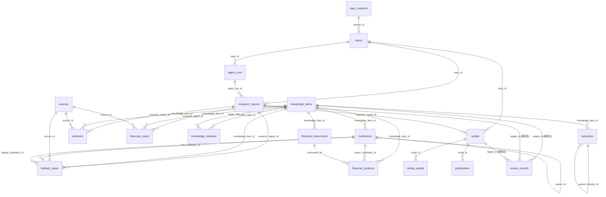
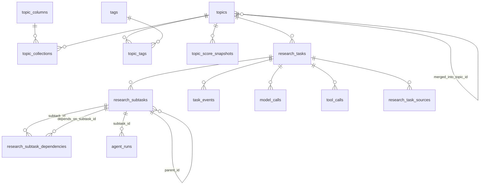
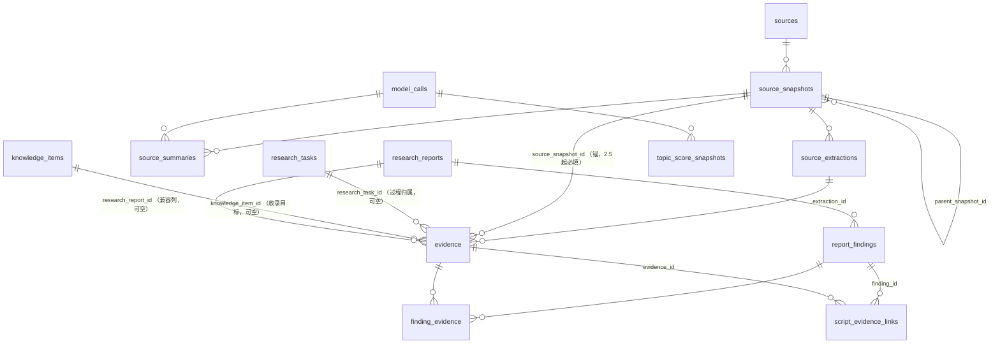
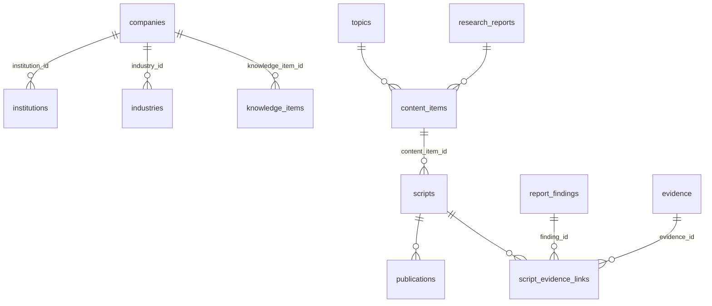
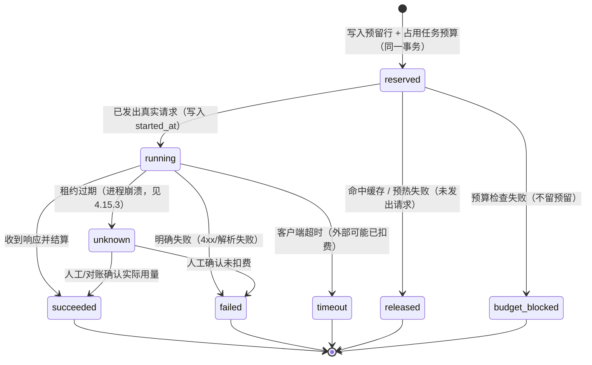

# 数据库设计：从 18 张业务表到 37 张业务表（M1.2 修订版）

> **版本**：M1.2（2026-11-10 设计修订）。上一版为 M1 初稿；本轮针对
> `m1_1_architecture_review.md` 的 2 个 P0、8 个 P1 与 P2/P3 问题逐条修订。
> **本文档只做设计，不含任何迁移脚本改动。** Alembic revision 在 2.0 及之后按 §6.2 的
> 六批次逐批生成；本阶段没有、也不允许有迁移文件。
> 现有模型事实（列数、外键、约束、行数）来自 `Base.metadata` / `PRAGMA` 实测，不是凭记忆书写。
>
> **M1.2 修订索引**：§0 决策 D4–D12 ｜ §1 计数口径纠正 ｜ §4.0 证据归属模型（P0-1）｜
> §4.15 模型调用先预留后记账（P0-2）｜ §4.20 `topic_columns` 停用机制（P1-8）｜
> §4.21 `review_records` 纳入文档（P1-1）｜ §5 加列清单 ｜ §6.2 六批次迁移（D7）｜
> §6.5 备份与回滚演练 ｜ §7.0 删除矩阵（P1-3/P1-4）｜ §7.2 `quote_hash` 算法（P2-3）

---

## 0. 已定决策（M1.2 修订后，共 D1–D12）

> M1.1 审查（`m1_1_architecture_review.md`）指出 2 个 P0 与 8 个 P1。以下 D1–D3 为原决策（保留），
> **D4–D12 是 M1.2 针对审查结论新增/改写的决策**。每条决策的理由、被否方案与迁移影响见
> `m1_2_decision_register.md`（决策登记表）。

| 决策 | 内容 | 落地方式 |
|---|---|---|
| **D1** | 选题 ↔ 内容合集 = 多对多 | 新增 `topic_collections`；`topics.column_id` 暂留 |
| **D1'** | 选题 ↔ 标签 = 多对多，标签可复用 | 新增 `tags` + `topic_tags` |
| **D2** | **复用 `topic_columns` 作为合集定义表**，不再造第二张合集表 | 只灌数据 + 加列（`is_active`/`is_system`，见 D10） |
| **D3** | `knowledge_domain` 暂不增加 `concepts` | 不改枚举；`knowledge/concepts/` 现阶段用 `domain: general` |
| **D4**（P0-1） | **证据归属改为"不可变快照为锚 + 任务为过程归属 + 引用走关联表"**（方案 C） | `evidence.source_snapshot_id` 2.5 起必填；`research_task_id` 为可空过程归属；`knowledge_item_id` 降级为"收录目标"引用；`research_report_id` 降级为兼容列。详见 §4.0 |
| **D5**（P1-3/P1-4） | **重要研究数据禁止物理级联删除**：新增/现有 FK 一律 `RESTRICT` 或 `SET NULL`，`CASCADE` 只允许出现在"纯连接表"与"审计子行"上 | 逐表删除行为见 §7.0 删除矩阵；现状 5 条危险 CASCADE 在 2.0 迁移中改写 |
| **D6**（P0-2） | **模型调用"先预留、后记账"**：`model_calls` 必须在发起真实调用**之前**落 `reserved` 行并占用任务预算；崩溃后按预留额保守计费，不自动释放 | `model_calls` 状态机见 §4.15；预算列语义见 §4.5 |
| **D7**（P1-2） | **迁移拆 6 个小批次**，每批独立 revision、独立备份、独立校验与回滚条件；不再"单次 revision 两段式" | 批次表见 §6.2；与 `implementation_roadmap.md` 一一对应 |
| **D8**（P1-5） | **task_type 单一注册表**：`config/agent_routing.yaml` 为唯一来源，代码侧 `task_types.py` 与之逐项相等，DB 只做格式校验（`String(64)` + 长度/字符 CHECK），新增第十种 `topic.discover` | §4.6 与 `agent_architecture.md` §2.0；同步测试 `tests/test_task_type_registry.py` |
| **D9**（P2） | **`report_findings` 是结论的唯一权威**；`research_reports.findings` JSON 降级为"派生快照"，由服务层在同一事务内从 `report_findings` 渲染 | §4.13 + §5；两侧不一致由一致性测试发现 |
| **D10**（P1-8） | `topic_columns` 是合集主数据的**唯一来源**，但需要 `is_active` / `is_system` 两列支持"停用而不删除"与"seed 行保护" | §4.20；启动时校验 YAML ↔ DB |
| **D11** | `review_records` 纳入模型清单并扩展 `target_type`（新增 `report_finding`），Finding 级审核可追溯 | §4.21 + §5 ALTER（重建 CHECK） |
| **D12** | SQLite 运行参数（WAL / `busy_timeout` / 单 Worker / 租约心跳）属于**架构约束**，不是可选优化；`system_architecture.md` §6.1 为准 | 见 `system_architecture.md` §6.1 |

---

## 1. 现有数据库 ER 图（实测：18 张业务表 + `alembic_version` = 19 张物理表）

> **计数口径（全文统一）**：
> - `Base.metadata.tables` = **18**（业务表，不含 `alembic_version`）；
> - `inspector.get_table_names()` = **19**（含 `alembic_version`）；
> - 目标态：业务表 **37**、物理表 **38**。
>
> M1.1 审查指出本节旧标题"19 张表"与图内 17 个实体不一致（P3），此处已按上述口径改写。



> `review_records` 使用 `target_type` + `target_id` 弱多态（无物理 FK），是既有设计；
> M1.2 只在既有 CHECK 中加入 `report_finding`（D11），不改变弱多态形态。

**现状缺口（一句话）**：这条链是 `资料 → 证据 → 报告 → 脚本 → 发布`，
但**没有"谁去取资料""资料原件存在哪""报告结论分几档""一次研究花了多少钱"**。

---

## 2. 目标数据库 ER 图（业务表 18 → 37，物理表 19 → 38）

### 2.1 选题与研究（Layer A）



### 2.2 资料与证据（Layer B）



**D4 一句话**：`evidence` 的**唯一必填锚**是 `source_snapshot_id`（不可变字节），
`research_task_id` / `knowledge_item_id` / `research_report_id` 都是**可空的过程或引用信息**；
"证据支持了哪些结论"永远通过 `finding_evidence`（M:N）表达，不通过归属列表达。
详见 §4.0。

### 2.3 知识与内容（Layer C）



---

## 3. 新增表清单（19 张）与"为什么必须有它"

| # | 表 | 引入阶段 | 一句话理由 | 为什么不能用现有表代替 |
|---|---|---|---|---|
| 1 | `tags` | 2.0 | 标签字典，可复用、可统计 | 标签散落在 JSON 里无法去重、无法"点击标签看全部选题" |
| 2 | `topic_collections` | 2.0 | 选题↔合集多对多（D1） | `topics.column_id` 是单值列，物理上放不下第二个合集 |
| 3 | `topic_tags` | 2.0 | 选题↔标签多对多 | 同上；且需要 `tag_id` 外键保证标签归一 |
| 4 | `topic_score_snapshots` | 2.0 | 六维评分的**历史快照** | 分数会随资料变化；只存当前值就无法回答"为什么当初判 0.74" |
| 5 | `research_tasks` | 2.0 | "一次研究"这个业务单元 | `agent_runs` 是**单次 Agent 执行**，粒度太细；预算/进度/暂停都要有归属 |
| 6 | `research_subtasks` | 2.0 | 研究问题的拆解节点 | 没有它就无法"只重跑第 3 问"、无法显示进度条 |
| 7 | `research_subtask_dependencies` | 2.0 | 子任务 DAG 依赖 | 把依赖塞进 JSON 无法做"下一批可执行任务"的 SQL 查询 |
| 8 | `task_events` | 2.0 | 任务事件流水（审计与恢复） | 只有最终状态无法解释"为什么失败/谁改的方向" |
| 9 | `source_snapshots` | 2.0 | **不可变资料快照**（字节 + 哈希） | `sources` 只有 URL；网页改版后原证据消失 |
| 10 | `source_extractions` | 2.0 | 解析结果（与原件分离） | 原件是 PDF 字节，解析文本是可检索层；混在一起无法换解析器重跑 |
| 11 | `source_summaries` | 2.0 | **AI 摘要，显式标记** | 若与原文同表，就会产生"AI 摘要被当成来源"的隐患（明确禁止） |
| 12 | `research_task_sources` | 2.0 | 资料↔研究任务，带用途 | 一份资料在不同任务里用途不同（背景/数据/反证） |
| 13 | `model_calls` | 2.0 | 每次模型调用的计量与留痕 | 没有它就无法控制成本、无法回答"这句话谁写的" |
| 14 | `tool_calls` | 2.0 | 每次工具调用的留痕 | 抓取失败/解析失败必须可复盘 |
| 15 | `report_findings` | 2.5 | **五档结论**逐条结构化 | 现有 `findings` JSON 只有三档且不可查询统计 |
| 16 | `finding_evidence` | 2.5 | 结论↔证据，带支持/反驳角色 | `evidence.research_report_id` 只能到"报告级"，到不了"某句话级" |
| 17 | `companies` | **2.7（B6 批次）** | 非金融公司档案（公司商业解剖） | `institutions` 语义是金融机构+足球组织；混用会让枚举失控（判定规则见 §4.17 与决策 **D13**；**最晚决策点 = B6 之前**，Q7=A 已确认） |
| 18 | `content_items` | 2.9 | 一个报告可派生多种内容形态 | `scripts` 只是视频脚本；图文/报告/课程没有归属 |
| 19 | `script_evidence_links` | 2.9 | 脚本段落↔研究依据 | 审核时必须能回答"这段话依据哪条证据" |

> **刻意不新增**：
> - 不建 `collections` 表（决策 D2）；
> - 不建 `topics_v2`（在 `topics` 上扩列更安全）；
> - 不建 `knowledge_item_sources`（知识条目到来源可通过 `evidence` 传递，避免冗余）；
> - **不建 `knowledge_evidence_links`**：M1.2 明确"一条证据只归属一个收录目标"
>   （`evidence.knowledge_item_id`，1:N，`RESTRICT`）。若将来出现"一条证据要同时挂在两条
>   知识条目下"的真实需求，再加关联表——现在加等于为假想需求建表（决策 D4 的推论）；
> - 不建向量表（D3 与架构原则）；
> - 不建 `review_records` 之外的审核表（现有表够用，仅扩展 `target_type`，见 D11）。

---

## 4. 新表字段设计

> 约定（沿用第一阶段）：`id INTEGER PK`；每个表都有 `created_at` / `updated_at`（`TimestampMixin`，UTC，带索引）；
> 枚举一律 `str Enum` + `native_enum=False` + `create_constraint=True` + `length=40`；
> 金额 `NUMERIC(20,2)`，费用 `NUMERIC(12,6)`；所有外键显式命名（`fk_<表>_<列>`，走既有 `NAMING_CONVENTION`）。

### 4.0 证据归属模型（P0-1 修订，决策 D4）

#### 4.0.1 问题是什么

现状 `evidence` 只有 `source_id` + 二选一目标列，且
`ck_evidence_has_claim_target :: knowledge_item_id IS NOT NULL OR research_report_id IS NOT NULL`
（实测约束原文）。这导致三个硬伤：

1. **研究过程中无法落证据**：证据必须在"研究报告"存在之后才能保存；
   但真实流程是"先抽证据 → 再写结论 → 再生成报告"。
2. **删报告会连证据一起删**：`evidence.research_report_id` 现为 `ON DELETE CASCADE`（实测）。
3. **"证据支持了哪句话"无处表达**：报告级挂载只能到"这份报告用过它"，到不了 Finding 级。

#### 4.0.2 三个候选方案对比

| 方案 | 形态 | 优点 | 致命问题 |
|---|---|---|---|
| **A. 单一主要归属 + 多对多引用** | `research_task_id` NOT NULL 为唯一归属，引用走 `finding_evidence` 等 | 语义单一、无"多个归属列打架" | 知识库里人工补录的证据**没有任务**，只能伪造一个"手工任务"；跨任务复用同一份采集结果需复制行 |
| **B. 多个可选归属列 + 至少一个非空**（现状扩展） | `research_task_id` / `knowledge_item_id` / `research_report_id` 均可空，CHECK 至少一个 | 兼容现状、改动最小 | 语义随列组合爆炸（谁算归属？删哪个会牵连？）；CHECK 无法表达"研究证据必须带任务"；三列的 `ON DELETE` 语义必须各不相同 |
| **C. 快照为锚 + 任务为过程归属 + 引用走关联表**（**推荐**） | `source_snapshot_id` 是唯一必填锚；`research_task_id`/`knowledge_item_id`/`research_report_id` 全可空且都是弱语义；支持/反驳关系只在 `finding_evidence` | 证据的"物质基础"不可变且永不消失；归属信息是元数据，删除上游不毁证据；一词一义 | 需要"快照先于证据存在"的流程约束（2.2 抓取先落地）；legacy 行需一次回填 |

#### 4.0.3 采用方案 C 后的列语义（唯一解释）

| 列 | 语义（唯一解释） | 空值含义 | 删除上游时 |
|---|---|---|---|
| `source_id` | 逻辑来源（URL/出版方） | 不允许为空 | `RESTRICT`（来源不可物理删） |
| `source_snapshot_id` | **不可变字节锚**：这条证据的原文来自哪一次抓取 | 2.2–2.4 允许为空（legacy/手工文本）；**2.5 起必填** | `RESTRICT` |
| `extraction_id` | 引文取自哪份解析文本（`char_start` 的坐标基准） | 允许为空（无解析层时） | `SET NULL` |
| `research_task_id` | **过程归属**：谁采的、成本/工时记在哪个任务上 | 为空 = 不属于任何研究任务（知识库人工补录） | `SET NULL`（任务归档不应销毁证据） |
| `knowledge_item_id` | **收录目标**：这条证据被哪条知识条目收录 | 为空 = 未被知识库收录 | `RESTRICT` |
| `research_report_id` | **兼容列**：首次引用的报告（历史 API 兼容） | 为空 = 非报告路径产生 | `SET NULL` |
| `claim` / `original_excerpt` | 主张 / 原文片段 | 不允许为空 | — |
| `supersedes_evidence_id` | **版本链**：这条证据是"修正哪一条"得来的（证据不可变，改=新行） | 为空 = 首版 | `SET NULL`（前版可归档但不销毁） |
| `invalidated_at` / `invalidation_reason` | 软失效（来源被证伪、链接失效、数字口径变更） | 为空 = 有效 | — |

> **一句话规则**：`evidence` 只回答"这行是**从哪段字节**里摘出来的"，
> 它**不回答**"支持了哪条结论"——那是 `finding_evidence` 的职责。

#### 4.0.4 新 CHECK（替换原 `ck_evidence_has_claim_target`）

```text
ck_evidence_has_anchor      :: source_id IS NOT NULL
ck_evidence_anchor_enforced :: 自 2.5 起：source_snapshot_id IS NOT NULL
ck_evidence_excerpt_not_blank :: length(trim(original_excerpt)) > 0
ck_evidence_offset_pair     :: (char_start IS NULL AND char_end IS NULL)
                               OR (char_start IS NOT NULL AND char_end IS NOT NULL AND char_end > char_start)
ck_evidence_quote_hash_len  :: quote_hash IS NULL OR length(quote_hash) = 64
```

> `ck_evidence_has_claim_target` 在批次 B4 中被**删除**（SQLite 需 `batch_alter_table` 重建表），
> 替换为上面的 `ck_evidence_has_anchor` + 服务层归属规则。**注意**：现有 21 个端点与
> `EvidenceCreate` schema 仍要求"`knowledge_item_id` 与 `research_report_id` 二选一"，
> 因此 B4 只**放宽**约束（删旧 CHECK、加新 CHECK），不收紧；收紧动作放在 2.5（批次 B5 之后）。

#### 4.0.5 如何避免孤儿证据 / 如何不被上游删除牵连

| 风险 | 机制 |
|---|---|
| 孤儿证据（没有任何快照） | 2.5 起 `source_snapshot_id` NOT NULL；2.2–2.4 期间用 `ck_evidence_has_anchor` + 服务层"agent 产生的证据必须带 snapshot" |
| 删报告连证据一起删 | `research_report_id` 改为 `SET NULL`（当前是 CASCADE，**必须改**） |
| 删知识条目连证据一起删 | `knowledge_item_id` 改为 `RESTRICT`；知识条目只允许软归档 |
| 删任务连证据一起删 | `research_task_id` 为 `SET NULL`，且任务本身只允许 `cancelled/archived`，不做物理删 |
| 证据被篡改（引文与原文不符） | `quote_hash`（规范化后 sha256）+ `quote_mismatch` 标记 + Fact Checker 复核；不一致 → `needs_revision` |
| 同一份证据被多处引用 | 通过 `finding_evidence`（M:N）与 `script_evidence_links`，不复制 `evidence` 行 |

#### 4.0.6 迁移影响（写进 §6 批次 B4）

1. `evidence` 新增 9 列（`source_snapshot_id`/`research_task_id`/`extraction_id`/`char_start`/`char_end`/`quote_hash`/`strength`/`quote_mismatch`/`supersedes_evidence_id`）+ 2 列软失效（`invalidated_at`/`invalidation_reason`），全部可空 → 不破坏既有写入。
2. 删除旧 CHECK、新增 4 条 CHECK（`batch_alter_table` 重建表；SQLite 无法 `DROP CONSTRAINT`）。
3. `evidence.research_report_id` 外键行为 `CASCADE → SET NULL`（同样需重建表）。
4. `evidence.knowledge_item_id` 外键行为 `CASCADE → RESTRICT`。
5. 回填：`evidence.research_report_id IS NOT NULL` 的行，若其报告的 `research_task_id`
   不为空，则回填 `evidence.research_task_id`（幂等 UPDATE，见 §6.3）。
6. 开发库当前 `evidence` 为 0 行 → 实际回填量为 0，但仍然写成幂等 SQL，供未来真实数据使用。

---

### 4.1 `tags`

| 列 | 类型 | 约束 | 说明 |
|---|---|---|---|
| id | Integer | PK | |
| namespace | Enum `TagNamespace` | NOT NULL | `instrument`/`institution_type`/`industry`/`geography`/`period`/`mechanism`/`other`（前六项与 `content_taxonomy.yaml:multi_label.tag_dimensions` 一致） |
| name | String(80) | NOT NULL | 展示名，如"可转债" |
| slug | String(80) | NOT NULL, UNIQUE | 归一化键，如 `convertible-bond` |
| description | Text | NULL | |
| usage_count | Integer | NOT NULL default 0 | 冗余计数，写 `topic_tags` 时维护；用 `db_query` 可校验一致性 |
| is_active | Boolean | NOT NULL default true | 停用而不删除，保护历史关联 |

索引：`ix_tags_slug`(unique)、`ix_tags_namespace`；唯一约束 `uq_tag_namespace_name (namespace, name)`。

### 4.2 `topic_collections`

| 列 | 类型 | 约束 | 说明 |
|---|---|---|---|
| id | Integer | PK | |
| topic_id | Integer | FK `topics.id` **ON DELETE CASCADE**, NOT NULL | 选题被物理删除时，连接行随之消失（选题本身不物理删，见 §7.0） |
| column_id | Integer | FK `topic_columns.id` **ON DELETE RESTRICT**, NOT NULL | 合集 = `topic_columns` 的一行（D2）。**M1.1 P1-4：原设计为 CASCADE，与"合集是主数据"矛盾，已改 RESTRICT** |
| is_primary | Boolean | NOT NULL default false | 主合集，用于标题/标签展示与 Agent 主责判定 |
| rank | Integer | NOT NULL default 0, CHECK ≥0 | 次合集排序 |

约束：
- `uq_topic_collection (topic_id, column_id)`
- **部分唯一索引** `uq_topic_primary_collection (topic_id) WHERE is_primary = 1` —— 保证"每个选题最多一个主合集"。
  SQLite 与 PostgreSQL 都支持 partial unique index；MySQL 不支持（本项目不使用 MySQL）。
- 数量上限（1–3 个合集，其中恰好 1 个 primary）在**服务层**校验（策略会变，且 SQLite 的 CHECK 无法跨行计数）。

> **为什么 `column_id` 是 RESTRICT 而不是 CASCADE**：`topic_columns` 是六大合集的**主数据**（D2/D10）。
> 删掉一个合集不应该静默清空所有选题的合集归属——那等于"删一个分类，所有选题变未分类"。
> 正确做法是 `topic_columns.is_active = false`（停用），历史关联继续有效（D10）。

### 4.3 `topic_tags`

| 列 | 类型 | 约束 |
|---|---|---|
| id | Integer | PK |
| topic_id | Integer | FK `topics.id` CASCADE, NOT NULL |
| tag_id | Integer | FK `tags.id` CASCADE, NOT NULL |
| weight | Float | NULL，0–1，AI 打标的置信度；人工打标为 NULL |

约束：`uq_topic_tag (topic_id, tag_id)`；CHECK `weight IS NULL OR (weight >= 0 AND weight <= 1)`。
数量上限（每选题 ≤6 个标签、合集 1–3 个）在 **服务层**校验，不用数据库 CHECK（会随策略变化）。

### 4.4 `topic_score_snapshots`

| 列 | 类型 | 约束 | 说明 |
|---|---|---|---|
| id | Integer | PK | |
| topic_id | Integer | FK `topics.id` CASCADE, NOT NULL | |
| profile | String(32) | NOT NULL default `default` | 评分方案名（`config/topic_scoring.yaml`） |
| importance / timeliness / research_value / reach_potential / commercial_value / data_availability | Float | NOT NULL | 六维，0–1 |
| total_score | Float | NOT NULL | 0–1，加权结果 |
| weights | JSON | NOT NULL | 当次使用的权重快照（权重会调，必须留痕） |
| rationale | JSON | NOT NULL | 每维一句话理由 + 依据（如"有 3 份一级来源"） |
| scored_by | Enum `ScoredBy` | NOT NULL | `rule` / `model` / `human` |
| model_call_id | Integer | FK `model_calls.id` SET NULL | `scored_by=model` 时必填 |
| is_current | Boolean | NOT NULL default true | 只有一条 current |

约束：六维与总分各自 `BETWEEN 0 AND 1`；`uq_topic_current_score` 部分唯一索引 `(topic_id) WHERE is_current = 1`。

### 4.5 `research_tasks`

| 列 | 类型 | 约束 | 说明 |
|---|---|---|---|
| id | Integer | PK | |
| topic_id | Integer | FK `topics.id` CASCADE, NOT NULL | |
| title | String(300) | NOT NULL | 可与选题标题不同（如"商业银行盈利模式：2023–2025 数据复核"） |
| objective | Text | NOT NULL | 研究目标（要回答什么） |
| scope | Text | NOT NULL | 研究范围（含/不含） |
| out_of_scope | Text | NULL | 明确不做什么，防跑题 |
| status | Enum `ResearchTaskStatus` | NOT NULL default `created` | 见 `state_machine.md` |
| priority | Integer | NOT NULL default 3, CHECK 1–5 | |
| lead_agent | String(64) | NULL | 主责 Agent key |
| plan | JSON | NULL | 拆解结果快照（含问题、依赖、预估） |
| planner | String(32) | NULL | `model` / `template` |
| budget_max_calls | Integer | NULL | 上限；NULL = 用全局默认（`Settings.cost.default_task_calls`） |
| budget_max_tokens | Integer | NULL | |
| budget_max_cost | Numeric(12,4) | NULL | 币种统一记 CNY，列名不写币种但在文档固定 |
| calls_spent / tokens_spent | Integer | NOT NULL default 0 | **已结算**用量（`model_calls` 终态回填） |
| cost_spent | Numeric(12,4) | NOT NULL default 0 | **已结算**费用 |
| calls_reserved / cost_reserved | Integer / Numeric(12,4) | NOT NULL default 0 | **已预留未结算**用量（P0-2/D6）；判定预算时用 `spent + reserved` |
| claimed_by | String(64) | NULL | 租约持有者（`hostname:pid`） |
| lease_until | DateTime(tz) | NULL | 租约到期时间 |
| lease_heartbeat_at | DateTime(tz) | NULL | 最近一次心跳（`system_architecture.md` §6.1） |
| attempt_token | String(32) | NULL | 当前执行权令牌；重试时轮换，旧令牌的写入被拒（幂等） |

> **预算判定的唯一公式（D6）**：
> `若 spent + reserved + 本次预估 > 上限 → 拒绝（budget_blocked），并写 task_events(budget_exceeded)`。
> `reserved` 只在 `model_calls` 进入终态（`succeeded`/`failed`/`timeout`/`released`）时释放。
> **进程崩溃后 `reserved` 不会被自动清零**——这是特性不是缺陷（见 §4.15 的 `unknown` 复原规则）。
| requested_by | String(64) | NOT NULL default `human` | |
| started_at / finished_at / paused_at | DateTime(tz) | NULL | |
| failure_reason | String(64) | NULL | `no_sources` / `budget_exceeded` / `model_unavailable` / `planner_failed` / `human_cancelled` / … |
| failure_detail | Text | NULL | |
| version | Integer | NOT NULL default 1, CHECK ≥1 | |

索引：`ix_research_tasks_status`、`ix_research_tasks_topic_id`、`ix_research_tasks_created_at`、`ix_research_tasks_lease_until`（恢复扫描用）。
CHECK：`budget_max_calls IS NULL OR budget_max_calls > 0`（其余预算列同理）。

### 4.6 `research_subtasks`

| 列 | 类型 | 约束 | 说明 |
|---|---|---|---|
| id | Integer | PK | |
| research_task_id | Integer | FK `research_tasks.id` CASCADE, NOT NULL | |
| parent_id | Integer | FK self SET NULL | 层级（可选） |
| sequence | Integer | NOT NULL | 展示顺序，`uq_subtask_sequence (research_task_id, sequence)` |
| question | Text | NOT NULL | 要回答的问题（自然语言） |
| task_type | String(64) | NOT NULL | 见 `agent_architecture.md` 的 task_type 表 |
| assignee | String(64) | NULL | Agent key；由 routing 决定 |
| status | Enum `SubtaskStatus` | NOT NULL default `pending` | |
| attempts | Integer | NOT NULL default 0 | |
| max_attempts | Integer | NOT NULL default 2 | |
| input | JSON | NULL | 交给 Agent 的输入（含资料清单/上游结果引用） |
| output | JSON | NULL | Agent 的结构化产出 |
| agent_run_id | Integer | FK `agent_runs.id` SET NULL | 最近一次执行记录 |
| error_message | Text | NULL | |
| started_at / finished_at | DateTime(tz) | NULL | |

CHECK：`attempts >= 0`、`max_attempts >= 1`、`parent_id IS NULL OR parent_id <> id`。

### 4.7 `research_subtask_dependencies`

| 列 | 类型 | 约束 |
|---|---|---|
| id | Integer | PK |
| subtask_id | Integer | FK `research_subtasks.id` CASCADE, NOT NULL |
| depends_on_subtask_id | Integer | FK `research_subtasks.id` CASCADE, NOT NULL |

约束：`uq_subtask_dependency (subtask_id, depends_on_subtask_id)`；
CHECK `subtask_id <> depends_on_subtask_id`。
**环检测在服务层做**（拓扑排序时发现环 → 拒绝落库，返回 422）。

### 4.8 `task_events`

| 列 | 类型 | 约束 | 说明 |
|---|---|---|---|
| id | Integer | PK | |
| research_task_id | Integer | FK `research_tasks.id` **RESTRICT**, NOT NULL | 任务历史不可被删（§7.0） |
| event_seq | Integer | NOT NULL, CHECK ≥1 | **任务内单调递增序号**，`uq_task_event_seq (research_task_id, event_seq)` |
| subtask_id | Integer | FK `research_subtasks.id` SET NULL | |
| event_type | Enum `TaskEventType` | NOT NULL | `created`/`queued`/`claimed`/`plan_created`/`subtask_started`/`subtask_succeeded`/`subtask_failed`/`retried`/`paused`/`resumed`/`direction_changed`/`budget_exceeded`/`completed`/`failed`/`cancelled` |
| actor | String(64) | NOT NULL | `system` / Agent key / `human` |
| message | Text | NULL | 人读说明 |
| payload | JSON | NULL | 结构化细节 |
| cost_delta | Numeric(12,6) | NOT NULL default 0 | 事件维度的费用增量 |

索引：`ix_task_events_research_task_id`、`ix_task_events_event_type`、`ix_task_events_created_at`。
**只追加，不更新**（由服务层保证；`updated_at` 恒等于 `created_at`）。

> **事件顺序（P2-9 修订）**：`created_at` 是秒/毫秒级时间戳，同一毫秒内的多条事件无法定序，
> 因此新增 `event_seq` 作为**任务内唯一排序键**：`seq = max(event_seq)+1 WHERE research_task_id = ?`，
> 在写事件的同一事务内取号（`BEGIN IMMEDIATE`，见 `system_architecture.md` §6.1）。
> `created_at` 只用于跨任务的时间线展示，**不承担定序职责**。

### 4.9 `source_snapshots`

| 列 | 类型 | 约束 | 说明 |
|---|---|---|---|
| id | Integer | PK | |
| source_id | Integer | FK `sources.id` CASCADE, NOT NULL | 逻辑来源 |
| storage_path | Text | NOT NULL | `data/raw/shares/ab/abcdef…bin`（相对仓库根） |
| content_hash | String(64) | NOT NULL | 原始字节 sha256 |
| byte_size | Integer | NOT NULL, CHECK ≥0 | |
| mime_type | String(96) | NULL | |
| final_url | Text | NULL | 跟随重定向后的地址 |
| http_status | Integer | NULL | |
| http_headers | JSON | NULL | 只保留 `content-type`/`last-modified`/`etag` 等，不存 cookie |
| fetched_at | DateTime(tz) | NOT NULL | |
| fetch_method | Enum `FetchMethod` | NOT NULL | `http_get`/`upload`/`manual_paste`/`browser_export` |
| snapshot_status | Enum `SnapshotStatus` | NOT NULL | `ok`/`http_error`/`timeout`/`blocked`/`too_large`/`partial` |
| error_detail | Text | NULL | |
| is_current | Boolean | NOT NULL default true | 同一 URL 最新一次成功快照 |
| parent_snapshot_id | Integer | FK self SET NULL | 重新抓取链（旧→新） |

约束：`uq_snapshot_content (source_id, content_hash)` —— 同样字节不重复存；
索引：`ix_source_snapshots_source_id`、`ix_source_snapshots_content_hash`、`ix_source_snapshots_fetched_at`。

**网页变化如何保留历史证据（明确回答需求）**：
同一 URL 再次抓取 → 内容哈希不同 → **新增一行** `source_snapshots`，旧行 `is_current=false`。
旧行的字节文件永不删除、`evidence` 仍指向旧快照。于是：
"2026 年 3 月的报道原文"与"2026 年 9 月改版后的同一 URL"是两条独立记录，
历史证据不会因为网站改版而失效。

### 4.10 `source_extractions`

| 列 | 类型 | 约束 | 说明 |
|---|---|---|---|
| id | Integer | PK | |
| snapshot_id | Integer | FK `source_snapshots.id` CASCADE, NOT NULL | |
| extraction_kind | Enum `ExtractionKind` | NOT NULL | `html_text`/`pdf_text`/`spreadsheet_rows`/`raw_text`/`ocr_text`(预留) |
| parser_name | String(64) | NOT NULL | 如 `beautifulsoup4`、`pypdf` |
| parser_version | String(32) | NOT NULL | 换解析器必须能追溯 |
| language | String(16) | NULL | |
| text_content | Text | NULL | ≤256KB 时直接入库 |
| text_path | Text | NULL | 超过阈值落 `data/processed/` |
| char_count | Integer | NULL | |
| structure | JSON | NULL | 标题层级 / 页数 / sheet 名与表头 |
| span_offset_base | Integer | NOT NULL default 0 | 声明 `evidence.char_start` 的基准 |
| status | Enum `ExtractionStatus` | NOT NULL | `ok`/`partial`/`failed` |
| error_detail | Text | NULL | |

约束：`uq_extraction_variant (snapshot_id, extraction_kind, parser_name, parser_version)`。

### 4.11 `source_summaries`（AI 生成，必须显式标记）

| 列 | 类型 | 约束 | 说明 |
|---|---|---|---|
| id | Integer | PK | |
| snapshot_id | Integer | FK CASCADE, NOT NULL | |
| extraction_id | Integer | FK `source_extractions.id` SET NULL | 摘要基于哪份解析文本 |
| summary | Text | NOT NULL | |
| key_points | JSON | NULL | |
| model_call_id | Integer | FK `model_calls.id` SET NULL | |
| prompt_version | String(32) | NOT NULL | 提示词版本，便于复现 |
| is_ai_generated | Boolean | NOT NULL default true | **恒为 true**；保留字段是为了将来允许"人工摘要"并区分 |
| confidence | Float | NULL（0–1） | |

**硬约束（服务层 + 审核）**：`evidence` 不允许指向 `source_summaries`；
引用 AI 摘要作为证据的请求直接 422。摘要是"导航"，不是"证据"。

### 4.12 `research_task_sources`

| 列 | 类型 | 约束 | 说明 |
|---|---|---|---|
| id | Integer | PK | |
| research_task_id | Integer | FK CASCADE, NOT NULL | |
| source_id | Integer | FK `sources.id` SET NULL | |
| snapshot_id | Integer | FK `source_snapshots.id` SET NULL | 精确到某次抓取 |
| purpose | Enum `SourcePurpose` | NOT NULL | `background`/`data_point`/`cross_check`/`counter_evidence` |
| added_by | String(64) | NOT NULL | Agent key 或 `human` |
| notes | Text | NULL | |

约束：`uq_task_source (research_task_id, source_id, purpose)`；
CHECK `source_id IS NOT NULL OR snapshot_id IS NOT NULL`。

### 4.13 `report_findings`（五档结论）

| 列 | 类型 | 约束 | 说明 |
|---|---|---|---|
| id | Integer | PK | |
| research_report_id | Integer | FK CASCADE, NOT NULL | |
| ordinal | Integer | NOT NULL | 报告内顺序，`uq_finding_ordinal (research_report_id, ordinal)` |
| tier | Enum `FindingTier` | NOT NULL | `verified_fact`/`supported_judgment`/`reasonable_speculation`/`unconfirmed`/`disputed` |
| statement | Text | NOT NULL | 结论句 |
| rationale | Text | NULL | 为什么这样定档 |
| confidence | Float | NULL（0–1） | |
| counter_evidence | JSON | NULL | 反方口径/反证说明（`disputed` 必填） |
| invalid_if | Text | NULL | 失效条件（`reasonable_speculation` 必填） |
| review_status | Enum `VerificationStatus` | NOT NULL default `unverified` | **Finding 级**复核状态（P2-1） |
| review_record_id | Integer | FK `review_records.id` SET NULL | 最近一次针对**这条 Finding** 的审核记录 |
| superseded_by_finding_id | Integer | FK self SET NULL | 结论被后续版本取代（保留历史，不覆盖） |

索引：`ix_report_findings_report_id`、`ix_report_findings_tier`。
CHECK：`tier = 'disputed' → counter_evidence IS NOT NULL`、`tier = 'reasonable_speculation' → invalid_if IS NOT NULL`
（第一条 SQLite 可用 CHECK 表达；第二条同）。

> **权威数据定义（D9，P2-2 修订）**：`report_findings` 是**结论的唯一权威源**；
> `research_reports.findings`（JSON）是**派生快照**——由服务层在写报告的同一事务内
> 从 `report_findings` 渲染生成，只读、不允许手工编辑。两侧一致性由
> `tests/test_findings_consistency.py`（2.5 阶段）校验：`SELECT count(*) FROM report_findings WHERE research_report_id=?`
> 必须等于 JSON 数组长度，且 `ordinal` 连续无缺号。
> **为什么保留 JSON**：导出、渲染、以及第一阶段 `ResearchReportCreate` API 的向后兼容。

> **Finding 级审核如何关联（P2-1）**：`review_records` 的 `target_type` 扩展为含 `report_finding`（D11），
> `target_id` 指向 `report_findings.id`；同时 `report_findings.review_status/review_record_id` 冗余最近结果，
> 便于列表页筛选。两个方向由服务层在同一事务内同时写，避免"审核表有记录但 Finding 仍显示 unverified"。

### 4.14 `finding_evidence`

| 列 | 类型 | 约束 |
|---|---|---|
| id | Integer | PK |
| finding_id | Integer | FK `report_findings.id` CASCADE, NOT NULL |
| evidence_id | Integer | FK `evidence.id` CASCADE, NOT NULL |
| role | Enum `EvidenceRole` | NOT NULL：`supports`/`refutes`/`contextual` |
| weight | Float | NULL（0–1） |

约束：`uq_finding_evidence (finding_id, evidence_id, role)`。
业务规则：`verified_fact` 至少要有一条 `role=supports` 且 `evidence.verification_status=verified`
（服务层校验 + Fact Checker 复核）。

### 4.15 `model_calls`（P0-2 修订：先预留、后记账）

| 列 | 类型 | 约束 | 说明 |
|---|---|---|---|
| id | Integer | PK | |
| research_task_id | Integer | FK `research_tasks.id` **ON DELETE SET NULL** | 归属任务；任务不做物理删除（§7.0），SET NULL 仅作防御 |
| subtask_id | Integer | FK SET NULL | |
| agent_run_id | Integer | FK `agent_runs.id` SET NULL | 发起调用的执行记录 |
| agent_name | String(64) | NULL | |
| purpose | String(64) | NOT NULL | `score`/`plan`/`summarize`/`extract`/`analyze`/`verify`/`script`/`classify` |
| provider | String(32) | NOT NULL | `deepseek`/`openai_compat`/`fake` |
| model | String(64) | NOT NULL | |
| request_hash | String(64) | NOT NULL | 归一化请求的 sha256（缓存键） |
| response_hash | String(64) | NULL | |
| prompt_preview | Text | NULL | 前 2KB，用于排查（不含密钥） |
| prompt_tokens / completion_tokens / total_tokens | Integer | NULL | 由 provider 返回 |
| reserved_cost | Numeric(12,6) | NOT NULL default 0 | **调用前**按价目表上界预留（`max_tokens` 场景取上限） |
| cost_estimate | Numeric(12,6) | NOT NULL default 0 | **结算后**的实际费用（终态写入） |
| pricing_unknown | Boolean | NOT NULL default false | 价目缺失时置 true，**不猜价格**：仅在人工例外登记后出现，按 `reserved_cost` 保守计费（否则调用已被拒绝，见 §4.15.4 与决策 D6/Q8=B） |
| billable | Boolean | NOT NULL default true | 是否计入 `calls_spent`/`cost_spent`；缓存命中与预算拒绝为 false |
| latency_ms | Integer | NULL | |
| cache_hit | Boolean | NOT NULL default false | 命中缓存则不发真实调用、不计费 |
| status | Enum `CallStatus` | NOT NULL | `reserved`/`running`/`succeeded`/`failed`/`timeout`/`unknown`/`budget_blocked`/`released` |
| error_detail | Text | NULL | |
| attempt_token | String(32) | NOT NULL | 与 `research_tasks.attempt_token` 对应，防旧执行者回写 |
| lease_until | DateTime(tz) | NULL | 该次调用的执行租约（崩溃判定用） |
| settled_at | DateTime(tz) | NULL | 进入终态的时间 |

索引：`ix_model_calls_task`、`ix_model_calls_request_hash`、`ix_model_calls_created_at`、`ix_model_calls_provider_model`、
`ix_model_calls_status`（恢复扫描）、`ix_model_calls_lease_until`。

> 注：`research_task_id` 用 **SET NULL**（任务归档不应销毁计费流水），但任务本身不做物理删除（§7.0），
> 两者并不冲突：`SET NULL` 是防御性默认值。

#### 4.15.1 调用状态机（D6）



**顺序铁律**：`reserved` 行必须在**发起真实网络请求之前**提交事务（`commit`），
不允许"先调用、后补记录"。这样即使下一毫秒进程被杀，也能从 `reserved`/`unknown` 反推出"可能已扣费"。

#### 4.15.2 八个必须回答的问题（逐条给出机制）

| 问题 | 机制 |
|---|---|
| 调用前预算检查 | `reserve()` 在同一 `BEGIN IMMEDIATE` 事务内读 `research_tasks(spent+reserved)`，超限则写 `budget_blocked` 行并抛 409/`budget_exceeded`，**不发请求** |
| 预算预留 | 写 `model_calls(status=reserved, reserved_cost=X, billable=true)` 且 `research_tasks.calls_reserved/cost_reserved += X` |
| 预先创建记录 | 见上；`reserved` 行是"将要发生的花销"的唯一凭据 |
| 成功 | `running → succeeded`：写真实 tokens/cost，`calls_spent += 1`、`cost_spent += 实际`，`calls_reserved/cost_reserved -= 预留` |
| 失败 | `running → failed`：`billable=false` 时全额释放预留；明确未扣费（本地校验失败）时释放 |
| 超时 | `running → timeout`：**按预留额保守计费**（外部大概率已扣费），`billable=true` |
| 进程崩溃 | 租约过期扫描把 `running → unknown`（§4.15.3），**不释放预留** |
| 并发超支 | 预算检查与预留写在同一个 `BEGIN IMMEDIATE` 事务内（SQLite 写锁串行化）+ Worker 并发=1（`system_architecture.md` §6.1）；即使未来多 Worker，写锁仍保证"预留总和 ≤ 上限" |

#### 4.15.3 崩溃后的复原规则（核心）

```text
扫描条件：status IN ('reserved','running') AND lease_until < now
处置：
  1. status → unknown，settled_at = now
  2. 计费：cost_estimate = reserved_cost（保守），billable = true
  3. 任务计数：calls_spent += 1，cost_spent += reserved_cost，reserved 相应减少
  4. 写 task_events(event_type='budget_exceeded'|'subtask_failed', message='orphan model call recovered')
  5. unknown 行永不自动删除；对账后人工置 succeeded/failed 才最终结算
```

> **原则：宁可多算，不可少算。** 外部 API 已经扣了钱而本地程序崩溃时，系统绝不能认为"没有发生调用"。
> `unknown` 就是"钱可能花了但结果不知道"的显式表达；它不是错误状态，而是**需要人看一眼**的状态。
> 首月运行建议：每次 `unknown` 出现都在 `data/exports/` 写一条对账提示（人工核对账单）。

#### 4.15.4 缓存与次数

- 命中缓存（`request_hash` 24h 内已有 `succeeded` 行且 `pricing_unknown=false`）：
  写一行 `status=succeeded, cache_hit=true, billable=false, cost_estimate=0`，**不增 `calls_spent`**。
- 缓存行的 `billable=false` 使"调用次数"反映的是**真实外部调用**，而不是"逻辑推理次数"；
  若需要逻辑次数，用 `count(*)` 不加 `billable` 过滤——两个口径都可在数据库里算出来。
- 价目缺失（`pricing_unknown=true` 的行**只可能由人工例外产生**）：**默认策略是拒绝调用（Q8=B）**——
  `ModelGateway` 在预留阶段发现价目缺失 → 返回 `budget_blocked`（`details.reason=pricing_unknown`）、
  **不发请求、不落 `reserved` 行、不计费**。只有在 `config/models.yaml` 的 `approved_exceptions`
  中显式登记了 `{model, max_cost_per_call_cny, total_budget_cny, approved_by, approved_at, expires_at}` 六项时，
  才允许调用；此时 `reserved_cost` 取 `unknown_price_upper_bound_cny` 上界，
  结算写 `pricing_unknown=true` 并**保留预估值**，同时在 `data/exports/pricing_gaps.log` 追加一行让人补价目。
  **绝不按 0 计费，也不在无登记的情况下猜测着花真钱。**


### 4.16 `tool_calls`

| 列 | 类型 | 约束 |
|---|---|---|
| id | Integer | PK |
| research_task_id / subtask_id | Integer | FK SET NULL |
| agent_name | String(64) | NULL |
| tool_name | String(64) | NOT NULL |
| arguments | JSON | NULL（脱敏后；不含密钥/绝对路径可选打码） |
| status | Enum `ToolCallStatus` | NOT NULL：`ok`/`error`/`timeout`/`denied` |
| result_summary | Text | NULL |
| rows_affected | Integer | NULL |
| duration_ms | Integer | NULL |
| cost_estimate | Numeric(12,6) | NOT NULL default 0 |
| error_detail | Text | NULL |

索引：`ix_tool_calls_task`、`ix_tool_calls_tool_name`、`ix_tool_calls_created_at`。

### 4.17 `companies`

| 列 | 类型 | 约束 | 说明 |
|---|---|---|---|
| id | Integer | PK | |
| name | String(200) | NOT NULL | |
| en_name | String(200) | NULL | |
| ticker | String(32) | NULL | |
| exchange | String(64) | NULL | |
| industry_id | Integer | FK `industries.id` SET NULL | 所属行业 |
| institution_id | Integer | FK `institutions.id` SET NULL | 若同时是持牌机构（如券商母公司） |
| country / jurisdiction | String | NULL | |
| business_model | Text | NULL | 商业模式 |
| revenue_segments | JSON | NULL | `[{segment, share, description}]` |
| cost_structure | Text | NULL | |
| moat | Text | NULL | 竞争优势 |
| risks | Text | NULL | |
| founded_year / listed_year | Integer | NULL | CHECK 范围 |
| knowledge_item_id | Integer | FK `knowledge_items.id` SET NULL | 公司档案 = 一条知识条目 |
| as_of_date / currency / unit | | NULL | 与既有金融表一致的数据口径三件套 |

约束：`uq_company_name_country (name, country)`；索引：`ix_companies_industry_id`、`ix_companies_ticker`。

**与 `institutions` 的实体边界（决策 D13 / 人工 Q7=A，已确认）**：两张表**按主体类型分工，不合并、不混用**。

| 判定顺序 | 问题 | 命中 → 落到哪张表 |
|---|---|---|
| 1 | 是否受金融监管牌照约束（银行/券商/保险/基金/支付/交易所/监管机构）？ | `institutions` |
| 2 | 是否以体育竞赛组织为身份（俱乐部/联赛/足协）？ | `institutions` |
| 3 | 是否以经营商品或服务、独立纳税为主业的企业？ | `companies` |
| 4 | 以上都不是（个人、非金融监管部门、临时主体）？ | 两张都不进，先在 `knowledge_items` 记录，2.8 知识中心统一处理 |

- **不重复建行**：同一法律实体若两种身份都成立（如某银行控股的科技子公司——母公司是 `institutions`、子公司是 `companies`），
  分别落表并用 `companies.institution_id` / `institutions.parent_id` **互指**，**禁止**把同一实体在两张表各写一条相同内容。
- **误判只能人工迁移**：判定错时用数据修正（改归属 + 保留下游引用），**不得靠删表重建解决**（`§7.0` 删除矩阵已禁止物理删除业务主数据）。
- **最晚决策点**：**B6 `b6_content_layer` 开始之前**（因为 `companies` 在 B6 建）；此前若在任何文档看到"在 2.5/B5 建 `companies`"，那是旧口径，以本节为准。

### 4.18 `content_items`

| 列 | 类型 | 约束 | 说明 |
|---|---|---|---|
| id | Integer | PK | |
| topic_id | Integer | FK `topics.id` SET NULL | |
| research_report_id | Integer | FK `research_reports.id` SET NULL | 研究来源 |
| form | Enum `ContentForm` | NOT NULL | `short_news`/`knowledge_video`/`documentary`/`article`/`research_report`/`series`/`member_research`/`course`（与 taxonomy `forms` 一一对应） |
| title | String(300) | NOT NULL | |
| status | Enum `ContentItemStatus` | NOT NULL default `planned` | |
| primary_collection_id | Integer | FK `topic_columns.id` SET NULL | |
| audience_level | Enum `AudienceLevel` | NULL | |
| template | Enum `VideoTemplate` | NULL | 仅视频类 |
| target_duration_seconds | Integer | NULL | |
| approved_at / approved_by | | NULL | 审批留痕 |
| notes | Text | NULL | |

索引：`ix_content_items_topic_id`、`ix_content_items_form`、`ix_content_items_status`。

### 4.19 `script_evidence_links`

| 列 | 类型 | 约束 |
|---|---|---|
| id | Integer | PK |
| script_id | Integer | FK `scripts.id` CASCADE, NOT NULL |
| segment_index | Integer | NOT NULL, CHECK ≥0（与 `scripts.segments` 数组下标一致） |
| finding_id | Integer | FK `report_findings.id` **ON DELETE SET NULL** | 指向结论（结论被删时链接降级为"仅证据"，不级联删脚本段落） |
| evidence_id | Integer | FK `evidence.id` **RESTRICT** |
| note | Text | NULL |

CHECK：`finding_id IS NOT NULL OR evidence_id IS NOT NULL`（一条链接至少要指向一个依据）。

**唯一约束（P2-11 修订）**：SQLite/PG 的唯一索引对 NULL 互不相等，因此不能用一个
`uq(script_id, segment_index, finding_id, evidence_id)` 表达"同一段同一依据只允许一条"。
改为两条**部分唯一索引**：

```text
uq_script_seg_finding :: UNIQUE (script_id, segment_index, finding_id) WHERE finding_id IS NOT NULL
uq_script_seg_evidence :: UNIQUE (script_id, segment_index, evidence_id) WHERE evidence_id IS NOT NULL
```

索引：`ix_script_evidence_scripts`、`ix_script_evidence_finding`、`ix_script_evidence_evidence`。

> 注意：Alembic 的 autogenerate **不识别部分索引**（M1.1 P2-12），必须手写
> `op.create_index(..., sqlite_where=sa.text("finding_id IS NOT NULL"))`，
> 并在迁移测试中用 `PRAGMA index_list('script_evidence_links')` 断言索引存在。

### 4.20 `topic_columns`（现有表，D10：合集主数据的停用机制）

> 本表**不是新增表**，但 M1.1 P1-8 要求"保留复用 + 稳定 code + 停用机制 + 启动校验"，
> 因此必须加两列。原 §5「明确不改 `topic_columns`」的表述作废（见决策 D10）。

| 列 | 类型 | 约束 | 说明 |
|---|---|---|---|
| is_active | Boolean | NOT NULL default true | 停用而不删除：停用后不出现在"可选合集"列表，但历史 `topic_collections` 仍有效 |
| is_system | Boolean | NOT NULL default false | seed 行标记：`is_system=true` 的行只能停用，不能删除（服务层校验） |
| taxonomy_version | String(16) | NULL | 最近一次由 `content_taxonomy.yaml` 同步时的 `version`，用于发现"配置改了但库没同步" |

**启动时校验（2.0 起，`backend/app/core/startup_checks.py`）**：

```text
1. yaml = config/content_taxonomy.yaml:collections[*].id
2. db   = SELECT code FROM topic_columns WHERE is_active = 1
3. 若存在 yaml 有而 db 无 → 启动日志 WARN（不自动建，避免"配置即迁移"）
4. 若存在 db 有而 yaml 无 → 启动日志 WARN + /api/system/status 的 warnings 数组带出来
5. 若 is_system=false 且被 topic_collections 引用的行被尝试删除 → 服务层 422
```

> **为什么不在启动时自动建合集行**：写库应该只发生在迁移/seed 脚本里（可审计、可回滚）。
> 启动时静默 `INSERT` 会让"配置改动"变成"隐式数据库变更"，正是 M1.1 批评的双源问题。

### 4.21 `review_records`（现有表，D11：纳入文档 + 扩展 target_type）

> 该表在模型清单中存在（18 张业务表之一），但 M1.1 审查发现 `database_design.md`
> 完全没提到它（0 次命中），而 `agent_architecture` / `business_workflow` / `api_design` 都依赖它。

实测现状：

| 约束 | 值 |
|---|---|
| `ck_review_records_target_type` | `knowledge_item` / `research_report` / `script` |
| `ck_review_records_reviewer_type` | `human` / `agent` |
| `ck_review_records_stage` | `professional` / `compliance` / `final` |
| `ck_review_records_verdict` | `pass` / `needs_revision` / `reject` |

**M1.2 变更**：`target_type` 增加 `report_finding`（Finding 级审核，P2-1），
`reviewer_type` 增加 `system`（自动校验器，如 quote_hash 不一致检测）。
SQLite 修改 CHECK 需要重建表 → 放在批次 B5（与 `report_findings` 同批，因为 FK 互相引用）。

> **弱多态的取舍**：`target_type` + `target_id` 无物理外键，是本表**既有**缺陷。
> M1.2 的决定是**接受现状但加一致性巡检**（`data/exports/` 每周一次的孤儿巡检 SQL），
> 而不是拆成三张表——因为拆表会让"一次审核覆盖多种目标"的既有查询全部要改。
> 这个取舍登记在 `m1_2_decision_register.md` 的 D11 备注里，列为**待人工确认项**。

---

## 5. 对现有表的修改（不删列，只加列）

| 表 | 新增列 | 类型/约束 | 为什么 |
|---|---|---|---|
| `topics` | `status` | Enum `TopicStatus` NOT NULL default `candidate` | 需要独立的选题生命周期，不能再用 `research_status`/`content_status` 兼任 |
| | `origin_type` | Enum `TopicOrigin` NOT NULL default `manual` | `manual`/`rss`/`news`/`knowledge_gap`/`ai_suggested` —— 区分人工与 AI 发现 |
| | `discovered_by` | String(64) NULL | Agent key 或 `human` |
| | `dedupe_key` | String(200) NULL, index | 去重键（标题归一 + 主体 + 时间窗），供唯一性提示而非硬唯一 |
| | `merged_into_topic_id` | FK self SET NULL | 合并选题时保留被合并方向 |
| | `score_total` / `score_updated_at` | Float / DateTime | 冗余当前分，便于列表排序（历史在 `topic_score_snapshots`） |
| `evidence` | `source_snapshot_id` | FK `source_snapshots.id` **RESTRICT**, index（2.2–2.4 可空，2.5 起 NOT NULL） | **不可变字节锚**（D4） |
| | `research_task_id` | FK `research_tasks.id` **SET NULL**, index | **过程归属**：哪次研究采到的（D4） |
| | `extraction_id` | FK `source_extractions.id` SET NULL | 指向解析文本（`char_start` 的基准） |
| | `char_start` / `char_end` | Integer NULL | 片段位置（Unicode 码点，基准见 §4.10 `span_offset_base`） |
| | `quote_hash` | String(64) NULL, index | 规范化引文的 sha256（算法见 §7.2） |
| | `strength` | Float NULL (0–1) | 证据强度 |
| | `quote_mismatch` | Boolean NOT NULL default false | 抽取文本与引文不一致的显式标记 |
| | `supersedes_evidence_id` | FK self **SET NULL** | 版本链：修正证据时指向被修正的旧行（证据不可变，改=新行） |
| | `invalidated_at` / `invalidation_reason` | DateTime / Text | 资料失效后的软失效 |
| `research_reports` | `research_task_id` | FK `research_tasks.id` SET NULL, index | 报告归属哪次研究 |
| | `outline` | JSON NULL | 结构快照（便于增量重写） |
| | `tier_stats` | JSON NULL | 五档计数冗余（列表页展示） |
| `agent_runs` | `research_task_id` / `subtask_id` | FK SET NULL, index | 执行记录挂到任务/子任务 |
| | `cost_estimate` | Numeric(12,6) default 0 | 单次执行成本 |
| `scripts` | `content_item_id` | FK `content_items.id` SET NULL | 脚本属于哪个内容产品 |
| `topic_columns` | `is_active` / `is_system` / `taxonomy_version` | Boolean / Boolean / String(16)（见 §4.20） | 合集主数据的停用与同步校验（**D10 推翻了原"不改 topic_columns"的说法**） |
| `research_tasks` | `calls_reserved` / `cost_reserved` | Integer / Numeric(12,4) default 0 | 预算预留（D6） |
| | `lease_heartbeat_at` / `attempt_token` | DateTime / String(32) | 租约心跳与执行权令牌（P1-6） |
| `model_calls` | 见 §4.15（全新表，含 reserved/unknown 状态） | — | P0-2 |
| `review_records` | 重建 CHECK：`target_type` 加 `report_finding`、`reviewer_type` 加 `system` | `batch_alter_table` 重建约束 | D11 |

**明确不改**：`sources`（逻辑来源保持纯净）、`knowledge_items`、`publications`、`media_assets`、
六张金融域表（`financial_instruments`/`financial_products`/`institutions`/`industries`/`football_cases`/`financial_cases`）。

> **但注意**：`publications`/`media_assets`/`scripts` 的**外键删除行为会被改写**（§7.0），
> 这不算"改列"，但确实是一次 schema 变更，必须写进批次 B6。

---

## 6. 迁移方案（安全、可回滚、无历史包袱）

### 6.1 前置事实

- 当前 head：`de8148733a9b`（唯一 revision）。
- 开发库 `data/finance_media.db`：**除 `alembic_version` 外全部为空表**（已实测）。
- `backend/migrations/env.py` 已配 `render_as_batch=True`（SQLite 改表必需）、`compare_type=True`。

### 6.2 六批次迁移（D7，取代原"单次 revision 两段式"）

M1.1 审查 P1-2 指出三处口径冲突：`database_design.md` 写"单次 revision"、
`m1_delivery_checklist.md`/`acceptance_criteria.md` 写"分五次"、
`implementation_roadmap.md` 各阶段又各写一次"迁库"。**M1.2 统一为 6 个批次**，
每批 = 一个 Alembic revision、一次备份、一组校验、一条回滚条件。

| 批次 | 阶段 | revision 名 | 建表/改表 | 为什么在这一批 | 回滚条件 |
|---|---|---|---|---|---|
| **B1** | 2.0 | `b1_topic_taxonomy` | 建 `tags`、`topic_collections`、`topic_tags`、`topic_score_snapshots`；改 `topics`（+7 列）、`topic_columns`（+3 列）；seed 六合集；回填 `topics.column_id → topic_collections` | 分类/标签是所有后续功能的前置，且纯增量、无外部依赖 | 任一新表计数不符 / 回填行数 ≠ `topics where column_id not null` → `downgrade -1` |
| **B2** | 2.0 | `b2_task_layer` | 建 `research_tasks`、`research_subtasks`、`research_subtask_dependencies`、`task_events`；改 `agent_runs`（+3 列）、`research_reports`（+3 列） | 任务层是 Worker 与租约的载体（P1-6 要求 WAL/租约在 Worker 上线前就位，而租约列在此） | `PRAGMA foreign_key_check` 非空 / 任务状态机列缺失 → `downgrade -1` |
| **B3** | 2.0 | `b3_metering` | 建 `model_calls`（含 `reserved`/`unknown` 状态）、`tool_calls`；改 `research_tasks`（+4 列预留与租约字段） | **P0-2 硬要求**：记账结构必须早于第一次真实模型调用（2.1 ModelGateway） | 缺 `ix_model_calls_status` / 缺预留列 → `downgrade -1`；**此批不过，2.1 不得开工** |
| **B4** | 2.2 | `b4_source_evidence` | 建 `source_snapshots`、`source_extractions`、`source_summaries`、`research_task_sources`；改 `evidence`（+9 列 +2 列软失效，删旧 CHECK，改 2 条 FK 行为） | **P0-1 硬要求**：证据归属必须在"证据提取功能"开发之前定稿；快照表是抓取的前提 | 旧 CHECK 未删 / `evidence` 新列缺失 / 回填 SQL 未幂等 → `downgrade -1`；**此批不过，2.3 不得开工** |
| **B5** | 2.5 | `b5_findings` | 建 `report_findings`、`finding_evidence`；改 `review_records`（重建 CHECK，+`report_finding`/`system`）；`report_findings` 反向 FK 到 `review_records` 需分两步（先建表后加 FK，SQLite 用 batch） | 结论分档与 Finding 级审核是一体两面，必须同批 | Finding 级审核写不进去 / tier CHECK 未生效 → `downgrade -1` |
| **B6** | 2.7–2.9 | `b6_content_layer` | 建 `companies`、`content_items`、`script_evidence_links`；改 `scripts`（+1 列）；**改写既有危险 FK 行为**（`scripts.topic_id`、`publications.script_id`、`media_assets.script_id`、`evidence.knowledge_item_id`/`research_report_id`、`evidence.source_id`） | 内容层最后；FK 行为改写需要一次全表重建，放在数据量最小时做 | 删除演练失败（删选题不应删脚本）/ `PRAGMA foreign_key_check` 非空 → `downgrade -1` |

**表创建顺序**（受外键依赖约束）：

```
B1: tags → topic_collections → topic_tags → topic_score_snapshots → ALTER(topics, topic_columns)
B2: research_tasks → research_subtasks → research_subtask_dependencies → task_events
    → ALTER(agent_runs, research_reports)
B3: model_calls → tool_calls → ALTER(research_tasks)
B4: source_snapshots → source_extractions → source_summaries → research_task_sources
    → ALTER(evidence)
B5: report_findings → finding_evidence → ALTER(review_records) → ALTER(report_findings: review_record FK)
B6: companies → content_items → script_evidence_links → ALTER(scripts) → FK 行为改写
```

**每批的统一动作（缺一不可）**：

```powershell
# 1. 备份（B1 之前先创建目录，见 §6.5）
New-Item -ItemType Directory -Force data\backups | Out-Null
sqlite3 data\finance_media.db ".backup data/backups/pre-B1-<timestamp>.db"
# 2. 升级
alembic upgrade head
# 3. 结构与数据校验（见 §6.4 对应批次）
# 4. 测试
.venv\Scripts\python.exe -m pytest -q
# 5. 往返演练（在临时库上，不碰开发库）
alembic -x db_url=sqlite:///data/backups/roundtrip.db downgrade -1
```

### 6.3 数据回填（幂等 SQL）

1. **合集主数据**：`backend/scripts/seed_collections.py`，
   读 `config/content_taxonomy.yaml` 的 6 个 `collections.id`，按 `code` upsert 进 `topic_columns`
   （`code` 已有唯一约束，可安全重复执行）。**不删除**人工建的栏目。
2. **旧单值 → 多对多**：

```sql
INSERT INTO topic_collections (topic_id, column_id, is_primary, rank, created_at, updated_at)
SELECT id, column_id, 1, 0, CURRENT_TIMESTAMP, CURRENT_TIMESTAMP
FROM topics
WHERE column_id IS NOT NULL
  AND NOT EXISTS (SELECT 1 FROM topic_collections tc WHERE tc.topic_id = topics.id);
```

3. **标签**：不入库预置（按需创建），但 `config/content_taxonomy.yaml` 里的
   `tag_dimensions` 通过 seed 脚本登记为 `tags(namespace=…)` 的**命名空间约定说明**，不建实际标签行。
4. **状态映射**：`topics.status` 按 `research_status`/`content_status` 推导一次，
   规则写死在迁移里并在 `docs/research_hub/state_machine.md` 记录：
   `content_status in (published, archived) → status=delivered/archived`，其余 → `approved`。

### 6.4 校验清单（每批都必须全绿；计数口径已统一）

**表数演进（`len(Base.metadata.tables)`，业务表）**：
`18` → B1 `22` → B2 `26` → B3 `28` → B4 `32` → B5 `34` → B6 **`37`**；
数据库物理表数（含 `alembic_version`）= **38**。

```bash
# 通用（每批结束都跑）
alembic current                                                                     # 必须是本批 revision
python -c "import backend.app.models as m; from backend.app.database.base import Base; print(len(Base.metadata.tables))"
python -m pytest -q                                                                 # 期望 96+ passed（新增测试后只增不减）
sqlite3 data/finance_media.db "PRAGMA foreign_key_check;"                            # 期望空
sqlite3 data/finance_media.db "PRAGMA integrity_check;"                              # 期望 ok
alembic downgrade -1 && alembic upgrade head                                         # 往返成功
```

**批次专项**：

| 批次 | 专项校验 |
|---|---|
| B1 | `select count(*) from topic_columns;` ≥6；`select count(*) from topic_collections;` == `select count(*) from topics where column_id is not null;`；`PRAGMA index_list('topic_collections')` 含 `uq_topic_primary_collection` |
| B2 | `PRAGMA index_list('task_events')` 含 `uq_task_event_seq`；`select count(*) from task_events where event_seq < 1;` == 0 |
| B3 | `PRAGMA index_list('model_calls')` 含 `ix_model_calls_status`；`select count(*) from model_calls where reserved_cost < 0;` == 0；**预留-结算往返单元测试通过** |
| B4 | `PRAGMA table_info('evidence')` 含 8 个新列；`select sql from sqlite_master where name='evidence'` 中**不再出现** `ck_evidence_has_claim_target`；`PRAGMA foreign_key_list('evidence')` 中 `research_report_id` 的 `on_delete` == `SET NULL` |
| B5 | Finding 级审核可写入且 `review_status` 同步；`PRAGMA index_list('script_evidence_links')` 含两条部分唯一索引 |
| B6 | **删除演练**：在临时库插入 1 选题+1 报告+1 脚本+1 发布 → 删选题 → 脚本与发布记录**仍在**（`topic_id` 变 NULL）→ 回滚事务 |

### 6.5 备份与回滚演练（P2-13 修订：从"写了方案"变成"可执行步骤"）

**前置事实（实测）**：`data/backups/` 目录**当前不存在**；`.gitignore` 已忽略 `*.db` 与 `data/*.db`，
因此备份文件不会进 Git（正确）。B1 之前必须手工创建目录。

| 层级 | 手段 | 数据影响 | 演练方式 |
|---|---|---|---|
| 代码回滚 | `git revert <commit>` + `alembic downgrade -1` | 本批新表/新列被删；旧列（如 `topics.column_id`）仍在 | 每批提交后立即在 `data/backups/roundtrip.db` 上跑一次 `downgrade -1 && upgrade head` |
| 数据回滚 | 迁移前 `sqlite3 .backup` 到 `data/backups/pre-<批次>-<时间戳>.db` | 完整可恢复 | 每批迁移前执行；恢复演练：把备份复制成 `data/restore_test.db`，用 `-x db_url=` 指向它跑 `alembic current` + `PRAGMA integrity_check` |
| 部分回退 | 配置开关 `features.research_hub=false` | 表保留，API 层拒绝写研究数据 | 2.0 起实现开关读取；开关为 false 时 `/api/system/status.features.research_hub=false` |

**保留策略**：至少保留最近 5 个批次备份 + 每月一个长期备份；备份不进 Git、不进远程。
**恢复演练频率**：每个批次迁移后一次；发现备份不可用 → 停止后续批次。

### 6.6 `topics.column_id` 的退场计划

| 阶段 | 状态 |
|---|---|
| 2.0 | 加 `topic_collections` 并回填；`column_id` **保留**，`POST /api/topics` 仍接受（写 `column_id` 的同时写一条 `topic_collections`，`is_primary=true`） |
| 2.7 | 所有读取路径切到 `topic_collections`；`column_id` 变成"兼容写入列" |
| 2.10（未来） | 评估删除列；删除前需一次全量数据校验 + 用户确认 |

### 6.7 PostgreSQL 迁移注意（未来）

1. 枚举：当前用 CHECK 约束模拟；迁 PG 时可保留（简单）或改原生 enum（需 `USING` 转换）。
2. `JSON` → `JSONB`（PG 上查询更快，但 SQLite 无此类型，代码层不要依赖 JSON 函数）。
3. 部分唯一索引两侧都支持（本项目不使用 MySQL）。
4. `DateTime(timezone=True)` 在 SQLite 存字符串（无时区），真实时区语义需在应用层用 UTC。
5. `Numeric` 行为一致；注意 SQLite 实际存储为 REAL，金额精度在大数场景要注意（<10^15 内安全）。

---

## 7. 删除语义、约束与索引

### 7.0 删除矩阵（P1-3 / P1-4 修订，决策 D5）

**先纠正一处文档错误**：旧版本 §7 写"不做物理级联删除 `publications`/`scripts`，用 `SET NULL` 保命"，
但实测数据库里 `scripts.topic_id`、`publications.script_id`、`media_assets.script_id`、
`evidence.knowledge_item_id`、`evidence.research_report_id` **全部是 `ON DELETE CASCADE`**。
即"文档描述与既有 DB 事实不符，且现状本身就会因为删一个选题而连带删掉脚本与发布效果数据"。
M1.2 把这条列为 **P1-4**，并在批次 B6 改写。

| 表 | 允许物理删？ | 删除方式 | 被删时对下游的影响 | 目标 FK 行为 |
|---|---|---|---|---|
| `topics` | ❌ | 归档（`status=archived`）/ 合并（`merged_into_topic_id`） | 报告/脚本/任务保留 | 上游 FK：`research_reports.topic_id` SET NULL、`scripts.topic_id` **SET NULL（改）**、`agent_runs.topic_id` SET NULL |
| `research_tasks` | ❌ | `status=cancelled/archived` | 证据、事件、模型账保留 | `task_events.research_task_id` **RESTRICT**；`evidence.research_task_id` SET NULL；`model_calls.research_task_id` SET NULL |
| `research_subtasks` | ✅（随任务归档时清理） | 物理删 | 依赖行、事件行 | `research_subtask_dependencies` CASCADE；`task_events.subtask_id` SET NULL |
| `research_reports` | ❌ | 版本化（`version`）/ 归档 | 结论、脚本 | `report_findings.research_report_id` **CASCADE**（结论属于报告）；`evidence.research_report_id` **SET NULL（改）**；`scripts.research_report_id` SET NULL |
| `evidence` | ❌（只追加 + 软失效） | `invalidated_at` | 引用链接失效 | `finding_evidence.evidence_id` CASCADE（连接行）；`script_evidence_links.evidence_id` **RESTRICT** |
| `sources` | ❌ | 停用（`is_active` 式策略放服务层） | 快照与证据 | `source_snapshots.source_id` CASCADE（快照属于来源版本链）；`evidence.source_id` **RESTRICT（改，现为 RESTRICT，保持）** |
| `source_snapshots` | ❌ | **永不删除**（字节是证据的物质基础） | 证据 | `evidence.source_snapshot_id` RESTRICT；`source_extractions` CASCADE（可重解析） |
| `knowledge_items` | ❌ | 版本化（`version` + `is_current`） | 证据收录 | `evidence.knowledge_item_id` **RESTRICT（改，现为 CASCADE）** |
| `scripts` | ❌ | 状态机（`archived`） | 素材与发布 | `media_assets.script_id` **SET NULL（改，现为 CASCADE）**；`publications.script_id` **RESTRICT（改，现为 CASCADE）** |
| `publications` | ❌ | **永不删除**（发布效果是外部事实） | 无 | 下游无 |
| `media_assets` | ✅（文件可删，行归档） | `deleted_at` 式软删 | 无 | — |
| `agent_runs` | ❌ | 只追加 | 报告/子任务引用 | `research_reports.agent_run_id` SET NULL；`research_subtasks.agent_run_id` SET NULL |
| `review_records` | ❌ | 只追加 | Finding 引用 | `report_findings.review_record_id` SET NULL |
| `topic_columns` | ❌（`is_system=true` 禁止删；其余仅能在无引用时删） | **停用** `is_active=false`（D10） | 选题合集归属 | `topic_collections.column_id` **RESTRICT（改，现为计划中的 CASCADE）** |
| `tags` | ❌ | 停用 `is_active=false` | 打标 | `topic_tags.tag_id` CASCADE（连接行） |
| `companies` / `content_items` | ✅（未被引用时） | 物理删 | 知识条目/脚本 | `content_items` 的下游 `scripts.content_item_id` SET NULL |

**四条铁律**：

1. **`CASCADE` 只允许出现在两类位置**：纯连接表（`topic_tags`、`finding_evidence`、`research_subtask_dependencies`）
   和"子行必须随父行消失"的结构性子行（`report_findings`、`source_extractions`、`task_events` 除外——它是审计）。
2. **审计与证据类表永不被级联删除**：`task_events`、`model_calls`、`tool_calls`、`evidence`、`source_snapshots`、`publications`。
3. **业务对象的生命周期用状态机表达，不用 `DELETE`**：选题、任务、报告、脚本、知识条目、合集、标签。
4. **每个"改 FK 行为"的迁移都必须配一条删除演练测试**（§6.4 B6），否则视为未完成。

### 7.1 四种删除语义（术语统一，避免"删了"含义不清）

| 术语 | 含义 | 数据是否存在 | 用在哪 |
|---|---|---|---|
| **物理删** | `DELETE FROM` | 行消失 | 连接表、子任务、未引用的草稿 |
| **软删** | 写 `deleted_at` / `invalidated_at` | 行在，查询默认过滤 | `evidence` 失效、`media_assets` 下架 |
| **归档** | 状态机到终态（`archived`） | 行在，索引排除 | 选题、任务、报告、脚本、知识条目 |
| **停用** | `is_active=false` | 行在，字典不再给出 | `tags`、`topic_columns` |

### 7.2 `quote_hash` 的规范化算法（P2-3 修订）

```text
输入：original_excerpt（从 extraction.text_content 中切出的片段，已按 char_start/char_end 定位）
步骤：
  1. Unicode 归一化：NFC
  2. 折叠空白：所有 \s+ → 单个空格，去首尾空白
  3. 全角 → 半角：U+FF01–U+FF5E → ASCII（-0xFEE0）；中文标点保持原样（，。；：！？“”‘’（）——……）
  4. 去除零宽字符：U+200B / U+200C / U+200D / U+FEFF
  5. 大小写：**不折叠**（英文缩写如 ROE/roe 语义不同，折叠会掩盖错误）
  6. 输出：sha256(规范化后的 UTF-8 字节) 的十六进制小写，长度恒为 64
实现位置：backend/app/core/text_norm.py:normalize_quote(text) -> str、quote_hash(text) -> str
一致性校验：evidence 落库后，Fact Checker 重新从 extraction 切出同一区间并计算哈希，
           不一致 → evidence.quote_mismatch = true + review 记录 verdict=needs_revision
字符偏移口径：char_start/char_end 是**Python 字符串索引（Unicode 码点）**，
            基准 = extraction.span_offset_base（默认 0），不含 BOM，换行统一为 \n。
```

### 7.3 索引与约束原则（本次新增表统一遵守）

| 原则 | 做法 |
|---|---|
| 外键列一律建索引 | SQLite 不会自动为 FK 建索引，查询会全表扫（已实测现有 18 表 FK 列**全部**有前导索引） |
| 唯一约束用"业务自然键" | 如 `(topic_id, column_id)`、`(source_id, content_hash)`、`(research_task_id, event_seq)` |
| 部分唯一索引表达"只能有一个 current/primary" | `WHERE is_primary = 1` / `WHERE is_current = 1` / `WHERE finding_id IS NOT NULL` |
| CHECK 只放"永远成立"的规则 | 范围（0–1）、非负、禁自环；**策略性规则放服务层**（会变） |
| 部分索引必须手写迁移 | Alembic autogenerate 不识别 `WHERE` 子句（P2-12），迁移里写 `sqlite_where=`，并用 `PRAGMA index_list` 断言 |
| 审计表只追加 | `task_events`、`model_calls`、`tool_calls`、`review_records` 不提供 UPDATE/DELETE 接口 |
| 反查索引等规模上来再加 | `evidence` 的"被引用次数"（P3-3）先不加列：十万行以内 `finding_evidence` 反查仍在毫秒级，观察 2.5 实测后再决定 |

### 7.4 与既有表的字段重叠、失效约束（M1.2 补，对应 P2-5 / P2-7 / P2-8 / P3-5）

这一节专门处理"新设计与既有 18 张表打架"的四处：不写清就会在施工时出现两套真相。

| # | 冲突 | 结论（唯一解释） | 落地批次 |
|---|---|---|---|
| **P2-5** | 既有 `evidence.page_number`(VARCHAR64)、`quote_locator`(VARCHAR200) 与新增 `char_start/char_end/quote_hash` 语义重叠 | **新列是权威定位**（可程序校验：`text[char_start:char_end]` 必须等于 `original_excerpt`）；旧两列降级为**辅助人类信息**（印刷页码、章节/表格名），可为空，**不参与校验、不参与去重**。三者同时存在不是冗余，而是"机器定位 + 人类可读"分工 | B4 |
| **P2-7** | 既有 `agent_runs.model_provider`/`model_name` 与新增 `model_calls` 重叠 | `agent_runs` 只保留**该次 Agent 运行的主模型与总耗时**（粗粒度、用于回看）；每一次具体调用（含重试、schema 修复重试）**只在 `model_calls` 记录**（细粒度、用于计费与审计）。两者不一致时**以 `model_calls` 求和为准**，并把 `agent_runs.model_*` 定义为"首次调用所用的模型" | B3 |
| **P2-8** | 既有 `uq_platform_item(platform, platform_item_id)` 因 `platform_item_id` 可空而**实际失效**（SQLite 中 NULL 互不相等） | 改为**部分唯一索引** `uq_platform_item_present(platform, platform_item_id) WHERE platform_item_id IS NOT NULL`，同时在服务层要求"发布记录必须填 `platform_item_id` 才能进入 `published` 状态"。这是一条**既有约束的修正**，写进 B6 | B6 |
| **P3-5** | `tool_calls` 在 2.4–2.5 只有 3 个真工具，可能长期近空表 | 保留建表（它是"AI 到底做了什么"的唯一证据源），但**在 2.4 验收里不设最小行数要求**，避免为了填表造假调用。文档明确标注"预期前两阶段近乎空表" | B3 |

> 共同原则：**出现两个都可能被当作真相的字段时，必须当场指定唯一权威**。上面四条就是本轮指定的结果。

### 7.5 证据定位规范（B4 验收前置，M1.2-final 新增）

> 这一节把"证据能否回到原文"从一句话变成**可验收的四条规则**。它是 B4 批次（`b4_source_evidence`）
> 的验收前置条件：**B4 迁移前先把本节四条写进代码契约，B4 之后任何一条不满足即视为 B4 未完成**。
> 本轮**只定义规范，不写代码**（`backend/app/core/text_norm.py`、`span_utils.py` 均在 2.2 才创建）。

#### 7.5.1 规则一：一条证据只属于一个 extraction（唯一文本域）

| 项 | 规定 |
|---|---|
| 绑定关系 | `evidence.source_snapshot_id` + `evidence.extraction_id` 共同确定**唯一文本域**；`original_excerpt` 必须能在 `source_extractions.text_content`（或 `storage_path` 指向的落盘文本）中按 `[char_start, char_end)` 精确切出 |
| 禁止 | **禁止跨 extraction 混用偏移**（如偏移来自 PDF 抽取、文本取自 HTML 抽取）；禁止一条证据同时声明两个 extraction |
| 非文本来源 | 图片/表格单元格等无法取文本域的证据（OCR 之前）**不允许建 `evidence`**，只能记 `source_summaries`（AI 摘要，`is_ai_generated=true`）——摘要不能当证据（M1 决策） |
| 校验落点 | `ck_evidence_offset_pair`（两列同空或同非空）+ 2.2 服务层切片断言 |

#### 7.5.2 规则二：extraction 版本如何确定与演进

| 场景 | 规定 |
|---|---|
| 版本三要素 | `source_extractions(parser_name, parser_version, span_offset_base)` 三者 + `extraction_kind` 共同定义"这一份文本是怎么来的"；三者任一变化 = **新的 extraction 行**，不是原地更新 |
| 一条证据用哪一版 | 证据创建时**显式记录它所用的 `extraction_id`**；之后无论新增多少 extraction，旧证据**永远指向旧 extraction**（可复现优先于"最新优先"） |
| parser 升级后 | ①旧 extraction 与旧证据**保持不动**（不重算、不批量改写偏移）②新抽取另起一行 ③若确需把旧证据迁到新文本，必须**新建一条 evidence 行并 `supersedes_evidence_id` 指向旧行**（旧行 `invalidated_at` 置位），**严禁原地改 char_start/char_end** |
| 多抽取并存 | 同一快照可同时有 `html_text` 与 `pdf_text` 两种 extraction；`uq_extraction_variant` 保证"同 kind+同 parser+同版本"只一行 |
| 快照升级 | 网页改版 → 新 `source_snapshots` 行（旧行 `is_current=0`）→ 旧证据仍指向旧快照；**旧字节永不删除**（§4.9） |

#### 7.5.3 规则三：字符偏移基准（写死，不留解释空间）

```text
坐标系：Python 字符串索引（Unicode 码点），不是 UTF-8 字节数，也不是 UTF-16 code unit
区间：  [char_start, char_end) —— 左闭右开；char_end > char_start 恒成立
基准：  相对于该 extraction 的文本起点，再叠加 extraction.span_offset_base（默认 0；
        若 parser 输出带页眉偏移则在此声明，不允许在每条证据里各自加常数）
换行：  统一 \n（CRLF→LF 在抽取阶段完成，证据阶段不再做换行归一）
BOM：   剔除，不计入偏移
越界：  char_start < 0 或 char_end > len(text) 或 char_end <= char_start
        → 视为"该证据与 extraction 不匹配"，父级操作记 blocked，不得写出这条证据
```

#### 7.5.4 规则四：quote_hash 校验（规范化 + 比对 + 失败动作）

- **规范化算法**：见 §7.2（NFC → 折叠空白 → 全角转半角 → 去零宽 → 大小写不折叠 → sha256 小写十六进制，恒 64 字符）。
- **落库时**：写 `original_excerpt` + `char_start/char_end` + `quote_hash = quote_hash(original_excerpt)`，三者必须自洽；
  服务层断言 `normalize_quote(original_excerpt) == normalize_quote(text[char_start:char_end])`，不等则拒绝写入（422）。
- **复核时（Fact Checker，`verify.claims`）**：重新按 `extraction_id + char_start/char_end` 切片 → 计算 `quote_hash` →
  与库中值比对：

  | 比对结果 | 动作 |
  |---|---|
  | 一致 | 校验通过，维持原 `verification_status` |
  | 不一致（原文变了/extraction 换了） | `evidence.quote_mismatch = true`、`verification_status = disputed`；依赖它的 `verified_fact` **强制降为 `unconfirmed`**；无其它 `supports` 证据时 `review_records(verdict='needs_revision', findings=[{id:'Q-1', severity:'blocker'}])` |
  | 切不出文本（越界/extraction 缺失） | 父级操作 `blocked`（`details.reason=quote_mismatch`）；证据打 `invalidated_at` + `invalidation_reason='extraction_mismatch'`，**不物理删除** |
  | 规范化后长度 < 8 字符 | 拒绝（过短片段无法自证，属引用不当） |

- **不做什么**：不自动"修复"证据（不重切、不改偏移、不重算后覆盖 hash）——**修复只能由人发起并产生新行**。

#### 7.5.5 B4 验收要求（设计级清单，2.2 阶段逐条打勾）

| # | 验收项 | 判定方式（不写代码，只写判定口径） |
|---|---|---|
| E1 | `evidence` 具备 9 个定位/效力新列且旧 `ck_evidence_has_claim_target` 已消失 | `PRAGMA table_info(evidence)` + `sqlite_master` 中 CHECK 文本 |
| E2 | `ck_evidence_offset_pair` 存在 | 同上（两列同空或同非空） |
| E3 | 一条证据能被精确回切 | 任取一条证据，`text[char_start:char_end]` 规范化后与 `original_excerpt` 规范化后**逐字符相等** |
| E4 | `quote_hash` 可复算 | 对同一片段重复两次规范化 → 哈希相同且长度 64 |
| E5 | 跨 extraction 混用被拒绝 | 用 A 抽取的偏移配 B 的 extraction → 写入失败（422），库里 0 行新增 |
| E6 | parser 升级不污染旧证据 | 新抽取成立后，旧证据的 `extraction_id` 与 `char_*` 不变，`quote_hash` 可复算通过 |
| E7 | 越界即 blocked | 人为构造越界偏移 → 父级操作 blocked，证据表 0 行新增 |
| E8 | 失败留痕不删除 | 制造 quote_mismatch → `invalidated_at` 非空、行仍存在、`review_records` 有 needs_revision |

> 这 8 条与 `acceptance_criteria.md` 2.2「证据定位」勾选项一一对应，是 B4 能否算完成的**唯一判据**。

---

## 8. 数据量预估与容量（决定要不要更复杂方案）

| 表 | 一年预估行数 | 依据 |
|---|---|---|
| `topics` | 500–2,000 | 每周 10–40 个候选 |
| `research_tasks` | 200–800 | 每周 4–15 次研究 |
| `research_subtasks` | 2,000–8,000 | 每任务 8–12 个子问题 |
| `source_snapshots` | 5,000–20,000 | 每次研究 15–40 份资料 |
| `evidence` | 20,000–80,000 | 每份资料 2–5 条证据 |
| `model_calls` | 20,000–100,000 | 每次研究 40–60 次调用 |
| `tool_calls` | 30,000–150,000 | 含抓取/解析/查询 |

> 结论：行数在 **十万级**，SQLite 完全够用（单文件几百 MB）。
> 真正的瓶颈是**文件字节**（`data/raw/`），需要按 `ab/` 哈希前缀分目录 + 定期归档，不需要上数据库集群。
