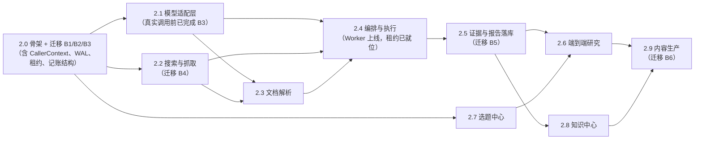

# 实施路线图：可独立验收的小阶段

> 原则：**每个阶段单独可验收**，做完一个就能停下、能跑测试、能回滚。
> 每个阶段都写清：目标 / 文件范围 / 依赖 / 是否迁库 / 测试方式 / 验收条件 / 外部费用。

---

## 0. 阶段依赖图

**为什么 2.0 在 2.1 之前**：所有后续阶段都需要 `config/*.yaml`、依赖分组、`capabilities/` 与 `execution/` 目录骨架；先建骨架才能并行开发后两个分支。
**为什么 2.7 与 2.2–2.5 可并行**：选题中心只依赖表结构与服务层，不依赖模型；可以先用规则评分跑通。

### 0.1 迁移批次与"安全机制先于能力"的对应关系（M1.2 重排）

M1.1 审查发现旧路线图把"记账表"排在 2.5、把"证据归属"排在 2.5，而真实模型调用在 2.1、
证据提取在 2.3——**安全结构落后于它保护的能力**。M1.2 的修正如下（与
[`database_design.md`](database_design.md) §6.2 的六批次一一对应）：

| 批次 | 落在哪个阶段 | 保护什么能力 | 为什么必须在前 |
|---|---|---|---|
| **B1** `b1_topic_taxonomy` | 2.0 | 多合集/标签 | 选题立项、Agent 合集路由都依赖 `topic_collections` |
| **B2** `b2_task_layer` | 2.0 | Worker、租约 | 租约/心跳列在任务表里；**Worker 上线（2.4）前必须在库** |
| **B3** `b3_metering` | **2.0（提前）** | 真实模型调用 + 成本 | **P0-2**：`model_calls` 与预留列必须早于 2.1 的第一次真实调用 |
| **B4** `b4_source_evidence` | **2.2（提前）** | 抓取 + 证据提取 | **P0-1**：证据归属（快照锚）必须早于 2.3 解析与提取落地 |
| **B5** `b5_findings` | 2.5 | 结论分档 + Finding 审核 | 与 2.5 的 findings 功能同批 |
| **B6** `b6_content_layer` | 2.7–2.9 | 内容层 + 危险 FK 改写 | 放在数据量最小时一次性重建 |

**四条不可跳过的纪律**（违反即该阶段不得开工）：

1. **CallerContext 与 `guard.require()` 在 2.0 实现**，早于任何 Agent 写库能力（2.4 起才有写）。
2. **WAL + `busy_timeout` + 租约 + 心跳在 2.0 实现**（连接参数与列结构），2.4 的 Worker 直接使用。
3. **`model_calls` 预留机制在 2.1 之前就位**（B3 在 2.0 批），ModelGateway 的第一行就是"无预留不发请求"。
4. **每批都独立备份 + 独立校验 + 独立回滚**，不做"一次性建 19 张表"。

---

## 1. 阶段明细

### 2.0 骨架 + 安全机制 + 迁移 B1/B2/B3（本节是 M1.2 改动最大的一节）

| 项 | 内容 |
|---|---|
| 目标 | 把"设计里的位置"变成可运行的骨架，并**先把安全机制落地**：配置、目录、CallerContext 守卫、SQLite 运行参数、租约列、记账表。**本阶段结束时仍不能真实调用任何模型/搜索** |
| 文件范围 | 新增 `config/models.yaml`、`config/agent_routing.yaml`、`config/pipelines.yaml`；新增目录 `backend/app/execution/`（`task_types.py`、`routing.py`）、`backend/app/capabilities/`（`guard.py`、`tools.py`、`db_query.py`、`db_write.py`、`budget.py`）、`backend/app/parsers/`（仅 `__init__.py` + Protocol）；`backend/app/core/caller.py`（`CallerContext` + `require_caller`）；`backend/app/database/session.py` 增 WAL/`busy_timeout`/`synchronous`（P1-6）；`backend/app/core/config.py` 增 `execution`、`cost` 读取；`pyproject.toml` 增 `[project.optional-dependencies] research`；`backend/scripts/seed_collections.py`；**三个迁移文件** `b1_topic_taxonomy`、`b2_task_layer`、`b3_metering` |
| 依赖 | 无 |
| 迁库 | ✅ **B1 + B2 + B3（三次独立迁移，各自可回滚）**；完成后 18 → **28** 张业务表（18+4+4+2，见 database_design §6.4；本文旧版本误写 26） |
| 测试 | `tests/test_config.py` 增三份 YAML 的 schema 校验；`tests/test_routing_config.py`（agent key ⊆ roster、task_type ⊆ 注册表）；`tests/test_task_type_registry.py`（含文档正则扫描）；`tests/test_caller_context.py`（三类调用者、越权 422 + `details.reason`）；`tests/test_sqlite_pragmas.py`（实测 `journal_mode=wal`、`busy_timeout=5000`）；`tests/test_migration_batches.py`（B1–B3 各自 upgrade→downgrade→upgrade） |
| 验收 | `pytest` 全绿；`/api/system/status` 新增 `execution`/`search`/`model` 三个 feature 键且默认 false，`database` 段增 `journal_mode`/`busy_timeout`；`topic_columns` 有 6 条且各含 `code`/`is_system=1`；`topics.column_id` 全部回填到 `topic_collections`（回填行数 = `topics where column_id is not null`）；无新增业务端点 |
| 回滚 | 每批 `downgrade -1` 可单独回滚；三批全回滚后回到 `de8148733a9b`；迁移前必须 `.backup` 到 `data/backups/`（目录需先创建） |
| 费用 | 0 |

> **为什么记账表（B3）放在 2.0**：2.1 一接真实模型就会产生**已经扣费但本地无记录**的风险窗口。> 把 `model_calls` 与 `research_tasks.calls_reserved/cost_reserved` 提前到 2.0，
> 才能让 2.1 的 ModelGateway 从第一行代码起就"先预留后调用"（P0-2）。

### 2.1 模型适配层（ModelGateway，真实调用的唯一入口）

| 项 | 内容 |
|---|---|
| 目标 | 一个能真实调用、能被替换、能记账的模型网关；**默认未配置时明确失败**；**无预留不发请求**；**价目缺失时拒绝调用（Q8=B）** |
| 文件范围 | 新增 `backend/app/capabilities/model_gateway.py`（`ModelGateway` 协议、`NullModelGateway`、`OpenAICompatibleGateway`、`reserve_call()` + `settle_call()`、崩溃复原扫描）、复用 2.0 的 `budget.py`；`config/models.yaml` 填价目、`cost.pricing_policy: reject_unknown` 与空的 `approved_exceptions`；`backend/app/core/pricing.py`（价目查询 + 例外登记校验）；`.env.example` 增 `LLM_BASE_URL`/`LLM_API_KEY`/`LLM_MODEL`（**留空**）；`tests/test_model_gateway.py`、`tests/test_model_gateway_reservation.py`、`tests/test_budget.py`、`tests/test_pricing_policy.py` |
| 依赖 | 2.0（B3 已在库） |
| 迁库 | ❌（`model_calls` 已在 B3 建好，这正是提前的原因） |
| 测试 | Fake 网关正常返回；`NullModelGateway` 返回 `not_configured` 且**不落 reserved 行**；JSON schema 失败重试 1 次（第二次同样走预留）；**预留六个用例**：预留失败不发请求 / 成功结算 / 超时按预留计费 / 缓存命中 `billable=false` / 崩溃复原（模拟租约过期→`unknown`） / 并发两次不超支；**价目策略四用例（Q8）**：无价目且无例外→`budget_blocked(pricing_unknown)` 且 `model_calls` **0 行** / 例外登记齐全→允许且 `pricing_unknown=true` / 例外 `expires_at` 过期→拒绝 / 例外缺字段（如无 `total_budget_cny`）→启动校验失败；全部离线，另加 1 个 `@pytest.mark.integration` 真实调用（默认跳过） |
| 验收 | 无密钥时任何调用抛 `DependencyUnavailableError`（503）而非静默成功；`model_calls` 里每次真实调用都有 `reserved → 终态` 两行状态证据；超时场景费用不为 0；**未登记例外的未知价模型调不通，且库里查不到任何 `model_calls` 残留**；`GET /api/system/status` 能读出 `pricing_policy` 与已登记例外数量 |
| 费用 | 0（无密钥）；用户配置价目后按量计（估算见 §3）；**未填价目 = 无法调用 = 0 费用** |

### 2.2 搜索与抓取

| 项 | 内容 |
|---|---|
| 目标 | `web_search` + `fetch_url` 真实可用，并把快照落盘 |
| 文件范围 | 新增 `backend/app/capabilities/search.py`（`SearchProvider` 协议 + `NullSearchProvider` + 一个真实 provider）、`fetch.py`（`Fetcher` + `HttpxFetcher`，含 UA/超时/大小限制/robots 提示）；`backend/app/models/source_snapshot.py` 等四个新模型 + 一个迁移 `b4_source_evidence`；`backend/app/services/source_snapshot_service.py`；`tests/test_search.py`、`tests/test_fetch.py`（用本地 HTTP 服务或 fixture 文件，**不联网**）、`tests/test_evidence_anchor.py` |
| 依赖 | 2.0 |
| 迁库 | ✅ **B4 `b4_source_evidence`**：建 `source_snapshots`、`source_extractions`、`source_summaries`、`research_task_sources`；改 `evidence`（+9 列 +2 列软失效、删旧 CHECK、改 2 条 FK 行为）。**证据归属必须在解析（2.3）之前定稿——这是 P0-1 的要求** |
| 测试 | FakeSearchProvider 固定结果；抓取成功/404/403/超时/超限五分支（用本地 aiohttp/http.server 假服务器）；快照文件写入 `data/raw/snapshots/` 且 `sha256` 一致 |
| 验收 | `POST /api/sources/{id}/fetch` 在无网络环境下返回 `blocked/timeout` 而非 500；同一 URL 两次抓取产生两行快照 |
| 费用 | 搜索按查询计（Tavily 约 $0.001/次级别）；抓取 0 |

### 2.3 文档解析（PDF / Excel / HTML）

| 项 | 内容 |
|---|---|
| 目标 | 把快照变成可引用的文本/表格 + 字符偏移 |
| 文件范围 | 新增 `backend/app/parsers/{pdf,xlsx,html}.py`；`backend/app/services/extraction_service.py`；`pyproject.toml` 加 `pypdf`、`openpyxl`；`tests/fixtures/` 放 1 个 PDF、1 个 XLSX、1 个 HTML；`tests/test_parsers.py` |
| 依赖 | 2.2（B4 已建 `source_extractions`） |
| 迁库 | ❌（`source_extractions` 已在 B4 建好） |
| 测试 | 三种格式各 3 例（成功/超限/损坏）；字符偏移可用于后续精确定位；无文本层 PDF 返回 `has_text_layer=false` 而不是空文本 |
| 验收 | 从 fixture PDF 抽出的文本能精确回切（`text[start:end] == quote`） |
| 费用 | 0（OCR 不做） |

### 2.4 编排与执行（骨架能跑，模型可换 Fake）

| 项 | 内容 |
|---|---|
| 目标 | 队列 + 租约 + DAG + AgentExecutor + 工具白名单；**用 Fake 网关与 Fake 工具就能跑通全流程** |
| 文件范围 | 新增 `backend/app/execution/{runtime,orchestrator,executor}.py`（`routing.py`/`task_types.py` 在 2.0 已有）、`backend/app/capabilities/tools.py` 的 `ToolRegistry.dispatch()` 接上 2.0 的 `guard.require()`；`backend/app/api/routes/research_tasks.py`、`ops.py`；`backend/app/execution/recovery.py`（三条崩溃扫描 S1/S2/S3）；`tests/test_runtime.py`、`test_routing.py`、`test_tools_permission.py`、`test_lease_recovery.py` |
| 依赖 | 2.0–2.3（工具需真实实现，但测试用 Fake）；**B2 的租约列与 2.0 的 WAL 已就位** |
| 迁库 | ❌（任务层 5 张表已在 B2 建好；`tool_calls` 在 B3） |
| 测试 | DAG 拓扑校验（环→422）；租约过期自动回收；重试上限；工具越权→`denied`；`execution.enabled=false` 时 `/start` 返回 409 并提示 tick；`tick` 能推进一个子任务 |
| 验收 | 一棵 3 节点 DAG 在 Fake 环境下从 `created` 走到 `succeeded`，`task_events` 有完整事件流，`tool_calls` 有记录，`GET /{id}/cost` 返回非零调用数 |
| 费用 | 0（Fake）；真实运行时按 2.1 计 |

### 2.5 证据、结论与报告落库

| 项 | 内容 |
|---|---|
| 目标 | 让"结论—证据—快照"三件套真正落库并可回溯 |
| 文件范围 | 新增模型 `report_findings`、`finding_evidence` + 迁移 **B5 `b5_findings`**（含 `review_records` 重建 CHECK）；新增 `backend/app/services/finding_service.py`、`evidence_link_service.py`、`tier_rules.py`（`claim_nature → FindingTier` 映射常量）；路由 `findings.py`、`reviews.py`；`tests/test_findings.py`、`test_evidence_chain.py`、`test_tier_rules.py` |
| 依赖 | 2.4、B4 |
| 迁库 | ✅ **B5**：2 新表 + `review_records` 约束重建（`report_findings.review_record_id` 反向 FK 需分两步） |
| 测试 | 绑定证据→链路可查；引文 hash 不符→`quote_mismatch`→结论强制降档（`tier_rules`）；失效证据不参与统计；`tier_stats` 与 findings 一致；Finding 级审核可写入 |
| 验收 | 报告中任意 `verified_fact` 能一路点到 `source_snapshots` 的 `char_start/char_end`；`GET /api/findings/{id}/evidence` 返回快照引用；`tests/test_tier_rules.py` 的映射表与 `module_design.md`/`agent_architecture.md` 逐字一致 |
| 费用 | 0 |

### 2.6 端到端研究（MVP 收口）

| 项 | 内容 |
|---|---|
| 目标 | 用《商业银行是如何赚钱的？》跑一次**完整真实**研究（愿付费时）或 Fake 全流程（离线验收） |
| 文件范围 | `backend/scripts/run_e2e_research.py`（CLI 驱动）；`tests/test_e2e_fake.py`（Fake 全链路，进 CI）；`tests/test_e2e_real.py`（`@pytest.mark.integration` + `@pytest.mark.costly`，默认跳过）；`docs/research_hub/e2e_report_template.md` |
| 依赖 | 2.4、2.5、2.7 |
| 迁库 | ❌ |
| 测试 | Fake：选题→任务→子任务→证据→报告→核查全绿；Real：产出报告 + 成本报告（人工核对） |
| 验收 | 报告每条事实有证据；`GET /{id}/cost` 与 `model_calls` 汇总一致；一次真实运行总成本 ≤ 设定上限 |
| 费用 | **唯一明显花钱的阶段**，见 §3 |

### 2.7 选题中心与工作台

| 项 | 内容 |
|---|---|
| 目标 | 评分、去重、合并/拆分、合集与标签、人工立项 |
| 文件范围 | `backend/app/services/topic_scoring.py`；路由 `collections.py`、`tags.py`、扩展 `topics.py`；`backend/scripts/seed_collections.py`（六合集 upsert，2.0 已建，此处补校验与人工入口）；`tests/test_topic_scoring.py`、`test_topic_collections.py`、`test_topic_merge.py` |
| 依赖 | 2.0（B1 已建 `topic_collections`/`tags`/`topic_score_snapshots` 并回填）、2.4 |
| 迁库 | ❌（B1 已在 2.0 完成；`companies` 移至 B6，见 2.9） |
| 测试 | 评分六维权重与人工覆盖；`dedupe_key` 命中提示；合并后原选题只读且 `column_id` 不丢；`PUT collections` 校验 1–3 个且 primary 唯一 |
| 验收 | 老数据 `column_id` 全部成功回填（脚本可重跑、幂等）；`GET /api/collections` 返回六合集 |
| 费用 | 规则评分为主（0 成本）；模型评分可选，单次 <¥0.01 |

### 2.8 知识中心

| 项 | 内容 |
|---|---|
| 目标 | 把已验证结论沉淀为知识条目，并支持检索与关联 |
| 文件范围 | `backend/app/services/knowledge_sync.py`（footnote→knowledge_item 提议，**不自动写**，需人工确认）；路由 `knowledge.py` 增 `POST /api/knowledge/from-report`；`tests/test_knowledge_sync.py` |
| 依赖 | 2.5 |
| 迁库 | ❌（复用现有 `knowledge_items`/`knowledge_relations`） |
| 测试 | 只有 `verified_fact` 可提议；重复条目检测；`concepts` 不使用（决策 3） |
| 验收 | `POST from-report` 返回候选条目清单（需 `confirm=true` 才落库） |
| 费用 | 0 |

### 2.9 内容生产能力

| 项 | 内容 |
|---|---|
| 目标 | 报告 → 脚本 → 审批 → 分镜（**不做渲染**） |
| 文件范围 | 新增模型 `content_items`、`script_evidence_links`、`companies` + 迁移 **B6 `b6_content_layer`**（含改写既有危险 FK：`scripts.topic_id`、`publications.script_id`、`media_assets.script_id`、`evidence.knowledge_item_id`/`research_report_id`/`source_id`）；`backend/app/services/script_service.py`；路由 `content.py`、`scripts.py`；`tests/test_script_generation.py`、`test_script_links.py`、`test_approval_gate.py`、`test_delete_semantics.py`（删除演练） |
| 依赖 | 2.5、2.6 |
| 迁库 | ✅ **B6**：3 新表 + `scripts` 加列 + **危险 FK 行为改写**（需全表重建，放最后、数据量最小时做） |
| 测试 | 脚本每段有 `finding_id` 或标 `background`；未审批不得建分镜（422）；审批只能人工端点；脚本改字不改档；**删除演练**：删选题不应删脚本、删脚本不应删发布效果数据 |
| 验收 | 一份报告能生成 2 种形式的脚本；审批后状态正确；`publications` 仍只能人工写 |
| 费用 | 脚本生成 1–2 次模型调用（¥0.05 内） |

---

## 2. 阶段与"必须停下来问人"的边界

| 阶段 | 是否需要额外授权 | 原因 |
|---|---|---|
| 2.0 | 否 | 只加配置、目录与**安全机制**（CallerContext/WAL/租约/记账表）；不接外部服务、无费用 |
| 2.1 | **需要**：是否接真实模型、用哪家、预算上限 | 会产生真实费用 |
| 2.2 | **需要**：是否接真实搜索、用哪家 | 会产生费用与网络访问 |
| 2.3 | 否 | 全本地 |
| 2.4 | 否（Fake 可验收） | 不产生费用 |
| 2.5 | 否 | 全本地 |
| 2.6 | **需要**：允许一次真实付费运行 | 唯一"整链路烧钱" |
| 2.7 | 否 | 规则评分 |
| 2.8 | 否 | — |
| 2.9 | 需确认：脚本生成用真实模型？ | 小额费用 |

> **2.0 的"否"有一个例外**：`config/models.yaml` 里若要填真实单价，属于"改配置"不是"接服务"，
> 但**填价目本身不需要授权**（它不产生调用）。真正的授权点是 2.1 的第一次真实请求。

---

## 3. 成本估算（明确标注为估算）

| 场景 | 假设 | 估算成本 |
|---|---|---|
| 一条知识视频研究（8 子任务 / 50 次调用） | 国产模型 ≈ ¥0.002–0.01 / 千 tokens，单次 3–8k tokens | **¥0.5–2.0 / 条** |
| 一条 60–120s 热点短评 | 12–20 次调用 | **¥0.1–0.4** |
| 一次 5–15min 深度纪录片研究 | 120–200 次调用 + 多源抓取 | **¥3–8** |
| 搜索费用 | 每任务 10–30 次查询 | 免费额度内多为 0；超出后 <¥0.5 |
| 存储 | SQLite + 本地文件 | 0（磁盘已有） |

> 全部为**量级估算**，真实单价取决于所选供应商。**Q8=B 生效后**：价目缺失的模型**默认调不通**，
> 因此"估算"不会变成"已花的钱"；只有人工在 `config/models.yaml: approved_exceptions`
> 登记了模型 + 单次上限 + 总预算 + 批准人/时间/有效期之后，才可能产生真实费用。

---

## 4. MVP 边界（最小可用版本 = 2.0–2.6 收口）

**MVP 包含**：

1. 人工建选题 → 立项 → 建研究任务；
2. 编排 5–12 个子任务，4 个研究 Agent + 1 个核查 Agent；
3. 真实搜索/抓取/解析（可选）或 Fake；
4. 结论五档 + 证据链 + 快照 + 引文定位；
5. 报告落库与人工终审；
6. 成本可见（`model_calls` + `/cost`）。

**MVP 明确不包含**：

- 自动选题发现（`POST /topics/discover` 返回"未实现"或明确 503，**不得假装**）；
- 知识库自动沉淀（仅人工确认后写入）；
- 任何视频渲染、配音、字幕合成；
- 多用户、鉴权、云端部署；
- 向量检索（继续用 LIKE + 结构化查询）。

---

## 5. 每阶段完成后的统一动作

1. `pytest` 全绿（新增用例数写进提交信息）；
2. **若本阶段含迁移**：按 §6.2 该批次的"统一动作"执行——建 `data/backups/` → `sqlite3 .backup` →
   `alembic upgrade head` → 跑该批专项校验 → 在临时库上 `upgrade`/`downgrade -1`/`upgrade` 往返 → 清理临时库；
3. `alembic check` 必须输出 "No new upgrade operations detected."（模型与迁移一致）；
4. 更新 `docs/research_hub/current_state_audit.md` 里对应条目的状态（DONE/PARTIAL）；
5. 更新 `docs/roadmap.md`（对外的阶段视图）；
6. 提交并推送（普通 commit，不用 force）；
7. **停**：等验收再开下一阶段。

> **回滚演练是硬要求**（M1.1 P2-13）：每批必须实际执行一次 `downgrade -1` 再 `upgrade`，
> 并在 `m1_2_delivery_report.md` 里贴命令与输出。只写"支持回滚"但从未跑过，等于没有回滚方案。
