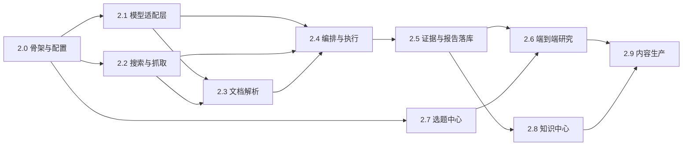

# 实施路线图：可独立验收的小阶段

> 原则：**每个阶段单独可验收**，做完一个就能停下、能跑测试、能回滚。
> 每个阶段都写清：目标 / 文件范围 / 依赖 / 是否迁库 / 测试方式 / 验收条件 / 外部费用。

---

## 0. 阶段依赖图

**为什么 2.0 在 2.1 之前**：所有后续阶段都需要 `config/*.yaml`、依赖分组、`capabilities/` 与 `execution/` 目录骨架；先建骨架才能并行开发后两个分支。
**为什么 2.7 与 2.2–2.5 可并行**：选题中心只依赖表结构与服务层，不依赖模型；可以先用规则评分跑通。

---

## 1. 阶段明细

### 2.0 骨架与配置层（无外部依赖）

| 项 | 内容 |
|---|---|
| 目标 | 把"设计里的位置"变成空目录与配置骨架；**不改任何行为** |
| 文件范围 | 新增 `config/models.yaml`、`config/agent_routing.yaml`、`config/pipelines.yaml`；新增目录 `backend/app/execution/`、`backend/app/capabilities/`、`backend/app/parsers/`（含 `__init__.py` 与 Protocol 定义）；`pyproject.toml` 增 `[project.optional-dependencies] research = [...]`；`backend/app/core/config.py` 增 `execution`、`cost` 配置读取（**只读配置，不接线**）；`docs/research_hub/*` 已是本次产出 |
| 依赖 | 无 |
| 迁库 | ❌ |
| 测试 | `tests/test_config.py` 增加对三份新 YAML 的 schema 校验（键齐全、枚举值合法）；`tests/test_routing_config.py` 校验 routing 里的 agent key 都存在于 `roster.yaml`、task_type 都在九种内 |
| 验收 | `pytest` 全绿；`GET /api/system/status` 的 `features` 仍全 false（新增 `execution`、`search`、`model` 三个键，默认 false）；无新增端点 |
| 费用 | 0 |

### 2.1 模型适配层（ModelGateway）

| 项 | 内容 |
|---|---|
| 目标 | 一个能真实调用、能被替换、能记账的模型网关；**默认未配置时明确失败** |
| 文件范围 | 新增 `backend/app/capabilities/model_gateway.py`（`ModelGateway` 协议、`NullModelGateway`、`OpenAICompatibleGateway`）、`backend/app/capabilities/budget.py`；`config/models.yaml` 填价目；`.env.example` 增 `LLM_BASE_URL`/`LLM_API_KEY`/`LLM_MODEL`（**留空**）；`tests/test_model_gateway.py`、`tests/test_budget.py` |
| 依赖 | 2.0 |
| 迁库 | ❌（`model_calls` 表在 2.5 一起建；本阶段先写内存账本） |
| 测试 | Fake 网关正常返回；`NullModelGateway` 返回 `not_configured`；JSON schema 校验失败重试 1 次；预算超限拦截；**全部离线**，另加 1 个 `@pytest.mark.integration` 真实调用（默认跳过） |
| 验收 | 无密钥时任何调用都抛 `DependencyUnavailableError`（503）而非静默成功；单测覆盖 6 个分支 |
| 费用 | 0（无密钥）；用户配置后按量计（估算见 §3） |

### 2.2 搜索与抓取

| 项 | 内容 |
|---|---|
| 目标 | `web_search` + `fetch_url` 真实可用，并把快照落盘 |
| 文件范围 | 新增 `backend/app/capabilities/search.py`（`SearchProvider` 协议 + `NullSearchProvider` + 一个真实 provider）、`fetch.py`（`Fetcher` + `HttpxFetcher`，含 UA/超时/大小限制/robots 提示）；新增 `source_snapshots` 模型与迁移（本阶段迁库一次）；`tests/test_search.py`、`tests/test_fetch.py`（用本地 HTTP 服务或 fixture 文件，**不联网**） |
| 依赖 | 2.0 |
| 迁库 | ✅ 新增 `source_snapshots`（单独迁移，可单独回滚） |
| 测试 | FakeSearchProvider 固定结果；抓取成功/404/403/超时/超限五分支（用本地 aiohttp/http.server 假服务器）；快照文件写入 `data/raw/snapshots/` 且 `sha256` 一致 |
| 验收 | `POST /api/sources/{id}/fetch` 在无网络环境下返回 `blocked/timeout` 而非 500；同一 URL 两次抓取产生两行快照 |
| 费用 | 搜索按查询计（Tavily 约 $0.001/次级别）；抓取 0 |

### 2.3 文档解析（PDF / Excel / HTML）

| 项 | 内容 |
|---|---|
| 目标 | 把快照变成可引用的文本/表格 + 字符偏移 |
| 文件范围 | 新增 `backend/app/parsers/{pdf,xlsx,html}.py`；`source_extractions` 模型与迁移；`pyproject.toml` 加 `pypdf`、`openpyxl`；`tests/fixtures/` 放 1 个 PDF、1 个 XLSX、1 个 HTML；`tests/test_parsers.py` |
| 依赖 | 2.2 |
| 迁库 | ✅ 新增 `source_extractions` |
| 测试 | 三种格式各 3 例（成功/超限/损坏）；字符偏移可用于后续精确定位；无文本层 PDF 返回 `has_text_layer=false` 而不是空文本 |
| 验收 | 从 fixture PDF 抽出的文本能精确回切（`text[start:end] == quote`） |
| 费用 | 0（OCR 不做） |

### 2.4 编排与执行（骨架能跑，模型可换 Fake）

| 项 | 内容 |
|---|---|
| 目标 | 队列 + 租约 + DAG + AgentExecutor + 工具白名单；**用 Fake 网关与 Fake 工具就能跑通全流程** |
| 文件范围 | 新增 `backend/app/execution/{runtime,orchestrator,executor,routing}.py`、`backend/app/capabilities/tools.py`（ToolRegistry）、`backend/app/capabilities/db_read.py`、`backend/app/capabilities/db_write.py`；新增模型 `research_tasks`、`research_subtasks`、`research_subtask_dependencies`、`task_events`、`tool_calls`、`tags`、`topic_collections`、`topic_tags`（一次迁移，见 database_design 顺序）；`backend/app/api/routes/research_tasks.py`、`ops.py`；`tests/test_runtime.py`、`test_routing.py`、`test_tools_permission.py` |
| 依赖 | 2.0–2.3（工具需真实实现，但测试用 Fake） |
| 迁库 | ✅ 最大的一次迁移（8 张表） |
| 测试 | DAG 拓扑校验（环→422）；租约过期自动回收；重试上限；工具越权→`denied`；`execution.enabled=false` 时 `/start` 返回 409 并提示 tick；`tick` 能推进一个子任务 |
| 验收 | 一棵 3 节点 DAG 在 Fake 环境下从 `created` 走到 `succeeded`，`task_events` 有完整事件流，`tool_calls` 有记录，`GET /{id}/cost` 返回非零调用数 |
| 费用 | 0（Fake）；真实运行时按 2.1 计 |

### 2.5 证据、结论与报告落库

| 项 | 内容 |
|---|---|
| 目标 | 让"结论—证据—快照"三件套真正落库并可回溯 |
| 文件范围 | 新增模型 `source_summaries`、`research_task_sources`、`report_findings`、`finding_evidence`、`model_calls`；ALTER `evidence`（加 `source_snapshot_id`/`char_start`/`char_end`/`quote_hash`/`strength`/`quote_mismatch`/`invalidated_at`/`invalidation_reason`）、`research_reports`（加 `research_task_id`/`outline`/`tier_stats`）、`agent_runs`（加 `research_task_id`/`subtask_id`/`cost_estimate`）；新增 `backend/app/services/finding_service.py`、`evidence_link_service.py`；路由 `findings.py`、`reviews.py`；`tests/test_findings.py`、`test_evidence_chain.py` |
| 依赖 | 2.4 |
| 迁库 | ✅ 5 新表 + 3 表加列 |
| 测试 | 绑定证据→链路可查；引文 hash 不符→`quote_mismatch`→结论降档；失效证据不参与统计；`tier_stats` 与 findings 一致 |
| 验收 | 报告中任意 `verified_fact` 能一路点到 `source_snapshots` 的 `char_start/char_end`；`GET /api/findings/{id}/evidence` 返回快照引用 |
| 费用 | 0 |

### 2.6 端到端研究（MVP 收口）

| 项 | 内容 |
|---|---|
| 目标 | 用《商业银行是如何赚钱的？》跑一次**完整真实**研究（愿付费时）或 Fake 全流程（离线验收） |
| 文件范围 | `backend/scripts/run_e2e_research.py`（CLI 驱动）；`tests/test_e2e_fake.py`（Fake 全链路，进 CI）；`tests/test_e2e_real.py`（`@pytest.mark.integration` + `@pytest.mark.costly`，默认跳过）；`docs/research_hub/e2e_report_template.md` |
| 依赖 | 2.4、2.5、2.7 |
| 迁库 | ❌ |
| 测试 | Fake：选题→任务→子任务→证据→报告→核查全绿；Real：产出报告 + 成本报告（人工核对） |
| 验收 | 报告每条事实有证据；`GET /{id}/cost` 与 `model_calls` 汇总一致；一次真实运行总成本 ≤ 设定上限 |
| 费用 | **唯一明显花钱的阶段**，见 §3 |

### 2.7 选题中心与工作台

| 项 | 内容 |
|---|---|
| 目标 | 评分、去重、合并/拆分、合集与标签、人工立项 |
| 文件范围 | 新增模型 `topic_score_snapshots`、`companies`；ALTER `topics`（加 `status`/`origin_type`/`discovered_by`/`dedupe_key`/`merged_into_topic_id`/`score_total`/`score_updated_at`）；`backend/app/services/topic_scoring.py`；路由 `collections.py`、`tags.py`、扩展 `topics.py`；`backend/scripts/seed_collections.py`（六合集 upsert）；`tests/test_topic_scoring.py`、`test_topic_collections.py`、`test_topic_merge.py` |
| 依赖 | 2.0、2.4（多对多表在 2.4 迁移中已建） |
| 迁库 | ✅ 2 新表 + `topics` 加列 + `topics.column_id → topic_collections` 回填 |
| 测试 | 评分六维权重与人工覆盖；`dedupe_key` 命中提示；合并后原选题只读且 `column_id` 不丢；`PUT collections` 校验 1–3 个且 primary 唯一 |
| 验收 | 老数据 `column_id` 全部成功回填（脚本可重跑、幂等）；`GET /api/collections` 返回六合集 |
| 费用 | 规则评分为主（0 成本）；模型评分可选，单次 <¥0.01 |

### 2.8 知识中心

| 项 | 内容 |
|---|---|
| 目标 | 把已验证结论沉淀为知识条目，并支持检索与关联 |
| 文件范围 | `backend/app/services/knowledge_sync.py`（footnote→knowledge_item 提议，**不自动写**，需人工确认）；路由 `knowledge.py` 增 `POST /api/knowledge/from-report`；`tests/test_knowledge_sync.py` |
| 依赖 | 2.5 |
| 迁库 | ❌（复用现有 `knowledge_items`/`knowledge_relations`） |
| 测试 | 只有 `verified_fact` 可提议；重复条目检测；`concepts` 不使用（决策 3） |
| 验收 | `POST from-report` 返回候选条目清单（需 `confirm=true` 才落库） |
| 费用 | 0 |

### 2.9 内容生产能力

| 项 | 内容 |
|---|---|
| 目标 | 报告 → 脚本 → 审批 → 分镜（**不做渲染**） |
| 文件范围 | 新增模型 `content_items`、`script_evidence_links`；ALTER `scripts` 加 `content_item_id`；`backend/app/services/script_service.py`；路由 `content.py`、`scripts.py`；`tests/test_script_generation.py`、`test_script_links.py`、`test_approval_gate.py` |
| 依赖 | 2.5、2.6 |
| 迁库 | ✅ 2 新表 + `scripts` 加列 |
| 测试 | 脚本每段有 `finding_id` 或标 `background`；未审批不得建分镜（422）；审批只能人工端点；脚本改字不改档 |
| 验收 | 一份报告能生成 2 种形式的脚本；审批后状态正确；`publications` 仍只能人工写 |
| 费用 | 脚本生成 1–2 次模型调用（¥0.05 内） |

---

## 2. 阶段与"必须停下来问人"的边界

| 阶段 | 是否需要额外授权 | 原因 |
|---|---|---|
| 2.0 | 否 | 只加配置与空目录 |
| 2.1 | **需要**：是否接真实模型、用哪家、预算上限 | 会产生真实费用 |
| 2.2 | **需要**：是否接真实搜索、用哪家 | 会产生费用与网络访问 |
| 2.3 | 否 | 全本地 |
| 2.4 | 否（Fake 可验收） | 不产生费用 |
| 2.5 | 否 | 全本地 |
| 2.6 | **需要**：允许一次真实付费运行 | 唯一"整链路烧钱" |
| 2.7 | 否 | 规则评分 |
| 2.8 | 否 | — |
| 2.9 | 需确认：脚本生成用真实模型？ | 小额费用 |

---

## 3. 成本估算（明确标注为估算）

| 场景 | 假设 | 估算成本 |
|---|---|---|
| 一条知识视频研究（8 子任务 / 50 次调用） | 国产模型 ≈ ¥0.002–0.01 / 千 tokens，单次 3–8k tokens | **¥0.5–2.0 / 条** |
| 一条 60–120s 热点短评 | 12–20 次调用 | **¥0.1–0.4** |
| 一次 5–15min 深度纪录片研究 | 120–200 次调用 + 多源抓取 | **¥3–8** |
| 搜索费用 | 每任务 10–30 次查询 | 免费额度内多为 0；超出后 <¥0.5 |
| 存储 | SQLite + 本地文件 | 0（磁盘已有） |

> 全部为**量级估算**，真实单价取决于所选供应商；`config/models.yaml` 的 `pricing_unknown: true` 时系统显示"费用未知"，不猜数字。

---

## 4. MVP 边界（最小可用版本 = 2.0–2.6 收口）

**MVP 包含**：

1. 人工建选题 → 立项 → 建研究任务；
2. 编排 5–12 个子任务，4 个研究 Agent + 1 个核查 Agent；
3. 真实搜索/抓取/解析（可选）或 Fake；
4. 结论五档 + 证据链 + 快照 + 引文定位；
5. 报告落库与人工终审；
6. 成本可见（`model_calls` + `/cost`）。

**MVP 明确不包含**：

- 自动选题发现（`POST /topics/discover` 返回"未实现"或明确 503，**不得假装**）；
- 知识库自动沉淀（仅人工确认后写入）；
- 任何视频渲染、配音、字幕合成；
- 多用户、鉴权、云端部署；
- 向量检索（继续用 LIKE + 结构化查询）。

---

## 5. 每阶段完成后的统一动作

1. `pytest` 全绿（新增用例数写进提交信息）；
2. `alembic upgrade head` + `downgrade -1` + 再 `upgrade`（迁移可逆性）；
3. 更新 `docs/research_hub/current_state_audit.md` 里对应条目的状态（DONE/PARTIAL）；
4. 更新 `docs/roadmap.md`（对外的阶段视图）；
5. 提交并推送（普通 commit，不用 force）；
6. **停**：等验收再开下一阶段。
