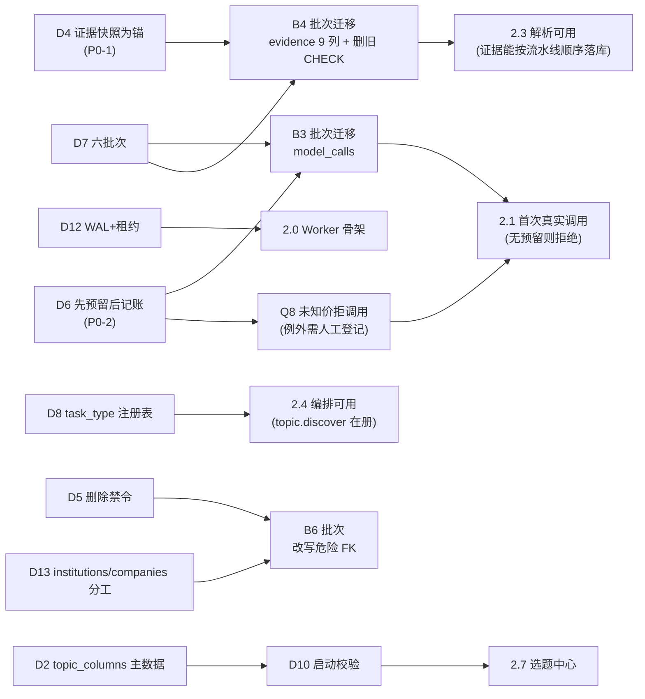

# M1.2 决策登记表（Design Decision Register）

> **文档性质**：M1.2「架构设计修订与决策固化」的决策台账。
> **它回答什么**：每个设计决策**为什么这么定**、代价是什么、谁还需要点头。
> **它不回答什么**：怎么实现（见各架构文档）、做完没有（见 [`m1_2_delivery_report.md`](m1_2_delivery_report.md)）。
>
> **代码状态**：本阶段只改 Markdown 文档与设计配置，`backend/`、数据库模型、Alembic 迁移、API 行为**零改动**。
> 本表所有"已决定"项都只代表**文档层面定稿**，不代表代码已实现。

---

## 0. 阅读约定

| 标记 | 含义 |
|---|---|
| **状态=已定** | 本轮在文档中固化，可直接作为施工依据 |
| **状态=已确认（人工）** | 曾在 M1.2 列为待确认项（Q 表），**已由你明确拍板**，现按结论执行；决策正文已按最终选择改写 |
| **状态=待人工确认** | 存在两种以上合理选择，成本或不可逆性由你判断，**不得由我替你决定** |
| **状态=推迟** | 现在定不了（缺信息），已写明触发条件与最晚决策点 |
| 依据列 `[V]` | 仓库代码/真实数据库**实测验证过** |
| 依据列 `[d]` | 仅来自文档推理，**未实测** |
| 代价列 | 选这个方案要放弃/承受什么——没有代价的决策通常是假决策 |

---

## 1. 决策总览

| # | 决策 | 状态 | 来源 |
|---|---|---|---|
| D1 | 选题 ↔ 内容合集用**多对多关联表** `topic_collections` | 已定 | M1（沿用） |
| D1' | 选题 ↔ 标签用 `tags` + `topic_tags` | 已定 | M1（沿用） |
| D2 | 复用 `topic_columns` 作**六大合集的唯一主数据表**，不建第二张合集表 | **已确认（人工 Q6=A）** | M1（沿用，M1.2 补强） |
| D3 | `knowledge_domain` **不新增** `concepts` 枚举值 | 已定 | M1（沿用） |
| **D4** | 证据归属 = **快照为锚 + 任务为过程归属 + 引用走关联表**（方案 C） | 已定 | **M1.2 新增（P0-1）** |
| **D5** | **禁止重要研究数据被物理级联删除**；CASCADE 只允许出现在连接表与结构性子行 | 已定 | **M1.2 新增（P1-3/P1-4）** |
| **D6** | 模型调用**先预留、后调用、再结算**（可崩溃复原的记账）；**未知价默认拒绝调用** | 已定（含 **Q8=B**） | **M1.2 新增（P0-2）** |
| **D7** | 数据库演进拆 **6 个批次（B1–B6）**，不允许一次性建 19 表 | 已定 | **M1.2 新增（P1-2）** |
| **D8** | `task_type` 采用**单一注册表 + 三处校验**，新增第十种 `topic.discover` | 已定 | **M1.2 新增（P1-5）** |
| **D9** | `report_findings` 是结论的**唯一权威**；`research_reports.findings` 降级为派生快照 | **已确认（人工 Q9=A）** | **M1.2 新增（P2-6）** |
| **D10** | `topic_columns` 增加 `is_active` / `is_system` / `taxonomy_version`，启动时只**校验**不自动建行 | 已定 | **M1.2 新增（P1-8）** |
| **D11** | `review_records` 纳入数据库设计文档并扩展 `target_type`，弱多态保留 | **已确认（人工 Q5=A）** | **M1.2 新增（P1-1）** |
| **D12** | SQLite 的 WAL / `busy_timeout` / 租约 / 心跳属于**架构约束**，不是性能调优选项 | 已定 | **M1.2 新增（P1-6）** |
| **D13** | `institutions` 与 `companies` **按主体类型分工**，不合并、不混用 | **已确认（人工 Q7=A）** | **M1.2-final 新增（P2-10）** |

---

## 2. 逐条决策

### D1 / D1' 多对多分类与标签（沿用 M1）

| 项 | 内容 |
|---|---|
| **决策** | 选题与内容合集、选题与标签均为多对多；`topics.column_id` 迁移期保留为兼容列 |
| **依据** | 品牌战略已定"一个选题可关联多个合集"，`config/content_taxonomy.yaml` 的 `multi_label.required: true`；现有 `topics` 只有单选 `column_id` [V] |
| **代价** | 全库多两张连接表；读路径要 join；`column_id` 双写期存在两套真相 |
| **状态** | 已定 |
| **退场条件** | `column_id` 在 2.0 双写、2.7 读路径切换、2.10 评估删除（见 `database_design.md` §6.6） |

### D2 复用 `topic_columns` 作合集主数据（沿用 M1，M1.2 补强）

| 项 | 内容 |
|---|---|
| **决策** | 不新建 `collections` 表；六大合集以 `topic_columns` 行承载（`code` 对齐 `content_taxonomy.yaml` 的 `collections[].id`），YAML 只管政策/范围/模板/Agent 绑定 |
| **依据** | 避免"两个表都叫合集"的双主数据；`topic_columns.code` 已有唯一约束 `uq_topic_columns_code` [V]，`VARCHAR(32)` 足够容纳最长 id `financial_knowledge`(19) [V] |
| **代价** | `topic_columns` 承担双重语义（历史上的"栏目" + 现在的"内容合集"）；字段（mission/scope/agents）仍在 YAML，DB 只存身份与启停 |
| **状态** | **已确认（人工 Q6=A，2026-11-10）**：`topic_columns` 是六大合集的唯一主数据表，长期保留；不再评估迁移到独立 `collections` 表 |
| **补强（M1.2）** | 新增 `is_active`（停用而非删除）、`is_system`（区分六大内置合集与用户自建栏目）、`taxonomy_version`（记录 YAML 版本）；启动校验 5 步（见 `database_design.md` §4.20），**不在启动时自动建行**（避免半截合集被当成真相） |
| **不可再变的边界** | 一旦确认，**任何"再建一张合集表"的提案都必须先推翻本决策**；新增合集只能走 `extension_policy`（YAML 加条目 + seed upsert + `taxonomy_version` +1），不得新建表 |

### D3 `knowledge_domain` 不加 `concepts`（沿用 M1）

| 项 | 内容 |
|---|---|
| **决策** | `knowledge/concepts/` 目录的条目用 `domain: general`，不新增枚举值 |
| **依据** | 新增枚举值需要迁移 + 改 6 处 CHECK；`concepts` 与 `financial_instruments` 边界模糊（"久期"是概念还是工具属性？） |
| **代价** | 概念类条目在 `knowledge_domain` 维度不可筛选，只能靠 `knowledge_relations` 与标签弥补 |
| **状态** | 已定（M2.8 知识中心阶段可复议） |

### D4 证据归属模型（M1.2 核心，P0-1）

| 项 | 内容 |
|---|---|
| **决策** | 采用**方案 C：快照为锚**。`evidence` 的主要归属是 `source_snapshot_id`（原文快照）+ `research_task_id`（过程归属）；`knowledge_item_id` 是收录目标（RESTRICT），`research_report_id` 降为**兼容列**（SET NULL）；**"这条证据支持哪个结论"改由 `finding_evidence` 表达**，不再塞进 `evidence` 行 |
| **被否方案 A** | 单一主要归属（`evidence` 只挂 `research_task_id`）+ 全部引用走 M:N 表。否掉原因：现有 `POST /api/evidence` 与 `EvidenceCreate` 的"二选一目标"契约会被推翻，**已通过测试的 6 个用例要重写**，且第一阶段刚交付的接口立刻变成"旧口径" |
| **被否方案 B** | 多个可选归属列 + "至少一个非空"。否掉原因：这正是当前设计的病根——`ck_evidence_has_claim_target` 强制"必须已有报告或知识条目"，与"证据先于结论产生"的流水线顺序直接冲突；再加一个 `research_task_id` 只是把 2 选 1 变成 3 选 1，**语义仍然没有唯一解释** |
| **依据** | 真实库 `ck_evidence_has_claim_target` = `knowledge_item_id IS NOT NULL OR research_report_id IS NOT NULL` [V]；`research_reports.summary/limitations` NOT NULL [V] → 想提前落证据就必须先写假报告（P2-13）；`source_extractions` 提供字符偏移，使"证据 = 某快照的某片段"可校验 |
| **代价** | ① `evidence` 从 14 列扩到 23 列，旧列 `page_number`/`quote_locator` 保留为**辅助定位**（印刷页码 / 人工标注），必须写清"以 `char_start/char_end` 为准"；② 2.5 起 `source_snapshot_id` NOT NULL，**没有快照的历史证据必须补快照或标 `invalidated_at`**；③ 旧 CHECK 要在 B4 删除，期间两条约束并存需说明"只放宽不收紧" |
| **状态** | 已定 |
| **验证方式** | 2.2 阶段必须有两条用例：证据可先于报告落库；删除报告后证据仍在（`research_report_id` 变 NULL） |

### D5 删除语义与级联禁令（P1-3 / P1-4）

| 项 | 内容 |
|---|---|
| **决策** | 四类删除语义明确区分：**物理删除 / 软删除（`invalidated_at`、`deleted_at`）/ 归档（`is_current=false`、`archived`）/ 停用（`is_active=false`）**。**CASCADE 只允许**出现在"连接表（`topic_collections`、`topic_tags`、`finding_evidence`、`script_evidence_links`）"与"结构性子行（如子任务依赖）"；研究数据（`sources`/`source_snapshots`/`evidence`/`research_tasks`/`agent_runs`/`scripts`/`publications`）**一律 RESTRICT 或 SET NULL** |
| **依据** | 真实库实测：`scripts.topic_id`、`publications.script_id`、`media_assets.script_id`、`evidence.knowledge_item_id`/`research_report_id` **全部 ON DELETE CASCADE** [V]；`media_assets.script_id` 与 `publications.script_id` 还是 NOT NULL [V] → 今天删一个选题会连带删掉脚本、素材和**发布效果数据**，而这些是不可再生的历史 |
| **代价** | ① 删除变麻烦：删选题前必须先处理脚本（改挂接或归档），需要 `DELETE /api/topics/{id}?force=` 之外的显式流程；② 现有 CASCADE 行为属**既有数据库**，改写必须走 B6 迁移（重建表 + 拷数据），有风险；③ 需要在 2.9 做删除演练测试 |
| **状态** | 已定；B6 实施前**不得**新增任何依赖物理删除的功能 |
| **纠正** | M1 版 `database_design.md` §7 曾宣称"不做物理级联删除 publications/scripts，用 SET NULL 保命"，与实测 CASCADE 不符 [V]——已在 M1.2 改为删除矩阵并列出真实 FK 行为 |

### D6 模型调用记账（M1.2 核心，P0-2）

| 项 | 内容 |
|---|---|
| **决策** | `model_calls` 表在**第一次真实调用之前**（2.0 B3 批次）建成；每次调用的生命周期是 `reserved → running → succeeded/failed/timeout/unknown`，另有 `budget_blocked`（未发请求）与 `released`（预留撤销）；预算判定式为 `spent + reserved + est ≤ 上限`；崩溃后租约过期的 `reserved/running` 行转 `unknown` 并**按 `reserved_cost` 保守计费**，永不自动删除 |
| **依据** | M1 版设计把 `model_calls` 放在 2.5、把预算检查写成"调用前拦截"，两者都晚于 2.1 的第一次真实请求 [d] → 存在"已扣费、无记录"窗口；`config/settings.yaml` **当前没有 cost 段** [V] |
| **代价** | ① 多一次事务（预留）+ 一次事务（结算），本地 SQLite 下每次调用约多 2 次写；② 崩溃会产生 `unknown` 脏数据，需人工/定期对账（已在 §8.3 列对账手段）；③ 价目表 `config/models.yaml` 需人工维护——**未知价不再是"按上界硬跑"，而是默认拒绝（见下行）** |
| **状态** | 已定；**未知价策略已由人工定为 Q8=B** |
| **未知价策略（Q8=B，人工确认 2026-11-10）** | **价目缺失的模型默认拒绝调用**：`ModelGateway` 在预留阶段先查价目，`pricing_status=missing` → 直接返回 `budget_blocked`（`details.reason=pricing_unknown`），**不发请求、不落 `reserved` 行、不计费**。唯一例外是"人工登记的白名单"：必须在 `config/models.yaml` 的 `approved_exceptions` 中显式写明 `{model, max_cost_per_call_cny, total_budget_cny, approved_by, approved_at, expires_at}` 四项完备，才允许调用；此时仍按 `unknown_price_upper_bound_cny` 预留、写 `pricing_unknown=true`、结算保留预估值，并进 `data/exports/pricing_gaps.log` |
| **为什么是 B 不是 A** | A（一律按上界硬跑）等于"用一个猜的数字换一次真实扣费"；在供应商与单价都未定的 2.x 阶段，**拒绝比猜更便宜**。代价是"没填价目就完全不能用"——这是刻意的：它逼着人在第一次花钱前把价目写清楚 |
| **硬门** | `ModelGateway.complete()` 没有 `model_call_id` 时必须抛 `RuntimeError("model call without reservation")`——这是代码级不变量，不是文档约定；同理"`pricing_status=missing` 且无有效例外登记"时必须抛 `UnknownPricingError`，不得静默放行 |

### D7 迁移六批次（P1-2）

| 项 | 内容 |
|---|---|
| **决策** | 拆成 B1 `b1_topic_taxonomy`（2.0）/ B2 `b2_task_layer`（2.0）/ B3 `b3_metering`（**2.0**）/ B4 `b4_source_evidence`（2.2）/ B5 `b5_findings`（2.5）/ B6 `b6_content_layer`（2.7–2.9）；每批独立备份、独立校验、独立回滚 |
| **依据** | M1 文档三处口径不一致：`database_design.md` §6.2「单次 revision，两段式」vs `m1_delivery_checklist.md` M1-R1「分五次」vs `implementation_roadmap.md` 各阶段「迁库 ✅」[V/d] |
| **代价** | 迁移文件从 1 个变 6 个；跨批次外键要**分两步**（先建列，后加约束）；每次升级都要跑备份 + 往返演练，2.0 的工作量增加约半天 |
| **状态** | 已定 |
| **不可跳过** | B3 必须早于 2.1；B4 必须早于 2.3（P0-1 的锚列）；B6 是唯一允许改写既有 FK 行为的批次 |

### D8 task_type 单一注册表（P1-5）

| 项 | 内容 |
|---|---|
| **决策** | `config/agent_routing.yaml` 是唯一权威；`backend/app/execution/task_types.py` 必须逐项相等（启动校验，不等则**拒绝启动**）；各 `PROMPT.md` 的 task_type 只能是注册表子集；DB 侧只做格式 CHECK（`GLOB '*.*'`），**不做枚举 CHECK**；新增第十种 `topic.discover` |
| **依据** | `topic.discover` 只出现在 `module_design.md:45`，而 `agent_architecture.md` 的九种 task_type 与 routing 白名单都没有它 [V] → 该任务会被路由层拒绝；DB 枚举 CHECK 会让"加一种任务"变成一次数据库迁移 |
| **代价** | ① 启动多一步配置校验，配错就起不来（这是故意的）；② `tests/test_task_type_registry.py` 需要正则扫描 Markdown，文档改写可能误报；③ 注册表与 PROMPT 的同步靠测试而非类型系统 |
| **状态** | 已定 |

### D9 结论的权威源（P2-6）

| 项 | 内容 |
|---|---|
| **决策** | `report_findings`（行 + `tier` + `finding_evidence`）是结论的**唯一权威**；`research_reports.findings`（JSON）保留为**派生快照**，只为"报告一次性读取"和向后兼容存在，禁止作为判定依据 |
| **依据** | 现有 `research_reports.findings` 是 JSON NOT NULL [V]，无法按 tier 查询/统计，也无法表达"某结论被哪条证据支持"；两处双写而无权威定义会导致对不上账 |
| **代价** | 写报告要写两份（表 + JSON 快照）；必须有一条"JSON 与表不一致即视为 bug"的测试；旧数据（当前 0 行）无需回填 |
| **状态** | **已确认（人工 Q9=A，2026-11-10）**：`research_reports.findings` **永久保留为派生快照，3.x 也不删**；权威数据只有 `report_findings` + `finding_evidence` |
| **重算与校验规则** | 快照必须能由表重建：`POST /api/research-reports/{id}/rebuild-findings-snapshot` 属**运维动作**（人工发起）；`tests/test_findings_snapshot_consistency.py`（2.5）断言"任取一份报告，`findings` JSON 与 `report_findings` 行按 `ordinal` 逐项一致（statement/tier/evidence_ids）"，不一致即测试失败 |
| **禁止用法** | 任何判定（是否可发布、tier 统计、证据追溯）**不得读 JSON**；API 返回 JSON 仅用于展示与向后兼容 |

### D10 `topic_columns` 的启停与校验（P1-8 配套）

| 项 | 内容 |
|---|---|
| **决策** | 加 `is_active` / `is_system` / `taxonomy_version`；启动时**只校验不建行**：①YAML 里每个 `collections[].id` 都能在 DB 找到且 `is_active=1`；②DB 里 `is_system=1` 的行都在 YAML 中；③`taxonomy_version` 不低于 YAML；④`code` 长度 ≤32；⑤合集数量 = YAML 数量 |
| **依据** | 合集身份靠 `code` 对齐但**没有外键、没有校验、没有停用机制**，seed 脚本按 code upsert，改 id 会留下孤儿合集 [V/d] |
| **代价** | 启动会因为"YAML 改了但没跑 seed"而失败——必须接受这个失败，否则等于没有校验；停用合集需人工确认不被任何选题引用为 primary |
| **状态** | 已定 |

### D11 `review_records` 纳入设计（P1-1）

| 项 | 内容 |
|---|---|
| **决策** | `review_records` 写进 `database_design.md`（M1 版 0 次提及），`target_type` 从 3 类扩到含 `report_finding`（并预留 `content_item`），`reviewer_type` 增 `system`；保留弱多态（`target_type+target_id`） |
| **依据** | 真实库四条 CHECK 已把取值写死 [V]；而 fit 审报告里 `review_records` 被 `agent_architecture.md`(3 次)/`business_workflow.md`(3 次)/`api_design.md`(1 次) 引用，**数据库设计文档却 0 次** [V] → 施工时必然踩空 |
| **代价** | 弱多态无外键 → 会留孤儿记录；扩 CHECK 需重建表（SQLite 只能 batch 重建） |
| **状态** | **已确认（人工 Q5=A，2026-11-10）**：弱多态长期保留，**不再评估**改成一表一关联列；用巡检查询兜住孤儿记录 |
| **兜底** | 2.5 加"孤儿审核记录"巡检：`select * from review_records r where (target_type='research_report' and not exists(select 1 from research_reports t where t.id=r.target_id)) or (target_type='report_finding' and not exists(select 1 from report_findings t where t.id=r.target_id)) or (target_type='script' and not exists(select 1 from scripts t where t.id=r.target_id)) or (target_type='knowledge_item' and not exists(select 1 from knowledge_items t where t.id=r.target_id))`；2.5 验收要求"该查询返回 0 行"（`P3-2`） |
| **为什么保留弱多态** | 审核目标会继续增加（`content_item` 已在预留），一表一关联列会让每加一种目标就改一次 `review_records` 结构；弱多态的代价只是"可能留孤儿"，而孤儿可以用巡检发现并清理 |

### D12 SQLite 运行时参数（P1-6）

| 项 | 内容 |
|---|---|
| **决策** | `journal_mode=WAL`、`busy_timeout=5000`、`synchronous=NORMAL`、`foreign_keys=ON`（已有）；单 Worker 并发=1；租约 300s、心跳 100s；`BEGIN IMMEDIATE` 抢占；`attempt_token` 每轮轮换；三条崩溃扫描（S1 任务 / S2 模型调用 / S3 僵死子任务） |
| **依据** | 实测当前库 `journal_mode=delete`、`busy_timeout=0` [V]；Windows 单机下 WAL 允许"读不阻塞写"，而 `busy_timeout=0` 会让并发写立刻 `database is locked` |
| **代价** | WAL 产生 `-wal`/`-shm` 附属文件，备份必须用 `sqlite3 .backup` 而不能直接拷 `.db`；`synchronous=NORMAL` 在断电极端情况下可能丢最后一个事务（可接受，因为我们有预留/结算两段） |
| **状态** | 已定 |

### D13 `institutions` 与 `companies` 的实体分工（M1.2-final 新增，Q7=A）

| 项 | 内容 |
|---|---|
| **决策** | **按主体类型分工，不合并、不混用**：`institutions`（现有表）= **持牌金融机构 + 金融监管/交易所 + 足球组织**（央行、监管、银行、券商、保险、基金、交易所、俱乐部、联赛）；`companies`（B6 新建）= **非金融经营主体**（产业链公司、上市公司、供应商、客户、被解剖的商业公司）。若一家公司同时是金融机构（如某银行控股的子公司），**以"被研究时的身份"决定落哪张表**，另一侧用 `institution_id` 外键互指而不是复制一条记录 |
| **依据** | 真实 `institutions.institution_type` 枚举已覆盖金融机构与足球组织 [V]，但**没有"普通企业"语义**；若把一般企业塞进 `institutions`，该枚举会失控膨胀（每加一种业态就要加枚举值，而枚举加值=迁移） |
| **判定口径（写死，供 2.5/2.9 实现时逐条对照）** | ① 是否受金融监管牌照约束？是→`institutions`；② 是否以体育竞赛组织为身份（俱乐部/联赛/足协）？是→`institutions`；③ 是否以经营商品/服务并纳税为主业的企业？是→`companies`；④ 三者都不是（个人、政府部门非金融监管）？→ 暂不进任何一张，先在 `knowledge_items` 里记，等 2.8 知识中心统一处理 |
| **代价** | ① 两张表存在"同一法律实体出现两次"的可能（如银行与其子公司分列），必须靠 `institution_id`/`parent_company_id` 互指而不是复制；② 跨表查询多一次 join；③ 误判时需要人工迁移（有 `2.9` 删除演练兜底，不能靠删表解决） |
| **状态** | **已确认（人工 Q7=A，2026-11-10）** |
| **最晚决策点（已统一）** | **B6 `b6_content_layer` 开始之前**——因为 `companies` 表在 B6 建；此前任何文档出现"2.5 B5 建 companies"都是**旧的错误口径，已在本轮统一修正** |
| **落地位置** | `database_design.md` §3 表清单第 17 行与 §4.17（`companies` 的"为什么存在"与判定口径）；`implementation_roadmap.md` 2.9（B6 阶段）；`module_design.md` §F 公司档案行 |

---

## 3. Q5–Q9：已关闭（人工已拍板）

> **状态变更说明**：M1.2 交付时这五项是"待人工确认"。**2026-11-10 你已逐项拍板**，下表由"待确认"改为"已关闭"，
> 决策正文（§2 的 D6/D9/D11）与 D13 已按最终结论改写。**任何人不得再按旧建议执行。**

| # | 问题 | 最终决定 | 关闭日期 | 落实位置 | 最晚生效点 |
|---|---|---|---|---|---|
| **Q5** | `review_records` 是否保留弱多态 | **A：保留弱多态 + 孤儿记录巡检** | 2026-11-10 | 本文 **D11**；`database_design.md` §4.21；`acceptance_criteria.md` 2.5（孤儿查询返回 0 行） | 2.5（B5）|
| **Q6** | `topic_columns` 是否最终作为合集主数据 | **A：确认复用，长期不迁移** | 2026-11-10 | 本文 **D2**；`database_design.md` §4.20；`content_taxonomy.yaml` `extension_policy` | 2.0（B1）起永久 |
| **Q7** | `institutions` 与 `companies` 边界 | **A：按主体类型分工** | 2026-11-10 | 本文 **D13**；`database_design.md` §3 第 17 行 / §4.17；`module_design.md` §F | **B6 `b6_content_layer` 开始之前** |
| **Q8** | 未知价模型是否允许调用 | **B：默认拒绝**；仅"人工登记的例外（模型 + 单次上限 + 总预算）"可调用 | 2026-11-10 | 本文 **D6**；`system_architecture.md` §4.1/§8；`tooling_architecture.md` §2.7；`database_design.md` §4.15.4；`implementation_roadmap.md` 2.1；`acceptance_criteria.md` 2.1；`api_design.md` 错误码表 | 2.1 首次真实调用前 |
| **Q9** | `research_reports.findings` 是否删除 | **A：永久保留为派生快照，不作权威** | 2026-11-10 | 本文 **D9**；`database_design.md` §4.13；3.x 也不删 | 2.5（B5）写报告时 |

**最晚决策点的统一口径**（本轮重点修正项）：

| 决策 | 旧口径（错/不一致） | 新口径（统一） |
|---|---|---|
| Q7 | 本文原写"在 2.5 那一批（B5）建 `companies` 之前" | **B6 `b6_content_layer` 开始之前**（`companies` 实际在 B6 建，见 `database_design.md` §6.2 与 `implementation_roadmap.md` 2.9） |

校核依据：`database_design.md` §6.2 B6 行、§6.2 表创建顺序 `B6: companies → content_items → …`、`implementation_roadmap.md` 2.5 行"迁库 ✅ B5（2 新表 + `review_records` 约束重建）"（**不含 `companies`**）、2.9 行"迁库 ✅ B6（3 新表含 `companies`）"。
四处一致 → Q7 的最晚点只能是 **B6 之前**。

### 3.1 现在还剩哪些"待人工确认"

| # | 事项 | 为什么不在这轮定 | 最晚点 |
|---|---|---|---|
| — | **无** | Q5–Q9 已全部关闭；其余未决项已在 §4「本阶段不做」中列明性质（不是"忘了定"，是"不需要现在定"） | — |

> 仍需你点头的只剩**外部授权类**事项（模型供应商与预算、是否允许真实联网抓取、是否修 `backend/app/main.py:27`），
> 它们不是设计决策，而是"花钱/动代码"的许可，记录在 `implementation_roadmap.md` §2 授权表与 `m1_delivery_checklist.md` §6。

---

## 4. 本阶段**不做**的决定（明确列出，防止被当成遗漏）

| 未决事项 | 为什么不现在决定 |
|---|---|
| 向量检索 / embedding | 明确不做（M1 决策），但"未来是否做"不占用本轮设计预算 |
| 多用户与鉴权方案 | 单机 127.0.0.1 场景下引入 OAuth 属过度设计；但**改公网前必须先做**（已写进 `api_design.md` §2.3 三条安全边界） |
| 模型供应商选型 | 涉及付费与账号授权，须你批准（M2 前置审批 1） |
| 视频渲染实现 | 属 M10 之后，本阶段只到"分镜/素材/脚本" |
| 云部署形态 | 无服务器预算，明确本地优先 |

---

## 5. 决策之间的关系（谁挡谁）

**读法**：左侧任何一条没定，右侧能力就不该开工——这正是 D7"安全机制先于能力"的含义。
注意 `Q8 → 2.1` 这条边：**未知价拒绝策略必须与预留机制同批上线**，否则 2.1 会出现"价目没填也能跑"的口子。

---

## 6. 变更记录

| 版本 | 日期 | 变更 |
|---|---|---|
| M1.2 | 2026-11-10 | 首次成表：D1–D12 固化 + Q5–Q9 待确认项 |
| **M1.2-final** | 2026-11-10 | ①Q5–Q9 **全部关闭**（A/A/A/**B**/A），D2/D6/D9/D11 正文按最终结论改写；②**新增 D13**（`institutions`/`companies` 分工）；③**修正 Q7 最晚决策点**：`2.5 B5` → **`B6` 开始之前**，并给出四处校核依据；④Q8 由"允许按上界硬跑"改为"**默认拒绝 + 人工例外登记**"，连带修改 7 处文档；⑤决策依赖图补 `Q8 → 2.1` 与 `D13 → B6` |
