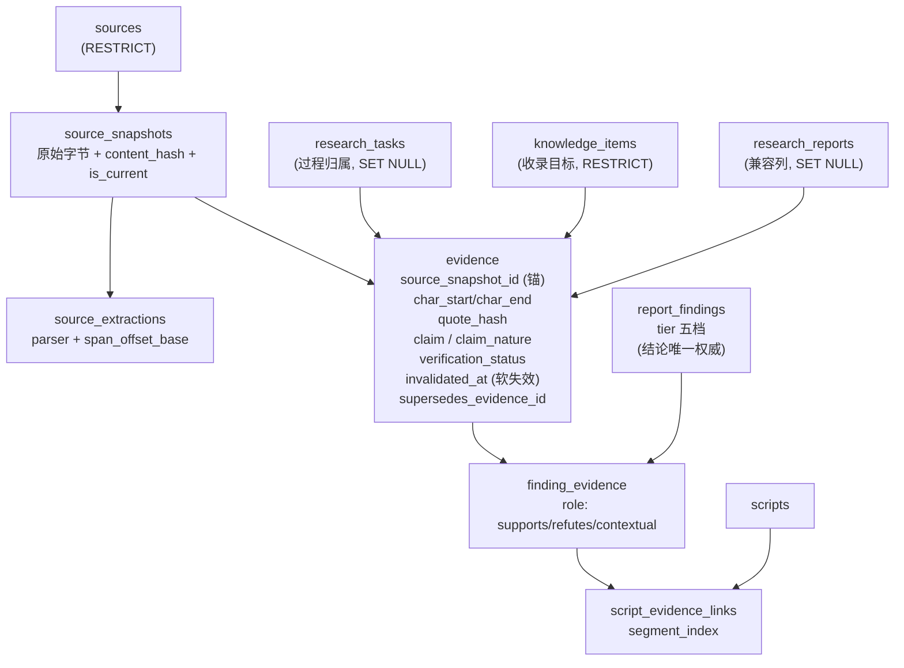
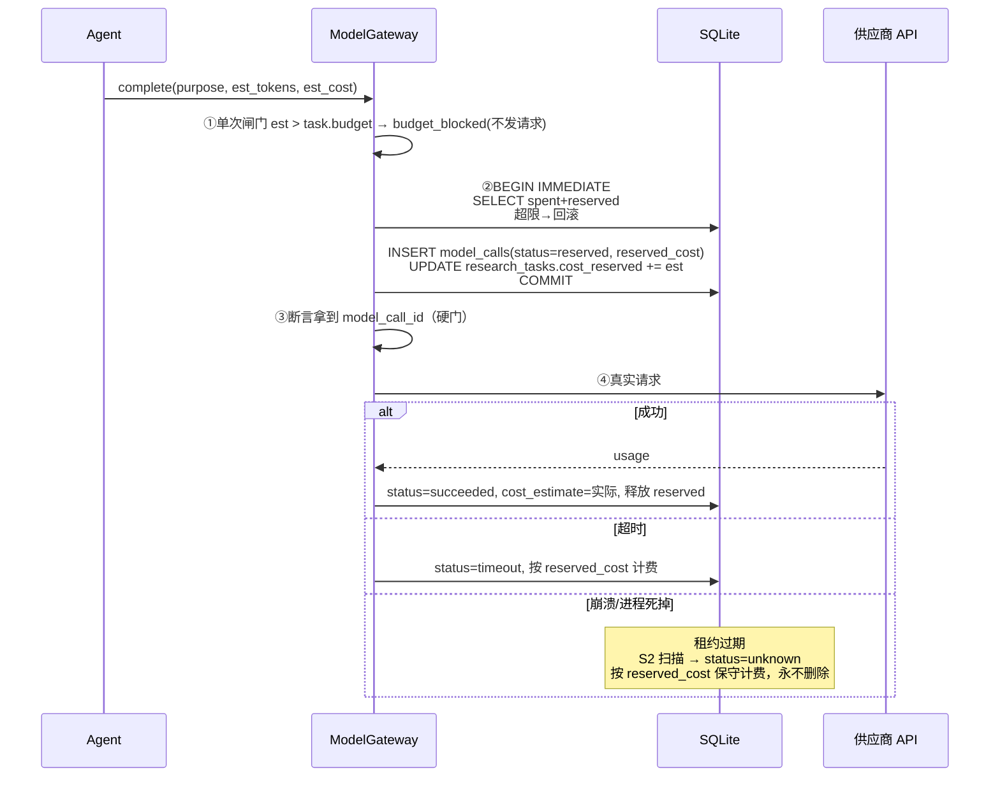

# M1.2 交付报告：架构设计修订与决策固化

> **本阶段性质**：设计阶段。**没有写任何业务代码**，`backend/`、数据库模型、Alembic 迁移、API 行为**零改动**。
> **Git 状态**：**未提交、未推送**（按任务书 §八要求），改动全部停留在工作区等人工审查。
> **这份报告的作用**：回答"M1.1 查出的 31 个问题，到底改完了没有、改成了什么、哪些还得靠将来写代码才能验证"。

---

## 0. 一页纸结论

| 项 | 结果 |
|---|---|
| M1.1 问题总数 | **31** 条（P0×2、P1×8、P2×16、P3×5） |
| **本轮已修订文档** | **31 / 31**（100%）——每一条都能在文档里指到具体位置 |
| 其中"仅靠文档即可关闭" | **27** 条 |
| 其中"必须等写代码才能最终验证" | **4** 条（P0-1、P0-2 的运行时行为；P2-12 备份实跑；P2-15 中断演练） |
| 跨文档冲突复检 | **22 项检查，0 项失败**（见 §4） |
| 仍需人工决策 | **5 项**（Q5–Q9，均不阻塞 M2 骨架） |
| 业务代码 / 迁移 / API 改动 | **0**（`git diff --name-only -- backend config data alembic.ini tests` 无输出） |
| 测试 | **96 passed**（与 M1 基线一致，无新增无回归） |
| M2 启动判断 | **有条件可启动**：2.0 骨架可以开工，2.1 真实调用前必须关闭 Q8 + 完成 B3 |

**一句话**：M1 的图纸上原来有两处结构裂缝（证据落不进去、钱记不上账）和八处口径不一致；M1.2 把裂缝补成了明确构造，把口径统一成一句话结论，并给每一处都指定了"哪一批迁移来落地"。

---

## 1. 证据分级（先声明我凭什么这么说）

| 标记 | 含义 | 本轮占比 |
|---|---|---|
| `[文档]` | 只在设计文档层面完成修订，**未运行任何代码** | 27 项 |
| `[实测]` | 用现有仓库代码 / 真实 SQLite / 真实测试验证过 | 贯穿（用于确认现状前提） |
| `[待开发]` | 需要在 2.x 阶段写代码后才能真正验证 | 4 项 |

**必须说清楚的一句**：**"文档修订完成"不等于"功能实现完成"**。本轮所有"已修订"都只代表施工图改了，仓库里仍然没有一行新的执行代码。

---

## 2. M1.1 问题逐项处理状态（31 条全表）

### 2.1 P0（2 条，全部影响 M2 之前必须关门）

| 编号 | 问题 | 处理方式 | 文档位置 | 状态 | 需代码验证 |
|---|---|---|---|---|---|
| **P0-1** | `evidence` 被 `ck_evidence_has_claim_target` 强制"必须已挂报告或知识条目"，与"证据先于结论产生"的流水线顺序**直接冲突**；删报告会连带删证据 | **重写归属模型（D4，方案 C：快照为锚）**：`source_snapshot_id` 为定位锚 + `research_task_id` 为过程归属 + `knowledge_item_id` 为收录目标（RESTRICT）+ `research_report_id` 降为兼容列（SET NULL）；"支持哪个结论"改由 `finding_evidence` 表达；新 CHECK 组 `ck_evidence_has_anchor` 等 5 条；旧 CHECK 在 B4 删除（只放宽不收紧） | `database_design.md` **§4.0**（4.0.1 硬伤 / 4.0.2 A·B·C 方案对比 / 4.0.3 逐列语义 / 4.0.4 CHECK / 4.0.5 六行机制 / 4.0.6 迁移影响）、§5 加列清单、§6.2 B4 行 | **文档已修订** | **是**：2.2 两条用例（证据可先于报告落库；删报告后证据仍在）|
| **P0-2** | `model_calls` 排在 2.5、预算写成"调用前拦截"，都**晚于 2.1 第一次真实请求** → 存在"已扣费、本地无记录"窗口 | **先预留、后调用、再结算（D6）**：`model_calls` 提前到 **B3（2.0 批）**；生命周期 `reserved → running → succeeded/failed/timeout/unknown`（另有 `budget_blocked`/`released`）；判定式 `spent + reserved + est ≤ 上限`；`reserve_call()` 必须在 `BEGIN IMMEDIATE` 内；崩溃后租约过期转 `unknown` 按 `reserved_cost` 保守计费、**永不自动删除**；**代码级硬门**"无预留不许发请求" | `database_design.md` **§4.15**（状态机 mermaid / 八问机制表 / 崩溃复原 / 缓存口径）、`system_architecture.md` §4.1 + **§8**、`tooling_architecture.md` **§2.7**、`implementation_roadmap.md` 2.0/2.1 | **文档已修订** | **是**：`tests/test_model_gateway_reservation.py` 六用例 |

### 2.2 P1（8 条）

| 编号 | 问题 | 处理方式 | 文档位置 | 状态 |
|---|---|---|---|---|
| **P1-1** | `review_records` 在数据库设计文档里 0 次出现，却在 Agent/流程/API 文档被引用 8 次；`target_type` 只有 3 类 | 纳入设计并**扩 `target_type` 含 `report_finding`**（预留 `content_item`）、`reviewer_type` 增 `system`；弱多态保留 + 2.5 加孤儿巡查 | `database_design.md` **§4.21**、§1 ER 三条弱多态边、§6.2 B5、§6.4 校验 | **文档已修订**（长期方案待 Q5）|
| **P1-2** | 迁移节奏三处口径冲突（"单次 revision 两段式" vs "分五次" vs 各阶段各自迁库） | **D7 六批次 B1–B6**，每批独立 revision/备份/校验/回滚；标清哪批必须早于哪个能力 | `database_design.md` **§6.2/§6.4/§6.5**、`implementation_roadmap.md` **§0.1**、`m1_delivery_checklist.md` §6（Q3 关闭） | **文档已修订** |
| **P1-3** | `topic_collections.column_id` 用 CASCADE，与"合集是主数据"语义相反，删合集会静默清空全部关联 | **改 RESTRICT**，并解释"删一个分类 = 所有选题变未分类，必须显式处理" | `database_design.md` **§4.2**、§7.0 删除矩阵 | **文档已修订** |
| **P1-4** | 既有库里 `scripts.topic_id`、`publications.script_id`、`media_assets.script_id`、`evidence.*` **全是 CASCADE**，删选题会连带删掉脚本、素材与**发布效果数据**；而 M1 文档却宣称"用 SET NULL 保命" | ①**纠正错误断言**；②**D5 删除语义四分类 + 17 行删除矩阵**；③明确 CASCADE 只允许连接表与结构性子行；④危险 FK 改写排进 **B6** 并配删除演练测试 | `database_design.md` **§7.0 / §7.1**、§6.2 B6、`acceptance_criteria.md` 2.9 删除演练 | **文档已修订**（FK 改写待 B6 实施）|
| **P1-5** | `topic.discover` 不在九种 task_type 目录里，路由层会拒绝该任务 | **D8 单一注册表**：`config/agent_routing.yaml` 权威 → `execution/task_types.py` 逐项相等（不等则拒绝启动）→ PROMPT.md 子集；DB 只做格式 CHECK 不做枚举；**新增第十种 `topic.discover`**；C2 测试含**文档正则扫描** | `agent_architecture.md` **§4.0**（三处同步/十种注册表/三处校验/新增流程）、§4.1 派生路由表、`module_design.md` §A | **文档已修订** |
| **P1-6** | 实测 `journal_mode=delete`、`busy_timeout=0`，Worker 一上线就会 `database is locked` | **D12**：WAL + `busy_timeout=5000` + `synchronous=NORMAL` + `foreign_keys=ON`；单 Worker 并发=1；租约 300s/心跳 100s；`BEGIN IMMEDIATE` 抢占；`attempt_token` 轮换；三条崩溃扫描 S1/S2/S3；幂等三件套 | `system_architecture.md` **§3.4**（5 小节）、§11 技术债、`acceptance_criteria.md` 2.0 | **文档已修订** |
| **P1-7** | 权限只在文档声明，代码里 0 个鉴权符号 | **CallerContext 统一模型**（human/agent/dev）+ `capabilities/guard.py` 的 `require()` **由 `ToolRegistry.dispatch()` 统一调用**；越权 → 422 `permission_denied`；dev 端点生产环境返回 404；三条安全边界（127.0.0.1 是信任边界不是鉴权） | `tooling_architecture.md` **§1.3**、`api_design.md` **§2.3**、`implementation_roadmap.md` 2.0、`acceptance_criteria.md` 2.0 | **文档已修订**（代码在 2.0）|
| **P1-8** | 合集身份靠 `code` 对齐但无外键、无校验、无停用机制，改 YAML 会留孤儿合集 | **D10**：`topic_columns` 加 `is_active`/`is_system`/`taxonomy_version`；**启动校验 5 步**（YAML↔DB 双向覆盖、版本、长度、数量）；**不自动建行** | `database_design.md` **§4.20**、§6.2 B1、`acceptance_criteria.md` 2.0 | **文档已修订**（长期方案待 Q6）|

### 2.3 P2（16 条）

| 编号 | 问题 | 处理 | 状态 |
|---|---|---|---|
| P2-1 | 评分量纲矛盾（六维 0–1 vs 阈值 3.5/5） | 统一 **0–1、阈值 0.70**，写明"展示层百分制由 API ×100，DB 与判定只用 0–1" | **已修订** `state_machine.md` §2.1 |
| P2-2 | 状态名不一致（`idea→approved`、task `"draft"`） | 改 `candidate → scored → awaiting_review → approved`、示例 `"created"` | **已修订** `api_design.md` §2.2-B/§3.1 |
| P2-3 | 预算字段命名不一致且无映射 | 统一 `budget_max_cost`/`calls_spent`/`cost_spent` + 新增 `calls_reserved`/`cost_reserved`；币种由 `models.yaml.cost.currency` 声明，字段名不带币种后缀 | **已修订** `api_design.md` §3.1 |
| P2-4 | `/api/sources/upload` 只出现在权限表 | 补入 D 组端点目录（multipart、落 `data/raw/uploads/`、`fetch_method=upload`）+ 说明"上传与抓取在快照表地位相同" | **已修订** `api_design.md` §2.2-D、`module_design.md` §C |
| P2-5 | 证据定位字段新旧重叠无共存规则 | **§7.4** 指定唯一权威：新列可程序校验，旧两类降为辅助人类信息 | **已修订** `database_design.md` §7.4 |
| P2-6 | `research_reports.findings`(JSON) 与 `report_findings` 双写无权威 | **D9**：表为唯一权威，JSON 降为派生快照（禁止作为判定依据） | **已修订** `database_design.md` §4.13 + D9 |
| P2-7 | `agent_runs.model_*` 与 `model_calls` 重叠 | **§7.4**：`agent_runs` 只留粗粒度主模型，细粒度以 `model_calls` 求和为准 | **已修订** |
| P2-8 | `uq_platform_item(platform, platform_item_id)` 因可空而失效 | **§7.4**：改部分唯一索引 `WHERE platform_item_id IS NOT NULL` + 服务层要求进 `published` 前必填 | **已修订**（落地在 B6）|
| P2-9 | 部分唯一索引 Alembic 不识别 → 静默漂移 | §7.3 原则行 + §4.19/§4.20 明写"手写 `op.create_index(..., sqlite_where=)` 并用 `PRAGMA index_list` 断言" | **已修订** |
| P2-10 | `companies` vs `institutions` 语义重叠 | 给出建议规则（institutions=金融机构/联赛/俱乐部，companies=一般企业），**列为 Q7 待确认** | **待人工确认** |
| P2-11 | `task_events` 无序号、`script_evidence_links` 无唯一约束 | 加 `event_seq` + `uq_task_event_seq`；加两条部分唯一索引 `uq_script_seg_finding`/`uq_script_seg_evidence` | **已修订** |
| P2-12 | `data/backups/` 不存在、备份命令从未实测 | 文档记录"当前不存在"事实 + 每批强制备份/演练 + 保留策略；**实跑排在 2.0** | **文档已修订，实跑待开发** |
| P2-13 | `summary`/`limitations` NOT NULL 迫使报告一次写全、无法建壳 | 采用 D4 后**不再需要建壳**（证据先落快照），保留 NOT NULL 作为"报告必须完整"的护栏 | **已修订**（结论式说明见 §4.0.5）|
| P2-14 | 部分唯一索引只保"至多一个 primary"，未保"至少一个" | **立项守卫**：进入 `approved` 前服务层强制"恰好 1 条 is_primary=1" + 迁移后校验"0 合集选题数 == 0" | **已修订** `state_machine.md` §2.1 |
| P2-15 | 迁移执行到一半中断的恢复路径未演练 | 写入 B 批次统一动作：临时库演练一次中断 + 恢复并记录 `alembic_version` | **文档已修订，演练待 2.0** |
| P2-16 | `quote_mismatch` 只标记不阻断；`claim_nature`→`FindingTier` 映射未定义 | **3.6.1 引文一致性闸门**（不一致 → disputed + 降档 + blocker）+ **3.6.2 三档→五档映射表**（由 `test_tier_rules.py` 守护） | **已修订** `agent_architecture.md` §3.6 |

### 2.4 P3（5 条）

| 编号 | 问题 | 处理 | 状态 |
|---|---|---|---|
| P3-1 | 文档计数与字段数漂移（19 vs 17、10/11/13 份、"5 张…精确说 7 张"、sources 14 vs 15、端点 11 vs 14） | 全部统一：18 业务表 / 19 物理表 / 37 与 38 目标、16 份文档、sources 15 列、Topic Hub 14 端点、写入 7 张 | **已修订**（`database_design.md` §1/§2、`current_state_audit.md` §2、`module_design.md`、`README.md`、`acceptance_criteria.md` §4、`m1_delivery_checklist.md`）|
| P3-2 | `review_records` 弱多态无 FK → 孤儿记录 | 保留弱多态 + 2.5 加"孤儿审核记录"巡检查询 | **已修订**（长期方案待 Q5）|
| P3-3 | `evidence` 无被引用次数字段 | **明确不加**：十万行以内反查仍在毫秒级，观察 2.5 实测再定（§7.3 已写） | **已修订（决策=不做）** |
| P3-4 | 新增合集 `code` 的 VARCHAR(32) 上限未声明 | D10 启动校验第 4 步：`code` 长度 ≤32；`taxonomy_version` 校验合集 id 变更 | **已修订** `database_design.md` §4.20 |
| P3-5 | `tool_calls` 可能长期近空表 | §7.4 明确保留 + **不设最小行数验收**（避免为填表造假调用） | **已修订** |

---

## 3. 两个 P0 的新架构图

### 3.1 证据归属（P0-1）

**修订前**（走不通）：

```mermaid
flowchart LR
  S["sources"] --> E["evidence<br/>CHECK: knowledge_item_id<br/>OR research_report_id"]
  R["research_reports<br/>summary/limitations NOT NULL"] --> E
  K["knowledge_items"] --> E
  E -.x["❌ 报告还不存在时<br/>证据无处可放"]:::bad
  classDef bad fill:#fee,stroke:#c00
```

**修订后**（快照为锚）：



**三条硬规则**：
1. **证据只需要"快照 + 片段"，不需要先有报告**——这是解决流水线顺序的关键。
2. **删报告不删证据**：`research_report_id` 是 SET NULL 的兼容列。
3. **"这条证据支持哪个结论"不在 `evidence` 里**，在 `finding_evidence`（一条证据可支持/反驳多个结论）。

### 3.2 成本与记账（P0-2）



**为什么这能救回"已扣费但本地无记录"**：`reserved` 行在**发请求之前**就已经提交。即使进程当场被 kill，数据库里也留着一行"我准备花这笔钱"，崩溃扫描据此保守入账。

---

## 4. 跨文档冲突复检结果（22 项，0 失败）

复检方式：脚本对 15 份文档做 22 条正则断言（`forbid` = 旧口径不得再作为当前断言出现；`require` = 新口径必须真的写进指定文档）。
> 复检脚本为一次性探针（未纳入交付物），检查项全部列在下表，可人工复核。

| # | 检查 | 类型 | 结果 |
|---|---|---|---|
| 1 | 「单次 revision」只允许出现在"已取代"语境 | forbid | ✅ |
| 2 | 「分五次」只允许出现在历史/划掉语境 | forbid | ✅ |
| 3 | 「3.5/5」只允许作为旧值对比 | forbid | ✅ |
| 4 | `idea → approved` 不得再出现 | forbid | ✅ |
| 5 | `"status": "draft"` 示例不得再出现 | forbid | ✅ |
| 6 | `budget_max_cost_cny`/`budget_used_calls` 不得作为当前字段 | forbid | ✅ |
| 7 | 旧文档计数（10/11/13 份）不得再出现 | forbid | ✅ |
| 8 | 不得出现 `/v2/` 前缀 | forbid | ✅ |
| 9 | 六批次 B1–B6 同时出现在 database_design 与 roadmap | require | ✅ |
| 10 | 0.70 阈值写入 state_machine | require | ✅ |
| 11 | `candidate → … → approved` 链路在 api_design / state_machine | require | ✅ |
| 12 | 示例状态 `created` 在 api_design | require | ✅ |
| 13 | `budget_max_cost` 在 api_design 与 database_design | require | ✅ |
| 14 | `topic.discover` 在 module_design 与 agent_architecture | require | ✅ |
| 15 | `/api/sources/upload` 在 api_design 与 module_design | require | ✅ |
| 16 | `CallerContext` 在 tooling / api / system / roadmap | require | ✅ |
| 17 | `busy_timeout` 在 system / roadmap / acceptance | require | ✅ |
| 18 | 预留记账在 database_design / tooling / system | require | ✅ |
| 19 | 代码级硬门在 system_architecture | require | ✅ |
| 20 | `source_snapshot_id` 在 database_design / module_design / acceptance | require | ✅ |
| 21 | 删除矩阵在 database_design | require | ✅ |
| 22 | 「安全机制先于能力」在 roadmap 与 acceptance | require | ✅ |

**过程中真实修掉的两处**：
1. `acceptance_criteria.md` §4 仍写"10 份文档"，且 `m1_delivery_checklist.md` 两处写"13 份" → 已改为 16 份并注明 M1 时点。
2. `api_design.md:68` 把立项路径简写成 `candidate → approved`，与状态机的四跳路径不完全一致 → 改为 `candidate → scored → awaiting_review → approved`（端点只完成最后一跳）。

---

## 5. 更新后的数据库迁移计划（取代 M1 的"单次两段式"）

| 批次 | revision 名 | 阶段 | 建什么 | 为什么排在这里（保护什么） | 回滚条件 |
|---|---|---|---|---|---|
| **B1** | `b1_topic_taxonomy` | 2.0 | `tags`、`topic_collections`、`topic_tags`、`topic_score_snapshots` + `topic_columns` 加 3 列 + 回填 | 选题立项与 Agent 合集路由都依赖多合集 | 表为空即可 `downgrade -1`；回填数据随 `column_id` 无损 |
| **B2** | `b2_task_layer` | 2.0 | `research_tasks`、`research_subtasks`、`research_subtask_dependencies`、`task_events` | 租约/心跳/`event_seq` 在任务表里，**Worker 上线（2.4）前必须在库** | 表为空直接回滚 |
| **B3** | `b3_metering` | **2.0（提前）** | `model_calls`、`tool_calls` | **P0-2**：必须早于 2.1 第一次真实调用，否则有"已扣费无记录"窗口 | 无外部状态，直接回滚 |
| **B4** | `b4_source_evidence` | **2.2（提前）** | `source_snapshots`、`source_extractions`、`source_summaries`、`research_task_sources` + `evidence` **加 9 列 + 2 列软失效 + 删旧 CHECK + 改 2 条 FK** | **P0-1**：证据归属必须早于 2.3 解析与提取落地 | 保留旧 CHECK 副本；`downgrade` 前先导出 `evidence` 快照 |
| **B5** | `b5_findings` | 2.5 | `report_findings`、`finding_evidence` + `review_records` 重建 CHECK + `research_reports` 加 3 列 | 与 findings 功能同批；反向 FK 分两步加 | 表空回滚；`review_records` 约束重建需先导出 |
| **B6** | `b6_content_layer` | 2.7–2.9 | `companies`、`content_items`、`script_evidence_links` + `scripts` 加列 + **危险 FK 改写**（`scripts.topic_id`/`publications.script_id`/`media_assets.script_id` CASCADE→RESTRICT/SET NULL）+ `uq_platform_item` 修成部分索引 | 需要全表重建，放在数据量最小时一次做完 | **最危险的一批**：必须先跑删除演练 + 备份 + 校验 `PRAGMA foreign_key_check` |

**每批统一动作**（缺一不可）：建 `data/backups/` → `sqlite3 .backup` → `alembic upgrade` → 专项校验（表数、列、约束、索引）→ 临时库 `upgrade/downgrade/upgrade` 往返 → `pytest` → 记录命令与输出到本报告附录。

---

## 6. 本轮改动的文件清单

| 文件 | 类型 | 主要改动 |
|---|---|---|
| `docs/research_hub/database_design.md` | 修改（+547 行） | §0 D1–D12 决策表、§1/§2 计数口径、**§4.0 证据归属（P0-1）**、§4.2/§4.5/§4.8/§4.13/§4.19 逐表修订、**§4.15 model_calls 重写（P0-2）**、**§4.20 topic_columns**、**§4.21 review_records**、§5 加列、**§6.2 六批次**、§6.4 校验、§6.5 备份演练、**§7 删除矩阵 + quote_hash 算法 + §7.4 字段重叠** |
| `docs/research_hub/system_architecture.md` | 修改（+140 行） | **§3.4 WAL/租约/崩溃恢复**、§4.1 ModelGateway 七条、**§8 三道闸门 + 预留记账**、§9 三层越权、§11 七条技术债 |
| `docs/research_hub/agent_architecture.md` | 修改（+120 行） | **§4.0 task_type 注册表（十种）**、§4.1 派生路由、**§3.6.1 引文闸门**、**§3.6.2 tier 映射表** |
| `docs/research_hub/tooling_architecture.md` | 修改（+80 行） | **§0 现状分级**、§1.2 三个新错误码、**§1.3 CallerContext**、§2.6 db_write 边界、**§2.7 llm_complete 重写（预留）** |
| `docs/research_hub/api_design.md` | 修改（+73 行） | §2.1 口径 14 路径/21 操作、§2.2-B 状态名、**§2.2-D /sources/upload**、**§2.3 CallerContext 权限表 + 三条安全边界**、§3.1 字段改名、§5 兼容性 |
| `docs/research_hub/state_machine.md` | 修改（+27 行） | **八套状态机（含 model_calls）**、§2.1 量纲 0–1/0.70 + 主合集约束 |
| `docs/research_hub/implementation_roadmap.md` | 修改（+121/−56） | §0 依赖图、**§0.1 迁移批次与安全机制对应**、2.0/2.1/2.2/2.4/2.5/2.7/2.9 逐阶段重写、§5 统一动作 + 回滚演练 |
| `docs/research_hub/acceptance_criteria.md` | 修改（+50 行） | **G11/G12 质量门**、2.0–2.9 清单补安全与批次项、§4 文档数 16 |
| `docs/research_hub/current_state_audit.md` | 修改 | §2 结论统一为 7 张、ER 计数口径说明 |
| `docs/research_hub/module_design.md` | 修改 | Topic Hub 14 端点 / Source Hub 9 端点 / sources 15 列 / `topic.discover` 第十种 / tier 唯一来源 |
| `docs/research_hub/m1_delivery_checklist.md` | 修改 | M1-R1 改六批次、Q3 关闭、文档数 |
| `docs/research_hub/README.md` | 修改 | 16 份文档 + 文档地图新增 3 行 |
| **`docs/research_hub/m1_2_decision_register.md`** | **新增** | D1–D12 决策台账（依据/代价/被否方案）+ Q5–Q9 待确认 + 决策依赖图 |
| **`docs/research_hub/m1_2_delivery_report.md`** | **新增（本文）** | 31 条逐项状态、两张新架构图、复检结果、迁移计划、M2 判断 |
| `docs/research_hub/m1_1_architecture_review.md` | **保持原样** | M1.1 审查报告，**未覆盖、未删除**（按任务书要求保留）|

**代码侧**：`git diff --name-only -- backend config data alembic.ini tests` → **无输出**。

---

## 7. 尚需人工决策（不阻塞 2.0，阻塞对应批次）

> **状态更新（M1.2-final，2026-11-10）**：下表五项**已由人工全部拍板关闭**，
> 最终决定见 `m1_2_decision_register.md` §3 与 `m1_2_final_review.md` §1。
> **特别注意：Q8 的人工选择是 B（未知价默认拒绝调用），与本表原"我的建议 A"相反——以人工决定为准。**
> 本表保留为"M1.2 交付当时的状态记录"，不追溯改写。

| # | 待确认 | 选项 | M1.2 当时建议 | 人工最终决定 | 阻塞谁 |
|---|---|---|---|---|---|
| Q5 | `review_records` 弱多态是否长期保留 | A 保留+巡查 / B 建 `review_targets` 关联表 / C 每种目标独立表 | A | **A（已关闭）** | B5（2.5） |
| Q6 | `topic_columns` 兼作合集主数据是否最终确认 | A 确认 / B 远期迁到 `collections` | A | **A（已关闭）** | B1 之后 |
| Q7 | `companies` 与 `institutions` 实体边界 | A 按类型分工 / B 合并为 `entities` | A | **A（已关闭）** | **B6（建 `companies` 前）** |
| Q8 | 未知价模型是否允许调用 | A 允许、按上界预留 / B 拒绝 | A | **B（已关闭，与本表建议相反）** | 2.1 首次真实调用前 |
| Q9 | `research_reports.findings` JSON 是否删除 | A 保留为派生快照 / B 2.5 后删列 | A | **A（已关闭）** | 3.0 前 |

**另需你批准的 M2 前置项**（M1 已列，此处更新）：①模型供应商与预算上限（默认日 ¥5 / 任务 ¥2）；②是否允许真实联网抓取（默认先手动粘贴 URL）；③是否修 `backend/app/main.py:27` 的旧定位文案。**④Q8 已关闭（B），不再是待批项。**

---

## 8. M2 是否具备启动条件

### 8.1 判断：**具备（仅限 2.0 骨架），2.1 需再过一道门**

| 前置条件 | 状态 | 说明 |
|---|---|---|
| 设计无重大冲突 | ✅ | 22 项复检 0 失败；两个 P0 已给出可施工的构造 |
| 两个 P0 的施工方案明确 | ✅ | P0-1 → B4 + §4.0；P0-2 → B3 + §4.15 + §2.7 |
| 迁移计划可执行 | ✅ | 六批次、每批独立备份/校验/回滚、批次与能力的先后关系已锁死 |
| 安全机制先于能力 | ✅ | CallerContext / WAL / 租约 / 记账结构全部排在 2.0 或对应能力之前 |
| 业务代码零改动 | ✅ | `git diff` 验证 |
| 测试无回归 | ✅ | 96 passed |
| M2 具体实现计划 | ✅ | `implementation_roadmap.md` 2.0 已重写为"骨架 + 安全机制 + B1/B2/B3" |

### 8.2 2.0 可以立刻做（不需要额外授权）

建目录与 Protocol、写 `config/models.yaml`/`agent_routing.yaml`/`pipelines.yaml`、`cost` 配置段、`CallerContext` + guard、`task_types.py` + 三处校验、WAL/busy_timeout、B1/B2/B3 三个迁移 + 备份 + 往返演练、`features` 三键、六个新测试文件。**这一步不联网、不花钱。**

### 8.3 2.1 之前必须先关掉的四件事

1. **Q8**（未知价是否可调用）——否则第一次真实请求就可能"没记账"或"直接不可用"。
2. **供应商与预算**（M2 前置 1）。
3. **B3 已上线并跑通预留六用例**——这是"无预留不发请求"的前提。
4. **一次真实小样本调用**（≤¥0.5）用来校准价目表，避免全按上界估。

### 8.4 我建议的下一步

> 等你审完本报告，**只批准 2.0**。2.0 做完后再单独批 2.1（真实调用），不要在同一个授权里把"花钱的开关"和"骨架"一起打开。

---

## 附录 A：本轮实测命令与输出

```powershell
# 1. 测试（无回归）
.venv\Scripts\python.exe -m pytest -p no:warnings
# → 96 passed in 7.96s

# 2. 业务代码零改动
git diff --name-only -- backend config data alembic.ini tests
# → （无输出）

# 3. 迁移版本未变
.venv\Scripts\python.exe -m alembic heads     # → de8148733a9b (head)
.venv\Scripts\python.exe -m alembic current   # → de8148733a9b (head)

# 4. 工作区状态（未提交、未推送）
git status --porcelain
# → 12 个 M（docs/research_hub/*.md）+ 3 个 ??（m1_1 报告、决策登记表、本报告）
git diff --stat
# → 12 files changed, 1003 insertions(+), 210 deletions(-)
```

> **数值更正（M1.2-final 复核，2026-11-10）**：上面第 4 条的 `1003 insertions/210 deletions`
> 是 M1.2 交付当时的**随手记录，与实测不符**。M1.2-final 逐文件复核后的真实值见下表
> （`git diff --numstat` 实测；M1.2-final 又新增了 §7.5 与 Q8 同步等改动，所以数字比"当时"更大）。
> 结论：**差错只在附录 A 的这两行统计，§6 的"改了哪些文件、改了什么"是准确的**；
> 但 §6 表格里逐文件的 `+N 行` 也是估算值，**以本表为准**。

| 文件（`docs/research_hub/`） | +行 | −行 | M1.2-final 后是否又改 |
|---|---|---|---|
| `database_design.md` | 569 | 68 | ✅（§7.5 证据定位规范、§4.15.4 价目、§3 第 17 行、`pricing_unknown` 注释） |
| `system_architecture.md` | 129 | 18 | ✅（§4.1 第 6 条、§8.2 `pricing_policy`） |
| `agent_architecture.md` | 109 | 13 | ✅（§7 成本分工"价目缺失即拒绝"） |
| `tooling_architecture.md` | 83 | 13 | ✅（§2.7 ⓪ 价目闸门、`config/models.yaml` 例外块） |
| `implementation_roadmap.md` | 82 | 45 | ✅（2.1 目标/文件/测试/验收/费用、§3 说明） |
| `api_design.md` | 61 | 18 | ✅（`details.reason=pricing_unknown`、`conflict` 行） |
| `acceptance_criteria.md` | 45 | 16 | ✅（价目策略门 + 人工例外四用例 + E1–E8） |
| `state_machine.md` | 23 | 4 | — |
| `module_design.md` | 13 | 4 | — |
| `README.md` | 9 | 6 | ✅（文档数 16→17、地图加 final review） |
| `m1_delivery_checklist.md` | 9 | 6 | ✅（M1-R4 改为 Q8=B） |
| `current_state_audit.md` | 6 | 4 | — |
| **合计（12 个已跟踪文件）** | **1138** | **215** | 9 个文件在 M1.2-final 又被修改 |

未跟踪文件（`??`）：`m1_1_architecture_review.md`、`m1_2_decision_register.md`、`m1_2_delivery_report.md`、`m1_2_final_review.md`（本轮新增）。

## 附录 B：本阶段**没有**做的事（避免误解）

- 没有写任何业务代码、没有建任何表、没有执行任何迁移；
- 没有调用任何模型/搜索/付费 API；
- 没有修改 `.env`、密钥、远程配置；
- 没有提交、没有推送；
- 没有进入 M2；
- 没有删除或覆盖 M1.1 审查报告与任何既有文档。

## 附录 C：证据分级对照（哪 4 条必须等代码）

| 编号 | 为什么必须等代码 |
|---|---|
| P0-1 | 文档已定"快照为锚"，但"证据能否真的先于报告落库"只有 B4 迁移 + 2.2 用例才能证明 |
| P0-2 | "无预留不发请求"是代码不变量，文档只能规定它，无法证明它 |
| P2-12 | `data/backups/` 的实跑与产物大小必须真跑一次 `sqlite3 .backup` |
| P2-15 | "迁移中断后恢复"必须在临时库真演练一次 |
