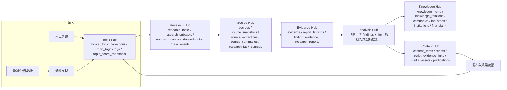

# 七大模块功能设计（M1.2 逐条落地）

> 本文档把任务书 M1.2 的每一条能力**逐项映射**到"现状 → 目标设计 → 涉及表/端点 → 所属阶段"。
> 现状标记与 [`current_state_audit.md`](current_state_audit.md) 一致：`DONE` / `DATA-ONLY`（有表无逻辑）/ `PROMPT-ONLY` / `NOT IMPL` / `NEEDS ADJ`。
> 阶段编号沿用 [`implementation_roadmap.md`](implementation_roadmap.md) 的 2.0–2.9。

---

## 0. 模块与表、端点的对应关系总览

| 模块 | 主表 | 已有端点 | 计划端点 | 阶段 |
|---|---|---|---|---|
| A Topic Hub | `topics`、`topic_columns`、`topic_collections`、`topic_tags`、`tags`、`topic_score_snapshots` | 5 | 11 | 2.7 |
| B Research Hub | `research_tasks`、`research_subtasks`、`research_subtask_dependencies`、`task_events`、`model_calls`、`tool_calls` | 0 | 13 | 2.4 |
| C Source Hub | `sources`、`source_snapshots`、`source_extractions`、`source_summaries`、`research_task_sources` | 4 | 7 | 2.2–2.3 |
| D Evidence Hub | `evidence`、`report_findings`、`finding_evidence`、`research_reports` | 5 | 9 | 2.5 |
| E Analysis Hub | 复用 D 的 findings/tier + `review_records` | 0 | 0（复用） | 2.5–2.6 |
| F Knowledge Hub | `knowledge_items`、`knowledge_relations`、`companies`、`industries`、`institutions`、`financial_*` | 7 | 1 | 2.8 |
| G Content Hub | `content_items`、`scripts`、`script_evidence_links`、`media_assets`、`publications` | 0 | 8 | 2.9 |

---

## A. Topic Hub — 选题中心

| 能力 | 现状 | 目标设计 | 涉及 | 阶段 |
|---|---|---|---|---|
| 人工创建选题 | `DONE`（`POST /api/topics`） | 保留；增加 `status=candidate` 与来源字段 | `topics.origin_type=manual` | 已有 |
| **主动发现选题** | `NOT IMPL` | Agent 任务 `topic.discover`：RSS/新闻源/知识缺口扫描 → 生成 **候选**（`status=candidate`、`origin_type=rss|news|knowledge_gap|ai_suggested`），**必须人工立项** | `POST /api/topics/discover`（202）、`POST /api/topics/candidates` | 2.7 |
| **新闻与事件采集** | `NOT IMPL` | 定时抓取 `config/research_sources.yaml` 中登记的信息源（RSS 优先，零成本）→ 归一化为候选选题；**只做候选，不做自动立项** | `sources`（`source_type=financial_news`）+ `topics.origin_type=news` | 2.7 |
| 选题评分 | `DATA-ONLY`（`priority` 单一字段） | 六维分（重要性/时效性/研究价值/传播潜力/商业价值/资料可获得性）→ 加权 `score_total` + 快照；`scored_by=rule|model|human`；人工可覆盖 | `topic_score_snapshots`、`POST /api/topics/{id}/score`、`GET /{id}/scores` | 2.7 |
| 选题去重 | `NOT IMPL` | `dedupe_key`（标题归一化 + 主体 + 时间窗）；相似度≥阈值 → 提示合并而非自动合并 | `topics.dedupe_key`、`GET /api/topics/duplicates` | 2.7 |
| 多合集关联 | `NEEDS ADJ`（只有单选 `column_id`） | `topic_collections`（1–3 个，唯一 primary）；迁移期与 `column_id` 双写 | `topic_collections`、`PUT /api/topics/{id}/collections` | 2.7 |
| 多标签 | `NEEDS ADJ`（无标签表） | `tags`（六 namespace 复用）+ `topic_tags`（≤6） | `tags`、`topic_tags`、`PUT /api/topics/{id}/tags` | 2.7 |
| 选题审核 | `NOT IMPL` | 状态机 `candidate→scored→awaiting_review→approved`；**立项只能人工** | `topics.status`、`POST /api/topics/{id}/approve` | 2.7 |
| 优先级 | `DATA-ONLY`（`priority` 1–5 手填） | 优先级 = 人工 `priority` ⊕ 评分；列表默认按 `priority asc, score_total desc` | `topics` | 2.7 |
| 选题状态 | `NEEDS ADJ`（`research_status`/`content_status` 兼任） | 独立 `topics.status`（7 态，见 [`state_machine.md`](state_machine.md) §2）；旧字段保留为投影 | `topics.status` | 2.7 |

**评分权重建议（可配置，`config/topic_scoring.yaml`）**：重要性 0.25、研究价值 0.20、时效性 0.15、传播潜力 0.20、商业价值 0.10、资料可获得性 0.10。缺资料时"可获得性"取 0.5 中性分，并在 UI 标注"未知"。

---

## B. Research Hub — 研究任务中心

| 能力 | 现状 | 目标设计 | 涉及 | 阶段 |
|---|---|---|---|---|
| 创建研究任务 | `NOT IMPL` | 由选题创建；带 `objective`/`scope`/预算 | `research_tasks`、`POST /api/research-tasks` | 2.4 |
| 研究目标与范围 | `NOT IMPL` | `objective`（一句话）+ `scope`（地域/期间/排除项/受众层级） | 同上 | 2.4 |
| 研究问题拆解 | `PROMPT-ONLY`（orchestrator Prompt 有描述） | Orchestrator 生成 5–12 个子任务 DAG；每个子任务有 `question`/`task_type`/`assignee`/`acceptance` | `research_subtasks` | 2.4 |
| 研究计划 | `NOT IMPL` | `POST /{id}/plan` 落库 + 事件 `plan_created`；可重生成并版本化 | `research_subtasks`、`task_events` | 2.4 |
| Agent 调度 | `PROMPT-ONLY` | `config/agent_routing.yaml` 白名单 + `routing.py` 校验；越界 422 | `backend/app/execution/routing.py` | 2.4 |
| 子任务依赖 | `NOT IMPL` | `research_subtask_dependencies`（DAG，创建时拓扑校验） | 同表 | 2.4 |
| 执行进度 | `NOT IMPL` | `GET /{id}` 返回计数（pending/running/succeeded/failed）+ `GET /{id}/events` | `task_events` | 2.4 |
| 失败重试 | `NOT IMPL` | `max_attempts=2`、指数退避、`retried` 事件；租约过期自动回收 | `research_subtasks.attempts` | 2.4 |
| 暂停/恢复/取消 | `NOT IMPL` | 三个端点 + 状态机守卫 | `research_tasks.status` | 2.4 |
| 人工介入 | `NOT IMPL` | `awaiting_human` 状态；`/{id}/revise` 生成新 plan 版本，已完成子任务保留 | `task_events(direction_changed)` | 2.4 |
| 成本与日志 | `DATA-ONLY`（`agent_runs` 有字段） | `model_calls`/`tool_calls` 逐次记账；`GET /{id}/cost` 汇总 | `model_calls`、`tool_calls` | 2.4–2.5 |

---

## C. Source Hub — 资料中心

| 能力 | 现状 | 目标设计 | 涉及 | 阶段 |
|---|---|---|---|---|
| 网络搜索 | `NOT IMPL` | `web_search`（`NullSearchProvider` 默认；接真实 provider 需批准） | `tool_calls` | 2.2 |
| 网页抓取 | `NOT IMPL` | `fetch_url` → `source_snapshots` + `data/raw/snapshots/{sha256}.html` | `source_snapshots` | 2.2 |
| 官方公告/财报 | `NOT IMPL` | 同为抓取 + PDF 解析；来源按 `icbc`… 等分类入 `sources.source_type=exchange_disclosure|company_report` | `sources`、`source_extractions` | 2.2–2.3 |
| PDF | `NOT IMPL` | `pypdf`，保留页码与字符偏移 | `source_extractions(kind=pdf_text)` | 2.3 |
| Excel | `NOT IMPL` | `openpyxl` 只读；行数据存 JSON 文件 | `source_extractions(kind=spreadsheet_rows)` | 2.3 |
| **用户上传资料** | `NOT IMPL` | `POST /api/sources/upload`（multipart）→ 落 `data/raw/uploads/` + `sources.url=file://...`；`fetch_method=upload` | `sources`、`source_snapshots(fetch_method=upload)` | 2.3 |
| 原始资料存储 | `DATA-ONLY`（`sources` 有元数据） | 原文存文件仓，DB 只存路径 + `sha256` | `source_snapshots.storage_path` | 2.2 |
| 来源信息 | `DONE`（`sources` 14 字段） | 增加 `publisher_type`/`jurisdiction` 一致性校验 | `sources` | 已有 |
| 抓取时间 | `DONE`（`accessed_at`） | 快照另记 `fetched_at` | `source_snapshots` | 2.2 |
| 发布时间 | `DONE`（`published_at`） | 缺失时由解析器尝试从正文/元数据提取，仍缺则留空（不猜） | `sources.published_at` | 2.2 |
| **内容版本** | `NOT IMPL` | 同 URL 多次抓取 → 多行快照，永不覆盖；`etag`/`last-modified` 用于判断是否变化 | `source_snapshots` | 2.2 |

**AI 摘要与原文分离**：`source_summaries` 恒带 `is_ai_generated=true`，且**不得**在任何地方被引用为"来源"；证据只能指向 `source_snapshots` 的原文切片。

---

## D. Evidence Hub — 证据中心

| 能力 | 现状 | 目标设计 | 涉及 | 阶段 |
|---|---|---|---|---|
| 事实提取 | `NEEDS ADJ`（`evidence.claim` 为自由文本） | 抽取结构化事实片段：`claim_nature` + 原文切片 + 定位 | `evidence` + 新列 | 2.5 |
| 证据片段 | `NEEDS ADJ`（`original_excerpt` 无坐标） | 加 `source_snapshot_id` / `char_start` / `char_end` / `quote_hash` | `evidence` | 2.5 |
| **数字提取** | `NOT IMPL` | 数字类事实单独结构化：`metric`/`value`/`unit`/`currency`/`period`/`as_of`，供交叉验证与图表 | `report_findings.metrics`(JSON) + `evidence` 元数据 | 2.5 |
| 来源关联 | `DONE`（`evidence.source_id`） | 追加快照级关联（`source_snapshot_id`） | `evidence` | 2.5 |
| 结论关联 | `NEEDS ADJ`（只能挂 knowledge_item/report 之一） | 新表 `finding_evidence(role=supports/refutes/contextual)`；一结论多证据、一证据多结论 | `finding_evidence` | 2.5 |
| 交叉验证 | `PROMPT-ONLY`（Prompt 要求 ≥2 来源） | 代码内计算：同一 `claim` 的来源数、独立域名数、来源等级；不足则拒绝 `verified_fact` | `report_findings.tier` 守卫 | 2.5 |
| **冲突信息** | `NOT IMPL`（只有 `disputed` 枚举值） | 冲突对存 `finding_evidence` 双列 + `research_reports.limitations`；报告必须并列双方口径 | `report_findings(tier=disputed)` | 2.5 |
| 可信度评价 | `DONE`（`credibility_level` 5 档） | 与 `research_sources.yaml` 的 `credibility_scale` 对齐校验 | `sources` | 已有 |
| **历史版本** | `NOT IMPL` | 证据不可变：修改=新行 + `supersedes_evidence_id`；失效用 `invalidated_at`（不删行） | `evidence` | 2.5 |

> 核心不变式：**任何 `verified_fact` 都必须能解析到 `evidence → source_snapshot → 字符区间`**；链条断一环，档位自动降到 `unconfirmed`。

---

## E. Analysis Hub — 分析中心

分析中心**不新增表**，它是"同一套 `report_findings` + `tier`，按研究类型套不同框架"。

| 研究类型 | 触发合集 | 专用框架/必答问题 | 主要 Agent |
|---|---|---|---|
| 金融知识研究 | `financial_knowledge` | 定义 → 参与主体 → 资金流向 → 定价逻辑 → 风险结构 → 监管约束 | financial |
| 财经事件分析 | `market_briefing` | 事实时间线 → 谁受益谁受损 → 市场定价反应 → 可外推与不可外推 | financial + case |
| **宏观经济分析** | `market_briefing` | 指标口径（同比/环比/季调）→ 数据结构 → 政策传导链 → 与资产价格的**相关而非因果** | financial |
| 产业链研究 | `industry_research` | 上下游节点 → 成本与利润分配 → 壁垒与集中度 → 周期位置 | industry |
| 公司研究 | `company_teardown` | 商业模式 → 收入结构 → 成本结构 → 现金流质量 → 竞争与风险 | industry + case |
| 财务分析 | `company_teardown` | 三表勾稽 → 关键比率（ROE/毛利率/经营现金流净利比）→ 会计政策影响 | industry |
| 足球商业研究 | `football_finance` | 转会定价 → 俱乐部财务（摊销/工资占比）→ 版权与赞助 → 类比的成立与不成立 | football |
| 商业案例研究 | `business_cases` | 时间线 → 资金流 → 关键决策点 → 因果链 → 反事实与教训 | case |

**五档结论（`FindingTier`）与各自的最低证据要求**

| tier | 含义 | 最低要求 | 谁可设定 |
|---|---|---|---|
| `verified_fact` | 已验证事实 | ≥2 独立来源（≥1 一级）+ 精确引文 | Fact Checker（研究 Agent 只能建议） |
| `supported_judgment` | 有证据支持的分析 | ≥1 直接证据 + 推理链写明 | 研究 Agent（Fact Checker 复核） |
| `reasonable_speculation` | 合理推测 | 无直接证据但标注推理前提 | 研究 Agent |
| `unconfirmed` | 未确认信息 | 只有单一/低可信来源 | 任意 Agent（保守默认） |
| `disputed` | 来源间争议 | 必须列出双方来源与口径差异 | Fact Checker |

> **禁止**：把 `reasonable_speculation` 写成 `verified_fact`；脚本层引用推测必须显式口播标注（`config/content_rules.yaml:style` 已约束）。

---

## F. Knowledge Hub — 知识中心

| 能力 | 现状 | 目标设计 | 涉及 | 阶段 |
|---|---|---|---|---|
| 公司档案 | `DATA-ONLY`（`financial_*` 无 `companies`） | 新表 `companies`（名称/代码/交易所/行业/母公司/关联 `institution_id`） | `companies` | 2.7 |
| 行业档案 | `DONE`（`industries` 自引用树） | 增加 `key_metrics`（JSON，带口径与期间） | `industries` | 2.8 |
| 产业链档案 | `PARTIAL`（`industries.chain_stage`） | 产业链 = `industries` 树 + `knowledge_relations(type=composed_of)`；暂不建独立表 | `knowledge_relations` | 2.8 |
| 金融概念 | `DONE`（`knowledge_items` 9 段结构） | 继续用 `knowledge_domain=general`（决策 3：不加 `concepts`） | `knowledge_items` | 已有 |
| 商业案例 | `DONE`（`financial_cases`/`football_cases`） | 与 `report_findings` 建立引用 | 两张 cases 表 | 已有 |
| 历史研究 | `DONE`（`research_reports` 版本化） | 检索入口 + 与内容作品反查 | `research_reports` | 2.8 |
| 公司与行业关联 | `PARTIAL`（`knowledge_relations` 有 `RelationType`） | 增加 `subject_type/object_type` 通用化（弱多态，同 `review_records` 做法） | `knowledge_relations` | 2.8 |

**沉淀规则（防污染）**：只有 `verified_fact` 与经人工确认的 `supported_judgment` 可进入知识库；`POST /api/knowledge/from-report` 默认 dry-run，需 `confirm=true`。**不做自动写入**。

---

## G. Content Hub — 内容生产中心

| 能力 | 现状 | 目标设计 | 涉及 | 阶段 |
|---|---|---|---|---|
| 报告转视频 | `NOT IMPL` | `content_items(form=knowledge_video|short_news|documentary)` ← `report_id`，一报告多产品 | `content_items` | 2.9 |
| 报告转图文 | `NOT IMPL` | `form=article`，复用同一 `content_items` | 同上 | 2.9 |
| 短视频脚本 | `PROMPT-ONLY`（scriptwriter Prompt） | `scripts(template=financial_mechanism|football_explainer)`，60–120s 口径 | `scripts` | 2.9 |
| 深度视频脚本 | `PROMPT-ONLY` | `template=case_documentary|industry_research`，300–900s | `scripts` | 2.9 |
| 会员报告 / 课程 | `DATA-ONLY`（`form` 枚举已含） | 走 `content_items(form=member_research|course)`，**不自建新表**；交付物仍是文件 | `content_items` | 2.9 |
| **版本管理** | `PARTIAL`（`scripts` 有 `version` + `uq_script_version`） | 已审批脚本修改必须新建版本；旧版本保留可回溯 | `scripts.version` | 2.9 |
| 人工审核 | `DATA-ONLY`（`review_records`） | 三道闸门：专业审 → 合规审 → 终审；**审批只走人工端点** | `review_records`、`POST /api/scripts/{id}/approve` | 2.9 |
| 发布状态 | `DATA-ONLY`（`publications` 唯一约束齐备） | `published` 只能人工登记，必须带 `script_version` | `publications` | 2.9 |
| **内容效果反馈** | `DATA-ONLY`（`publications` 有 views/likes/…/completion_rate） | 人工回填或后续接平台导出；**反馈回流选题评分**（"传播潜力"维度用历史数据校准） | `publications` → `topic_score_snapshots` | 2.9 |
| 研究成果与作品分离 | `DONE`（表结构已分离） | 硬约束：内容层对 `research_reports`/`report_findings` **只读** | `script_evidence_links` 只增不改 | 已有 |

**驳回规则（代码强制）**：`POST /scripts/{id}/approve` 前必须有 `script_evidence_links` 覆盖每个非 `background` 段落；缺依据的段落只能标 `background` 并降级为"口播说明"，不得挂假引用。

---

## H. 模块之间的四条硬边界

| # | 边界 | 违反的表现 |
|---|---|---|
| 1 | 资料 ≠ 摘要：`source_summaries` 永不作为来源被引用 | 用 AI 摘要冒充原文 |
| 2 | 证据 ≠ 结论：证据是切片，结论是判断 | 把"我搜到了"当成"事实成立" |
| 3 | 报告 ≠ 作品：内容层对研究成果只读 | 脚本改数字/改结论 |
| 4 | 候选 ≠ 立项：AI 只能产出候选 | 自动开题、自动发布 |
