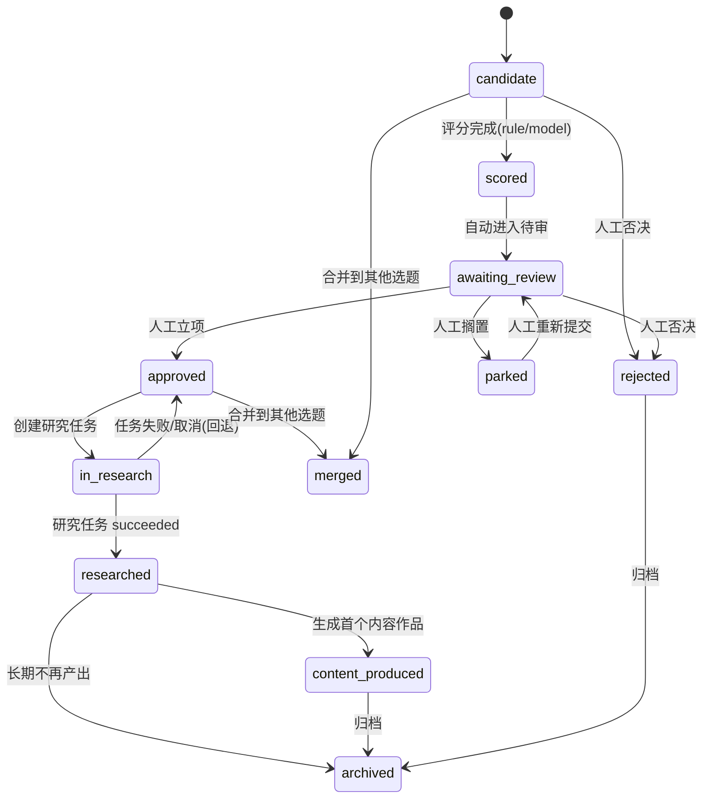
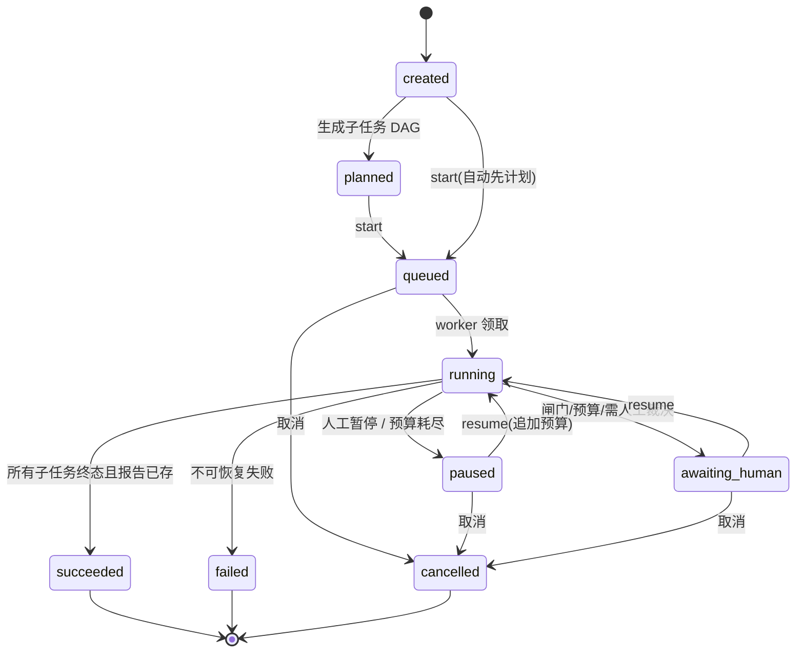
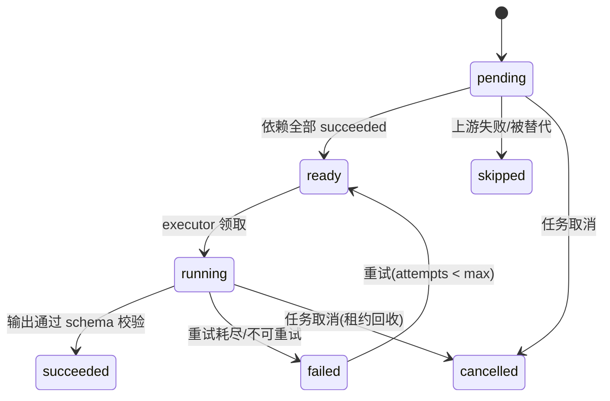
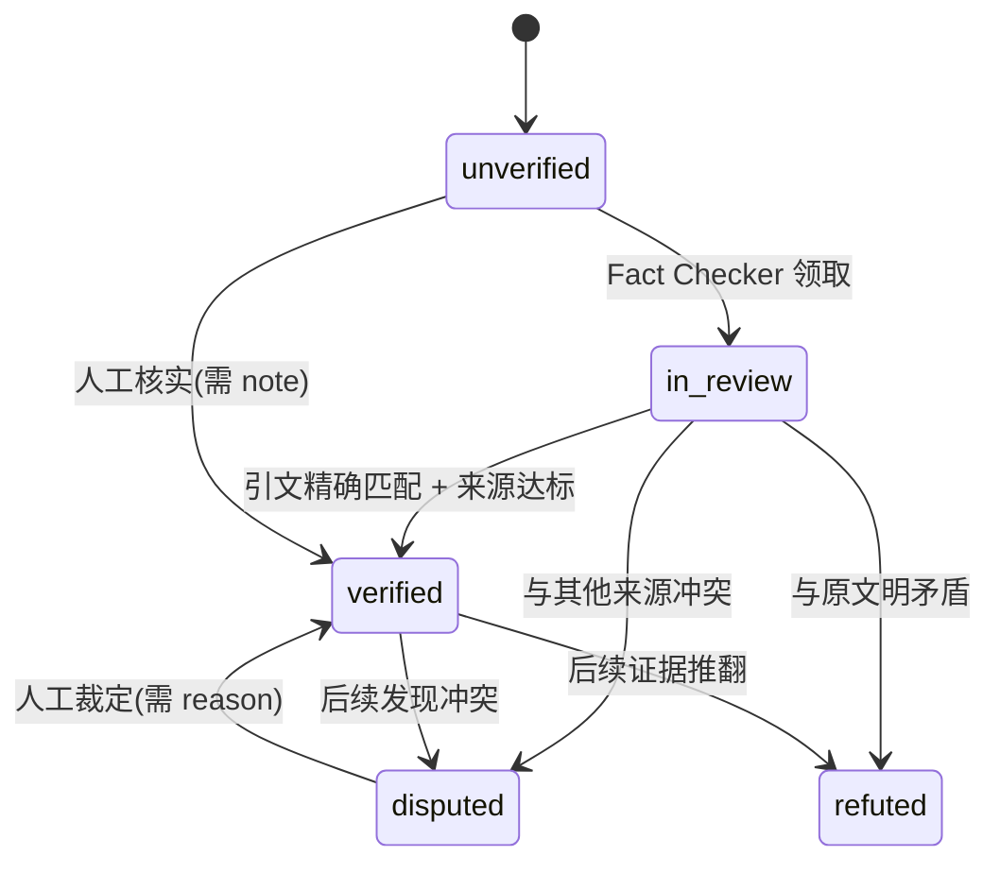
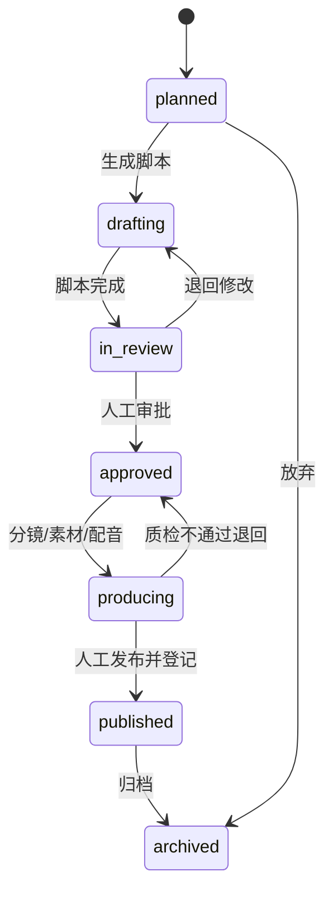

# 状态流转：八套状态机与非法迁移规则

> 原则：**状态是代码里的事实，不是文档里的口号**。每次迁移由服务层 `_assert_transition()` 校验，非法迁移返回 422 并附"允许的目标状态"。
> 所有迁移必须写 `task_events`（研究域）或 `review_records`（审核域），失败后能回答"谁在什么时候改的"。

---

## 1. 八套状态机总览

| 状态机 | 载体 | 枚举 | 谁在推 | 人工闸门 |
|---|---|---|---|---|
| 选题生命周期 | `topics.status` | `TopicStatus` | 人 + 系统评分 + Agent 发现 | ✅ 立项、合并/拆分 |
| 研究任务 | `research_tasks.status` | `ResearchTaskStatus` | 编排层 | ✅ 恢复/追加预算 |
| 研究子任务 | `research_subtasks.status` | `SubtaskStatus` | 执行层 | — |
| **模型调用记账** | `model_calls.status` | `CallStatus`（M1.2 新增，见 `database_design.md` §4.15.1） | `ModelGateway` | —（超预算转人工） |
| 资料快照/解析 | `source_snapshots.snapshot_status`、`source_extractions.extraction_status` | `SnapshotStatus`、`ExtractionStatus` | 工具层 | — |
| 证据核实 | `evidence.verification_status` | `VerificationStatus`（现有） | Fact Checker + 人 | ✅ 人工复核争议 |
| 内容作品 | `content_items.status` | `ContentItemStatus` | 制作层 + 人 | ✅ 审批、发布 |
| 脚本 | `scripts.status` | `ScriptStatus`（现有） | Scriptwriter + 人 | ✅ 审批 |

> 现有 `topics.research_status` / `content_status` 在迁移期**保留**，映射为 `topics.status` 的投影（见 §2.1），2.10 再评估删除。
>
> **`CallStatus` 单独说明**：它不属于"业务流程状态"，而是**记账状态**（`reserved → running → succeeded/failed/timeout/unknown`）。
> 之所以放进本文档，是因为它同样受"非法迁移 422 + 状态必须落库"的约束，且崩溃恢复依赖它。
> 完整状态图与八问（崩溃/超时/缓存/并发/未知价）见 `database_design.md` §4.15，本文档不重复展开，避免两处漂移。

---

## 2. 选题生命周期（`TopicStatus`）

### 2.1 状态与迁移



| from | to | 触发 | 执行者 | 守卫条件 | 副作用 |
|---|---|---|---|---|---|
| `candidate` | `scored` | 评分写入 `topic_score_snapshots` | 系统 | 六维分齐且有 `scored_by` | `score_total` 更新 |
| `candidate`/`scored` | `awaiting_review` | 自动（评分后）或人工提交 | 系统 | `score_total >= 阈值`（**0–1 量纲，默认 0.70**，见下方说明） | 进待审队列 |
| `awaiting_review` | `approved` | `POST /topics/{id}/approve` | **人** | 人工确认 | `approved_at` 记录在事件 |
| `awaiting_review` | `rejected`/`parked` | 人工操作 | **人** | 需给 `reason` | 事件 `rejected`/`parked` |
| `approved` | `in_research` | 创建 `research_tasks` | 系统/人 | 任务存在且未取消 | `research_status=in_progress`（兼容投影） |
| `in_research` | `researched` | 任务 `succeeded` 且报告 `verification_status=verified` | 系统 | 报告必须过 Fact Checker | `research_status=completed` |
| `in_research` | `approved` | 任务 `failed`/`cancelled` | 系统 | — | 允许重开 |
| `researched` | `content_produced` | 首个 `content_items` 创建 | 系统 | — | `content_status=approved`（兼容投影） |
| 任意（除 `merged`） | `archived` | 人工归档 | **人** | — | 只读 |
| `candidate`/`approved` | `merged` | `POST /topics/{id}/merge` | **人** | 目标选题存在且未合并 | `merged_into_topic_id` 必填 |

**评分量纲统一（M1.1 审查 P2 修正）**

六维分每项取 **0–1**（`topic_score_snapshots` 的六列 + `weights` 均为 0–1），
加权和 `score_total` 也落在 **0–1**；因此进入待审的阈值写成 **0.70**，而不是旧文的 "3.5/5"。
两套量纲混用会让"到底多少分才立项"变成一句无法执行的话。展示层若想用百分制，由 API 乘 100，
**数据库与判定逻辑只用 0–1**。

**主合集约束（与 `topic_collections` 对齐）**

`topics.status` 进入 `approved` 的**前提**是：该选题在 `topic_collections` 中
**恰好有 1 条 `is_primary=1`**（1–3 条关联）。守卫写在服务层（`_assert_transition` 前置检查），
数据库侧用部分唯一索引 `uq_topic_primary_collection(topic_id) WHERE is_primary = 1` 兜底。
否则会出现"立项了但不知道属于哪个合集"的选题——内容中心的模板选择与 Agent 路由都依赖它。

**禁止**：`approved → candidate`（不可逆回退到候选）、`archived → *`（需人工新建）、任何绕过 `awaiting_review` 直接 `approved` 的路径（除人工端点外，Agent 无此工具）。

---

## 3. 研究任务（`ResearchTaskStatus`）



| from | to | 触发 | 守卫 | 副作用 |
|---|---|---|---|---|
| `created` | `planned` | `POST /{id}/plan` | 选题必须 `approved` | 写 `research_subtasks` + 依赖 + 事件 `plan_created` |
| `created`/`planned` | `queued` | `POST /{id}/start` | 至少 1 个子任务；预算 > 0 | 事件 `queued` |
| `queued` | `running` | worker 领取（`claimed_by`+`lease_until`） | 租约未过期 | 事件 `claimed` |
| `running` | `awaiting_human` | 命中人工闸门（`verify.claims` 完成 / 需方向决策） | — | 事件 `needs_human` |
| `running` | `paused` | 人工或 `budget_exceeded` | — | 事件 `paused`/`budget_exceeded` |
| `paused`/`awaiting_human` | `running` | `POST /{id}/resume` | **人**操作 | 事件 `resumed` |
| `running` | `succeeded` | 全部子任务终态 + 报告落库 | 无 `blocker` 缺陷（若有则 `awaiting_human`） | 事件 `completed` |
| `running` | `failed` | DAG 死锁 / 重试耗尽 / 内部错误 | — | 事件 `failed` + `error` |
| `queued`/`paused`/`awaiting_human` | `cancelled` | `POST /{id}/cancel` | — | 事件 `cancelled`；子任务置 `cancelled` |

**禁止**：`succeeded`/`failed`/`cancelled` 之后再回到 `running`（如需重做，新建任务并 `revise`）；
**`revise` 不是状态迁移**：它生成新 `plan` 版本，已 `succeeded` 的子任务保留，仅重排未完成部分，并写事件 `direction_changed`。

---

## 4. 研究子任务（`SubtaskStatus`）



| from | to | 触发 | 守卫 |
|---|---|---|---|
| `pending` | `ready` | 依赖全 `succeeded` | DAG 无环 |
| `ready` | `running` | 领取 | `attempts < max_attempts(2)` |
| `running` | `succeeded` | 输出校验通过 | 必须写 `output_payload` |
| `running` | `failed` | 错误不可重试或超限 | 写 `error` + 事件 |
| `failed` | `ready` | 重试 | 指数退避（1s→4s） |
| 任意非终态 | `cancelled` | 任务取消 | — |

**租约**：领取时写 `claimed_by` + `lease_until = now + 120s`；进程崩溃后租约过期 → 自动回到 `ready` 且 `attempts += 1`，写事件 `retried(reason=lease_expired)`。

---

## 5. 资料快照与解析

### 5.1 `SnapshotStatus`

| 值 | 含义 | 是否可用于证据 |
|---|---|---|
| `ok` | 抓取成功且有内容 | ✅ |
| `partial` | 抓到部分内容（超长/被截断） | ⚠️ 可用但须注明截断 |
| `http_error` | 4xx/5xx | ❌（但记录本身是事实） |
| `blocked` | 反爬/需登录/验证码 | ❌ |
| `timeout` | 超时 | ❌ |
| `too_large` | 超上限 | ❌（可改抓摘要） |

> 快照是**不可变**记录：同一 URL 再抓 → 新行。不提供"更新快照"端点。

### 5.2 `ExtractionStatus`

`ok`（完整解析）→ 可抽证据；`partial`（部分页/部分表）→ 可抽证据但证据须标页码/行号，且 `strength` 降一级；`failed`（加密/损坏/无文本层）→ 不进证据链，`source_summaries` 也不得声称"已读全文"。

---

## 6. 证据核实（复用现有 `VerificationStatus`）



| 规则 | 说明 |
|---|---|
| `verified` 的准入 | `quote_exact` 匹配 + 来源等级 ≥ `medium` + 有 `source_snapshot_id` |
| 谁能改 | Fact Checker（`in_review→verified/disputed/refuted`）、**人**（任意→`verified`，必须 `note`） |
| 失效 | 不是状态迁移：写 `invalidated_at` + `reason`，证据保留但不再支撑结论 |
| `quote_mismatch=true` | 强制回到 `unverified` 并写事件 |
| 引用已失效证据的结论 | 自动降档为 `unconfirmed`，并在报告中标注 |

---

## 7. 内容作品与脚本

### 7.1 `ContentItemStatus`



### 7.2 `ScriptStatus`（现有枚举）

`draft → in_review → approved → storyboard_ready → produced → published`，旁支 `rejected`、`archived`。

| 硬规则（代码强制） | 说明 |
|---|---|
| `approved` 只能由**人工端点** `POST /scripts/{id}/approve` 触发 | Agent 无对应工具 |
| `approved` 之前不得有 `storyboard`/`media_assets` | 分镜端点校验脚本状态 |
| `published` 只能人工登记 `publications` | 且必须引用 `script_version` |
| 脚本不得改变 `findings.tier` | 只能引用；改档仅 Fact Checker |
| 已 `approved` 的脚本修改必须新建 `version` | 保留旧版本供追溯（`uq_script_version`） |

---

## 8. 非法迁移的统一处理

```json
422 Unprocessable Entity
{
  "error": {
    "code": "domain_validation_error",
    "message": "研究任务状态不允许从 succeeded 变为 running",
    "details": {
      "current": "succeeded",
      "requested": "running",
      "allowed": ["(新建任务)", "revise"]
    }
  }
}
```

服务层实现约定：

```python
ALLOWED = {
    "created": {"planned", "queued", "cancelled"},
    "running": {"succeeded", "failed", "paused", "awaiting_human", "cancelled"},
    # ...
}

def _assert_transition(current: str, target: str) -> None:
    if target not in ALLOWED.get(current, set()):
        raise DomainValidationError(
            f"研究任务状态不允许从 {current} 变为 {target}",
            details={"current": current, "requested": target,
                     "allowed": sorted(ALLOWED.get(current, set()))},
        )
```

**测试要求**：每套状态机至少一组"合法链路"参数化用例 + 一组"非法迁移"参数化用例（断言 422 且 `details.allowed` 非空）。
