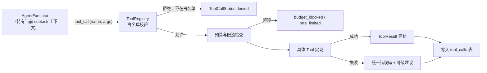

# 工具能力设计：Agent 如何真实调用外部能力

> **核心原则**：Agent 不能"通过 Prompt 假装拥有工具"。工具必须由代码注册、按白名单下发、调用留痕、失败可降级。
> 本文档定义 10 类工具的契约。第二阶段**先实现其中 6 类**（见 [`implementation_roadmap.md`](implementation_roadmap.md)），其余保留契约与降级行为。

---

## 1. 总体机制：ToolRegistry + 统一信封



### 1.1 统一返回信封（所有工具一致）

```json
{
  "ok": true,
  "tool": "web_search",
  "status": "ok",
  "data": { "...": "工具专属结构" },
  "usage": {"units": 1, "unit_kind": "query", "cost_estimate": 0.0, "currency": "CNY"},
  "warnings": ["部分结果缺少发布日期"],
  "duration_ms": 812,
  "tool_call_id": 10231
}
```

失败时 `ok=false`，`data` 为空，`error` 为 `{"code": "...", "message": "...", "retryable": true|false, "hint": "..."}`。

### 1.2 统一错误码（跨工具复用）

| code | 含义 | 可重试 | Agent 应做什么 |
|---|---|---|---|
| `not_configured` | 未配置（无密钥/未启用） | 否 | 走降级路径并写 `open_questions`，**不得编造** |
| `network_error` | 网络失败 | 是（退避） | 重试 ≤2 |
| `timeout` | 超时 | 是 | 重试 ≤1，随后降级 |
| `rate_limited` | 限流 | 是（长退避） | 排队或换源 |
| `invalid_argument` | 参数不合法 | 否 | 修正后重试 1 次 |
| `not_found` | 资源不存在（404 类） | 否 | 记录为"源失效" |
| `too_large` | 超过大小上限 | 否 | 分页/截断，或改抓摘要 |
| `unsupported_format` | 格式不支持 | 否 | 标记该源不可解析 |
| `permission_denied` | 该 Agent 无权 | 否 | 通过 handoff 申请 |
| `budget_blocked` | 预算不足 | 否 | 上报 `budget_exceeded` |
| `internal_error` | 实现缺陷 | 视情况 | 记 `tool_calls.error`，不重试 |

### 1.3 权限模型（三层）

| 层 | 由谁定义 | 内容 |
|---|---|---|
| 工具白名单 | `config/agent_routing.yaml` → `agents[].tools` | 该 Agent 可用的工具名集合 |
| 数据域权限 | 同上 `agents[].db_scopes` | 可读表 / 可写表（含字段级限制，如只允许写 `evidence.verification_status`） |
| 实例权限 | 运行时的 `ToolContext` | 当前 `research_task_id`/`subtask_id`/`budget_left`/`dry_run` |

> 违反任一层 → `permission_denied`，并写 `task_events(type=tool_denied)`，**供审计**。
> `dry_run=true` 时所有写工具改为"模拟成功 + 记录将写入的内容"，用于排演与测试。

---

## 2. 十个工具的契约

### 2.1 `web_search` — 网络搜索

| 项 | 内容 |
|---|---|
| 实现方式 | `SearchProvider` 协议的多实现：`NullSearchProvider`（默认，返回 `not_configured`）、`TavilyProvider`、`BingProvider`、`SearxngProvider`（自建，零边际成本）。密钥来自环境变量 `SEARCH_API_KEY`。 |
| 输入 | `query` (str, 1–200 字) / `max_results` (1–10, 默认 5) / `recency` (`any|7d|30d|365d`) / `domain_filter` (str[] 可选) / `language` (`zh|en`) |
| 输出 | `results[]`: `{title, url, snippet, publisher, published_at?, rank}`；`provider`；`total_found` |
| 错误处理 | 未配密钥 → `not_configured`（**不降级到伪造结果**）；空结果 → `ok=true, results=[]` 并由 Agent 记 `insufficient_evidence` |
| 权限边界 | 仅研究层 4 个 Agent + 编排层（`purpose=discover`）；**Fact Checker 不可搜索**（只允许 `fetch_url` 复核已知 URL，防止"用搜索找支持自己结论的证据"） |
| 费用 | 有（按查询计）；默认 provider 单价写入 `config/models.yaml` 的 `tools.web_search` |
| 落库 | `tool_calls`（入参/出参/耗时/费用）；结果本身不入库，需 `fetch_url` 才能成为 `sources` |

### 2.2 `fetch_url` — 网页抓取与快照

| 项 | 内容 |
|---|---|
| 实现方式 | `httpx` 同步客户端 + 可插拔 `Fetcher`；默认 `HttpxFetcher`（超时 15s、最大 5MB、UA 标识、robots 头检查）。成功即写 `source_snapshots`（原文字节存 `data/raw/snapshots/{sha256}.html`）。 |
| 输入 | `url` (必填) / `allow_pdf` (bool, 默认 true) / `max_bytes` (默认 5_000_000) / `purpose` (`collect|verify`，`verify` 仅 Fact Checker 可用) / `source_id?` |
| 输出 | `{snapshot_id, http_status, content_type, bytes, sha256, title, fetched_at, text_path?, needs_extraction}` |
| 错误处理 | 404 → `not_found`（标源失效）；403/验证码 → `blocked`（`SnapshotStatus.blocked`）；超限 → `too_large`；超时 → `timeout` |
| 权限边界 | 研究层 + Fact Checker（`purpose=verify` 时只能抓 `evidence` 中已存的 URL，不得自由探索） |
| 费用 | 无（仅网络与磁盘） |
| 落库 | `source_snapshots` + `tool_calls`。**快照是不可变证据**：同一 URL 再抓一次生成新版本，旧版本保留（见 §3） |

### 2.3 `parse_pdf` — PDF 解析

| 项 | 内容 |
|---|---|
| 实现方式 | `pypdf`（纯 Python，无需系统依赖）优先；扫描件无文本层 → 返回 `needs_ocr=true`（OCR **不在**第二阶段范围，标 NOT IMPLEMENTED） |
| 输入 | `snapshot_id` 或 `file_path` / `pages` (如 `"1-20"`，默认全部，上限 200 页) / `extract_tables` (bool, 默认 false，第二阶段返回 `unsupported_format` 提示) |
| 输出 | `extraction_id`, `pages[]`（每页 `text` + `char_offset`）, `total_chars`, `has_text_layer`, `metadata`（title/author/created_at） |
| 错误处理 | 加密 PDF → `unsupported_format`；无文本层 → `ok=true, has_text_layer=false`（Agent 必须降级为"仅用元数据"，不得臆测内容） |
| 权限边界 | 研究层 4 个 Agent |
| 费用 | 无 |
| 落库 | `source_extractions`（`kind=pdf_text`，存文本到 `data/raw/extractions/`） |

### 2.4 `parse_xlsx` — Excel 解析

| 项 | 内容 |
|---|---|
| 实现方式 | `openpyxl`（只读模式） |
| 输入 | `snapshot_id`/`file_path` / `sheet` (名称或序号) / `header_row` (默认 1) / `max_rows` (默认 2000) / `columns` (可选列筛选) |
| 输出 | `extraction_id`, `columns[]`, `rows[]`（值为原始字符串或数字）, `row_count`, `truncated` |
| 错误处理 | 超大表 → 截断并 `warnings`；公式未计算 → 返回缓存值并标 `formula_cached=true`（**数字必须标口径**） |
| 权限边界 | 研究层 4 个 Agent |
| 费用 | 无 |
| 落库 | `source_extractions`（`kind=xlsx_table`，行数据存 JSON 文件） |

### 2.5 `db_query` — 数据库只读查询

| 项 | 内容 |
|---|---|
| 实现方式 | **不是任意 SQL**：受控查询端点集合（`QuerySpec`），由 `backend/app/capabilities/db_read.py` 白名单实现，如 `knowledge_search`、`company_profile`、`industry_overview`、`recent_reports`、`evidence_by_finding`。 |
| 输入 | `spec` (枚举名) + `params` (dict，按 spec 校验) + `limit` (默认 20，上限 100) |
| 输出 | `rows[]`（仅 leaf 字段，**不序列化 ORM 对象**）+ `total` |
| 错误处理 | 未知 spec → `invalid_argument`；越权表 → `permission_denied` |
| 权限边界 | 所有 Agent 只读；Fact Checker 额外可读 `evidence`/`source_snapshots` 全量 |
| 费用 | 无 |
| 落库 | 仅 `tool_calls`（参数与行数，**不存行内容**，避免 PII 与体积膨胀） |

### 2.6 `db_write` — 数据库写入

| 项 | 内容 |
|---|---|
| 实现方式 | 受控写端点集合（`WriteSpec`），如 `evidence.create`、`source_summary.upsert`、`finding.create`、`content_item.update_status`、`review.record`。每个 spec 内部走对应领域服务，复用现有校验（如 `EvidenceCreate` 的二选一约束）。 |
| 输入 | `spec` + `payload`（Pydantic 校验）+ `idempotency_key`（必填，通常 `task_id:subtask_id:seq`） |
| 输出 | `{created_ids: [], updated_ids: [], skipped: []}` |
| 错误处理 | 校验失败 → `invalid_argument`（带字段路径）；幂等键重复 → `ok=true` + `skipped`（**不报错**，避免重试风暴）；FK 不存在 → `invalid_argument` |
| 权限边界 | 严格按 §1.3 的 `db_scopes`；**研究层不得写 `scripts`/`publications`**；制作层不得写 `evidence.tier` |
| 费用 | 无 |
| 落库 | 目标表 + `tool_calls` |

### 2.7 `llm_complete` — 模型调用

| 项 | 内容 |
|---|---|
| 实现方式 | `ModelGateway.complete(request)`：`provider`（`openai_compatible|anthropic|local`）+ `model` + `temperature` + `max_tokens` + `response_schema`（可选 JSON Schema）+ `purpose`（`plan|collect|extract|analyze|synthesize|verify|script|visual|qc`）。未配置 → `not_configured`。 |
| 输入 | `system_prompt_ref`（指向 `prompts/` 文件 + 变量）、`messages`、`response_schema?`、`max_tokens`（默认按 purpose 预设）、`cache_key?` |
| 输出 | `{text, parsed?（按 schema 校验）, usage{prompt_tokens,completion_tokens}, model, cost_estimate, latency_ms, cache_hit}` |
| 错误处理 | 无密钥/网络 → `not_configured`/`network_error`；JSON 不合 schema → 重试 1 次（temp-0.2）→ `schema_invalid`；预算不足 → 调用前拦截 `budget_blocked` |
| 权限边界 | 9 个 Agent 全部可用，但 `purpose` 与其角色绑定（如 Fact Checker 只能用 `verify`） |
| 费用 | **有**，是主要成本项。三层闸门：单次 `max_tokens` → 子任务预算 → 任务预算 → 日预算 |
| 落库 | `model_calls`（provider/model/purpose/tokens/cost/request_hash/latency/status），**不存完整 prompt 正文**（防泄漏与膨胀），只存 `prompt_hash` + 前 500 字摘要 |

**成本闸门示例（`config/models.yaml`）**

```yaml
providers:
  openai_compatible:
    base_url: ${LLM_BASE_URL}
    pricing_unknown: true        # 不猜价：费用显示为"未知"
models:
  default:
    provider: openai_compatible
    model: ${LLM_MODEL}
    max_output_tokens: 4000
cost:
  daily_cap_cny: 5.0
  per_task_cap_cny: 2.0
  max_calls_per_subtask: 8
```

### 2.8 `task_update` — 任务状态更新

| 项 | 内容 |
|---|---|
| 实现方式 | 内部工具（不对外 HTTP）：`TaskRuntime.update(subtask_id, status, output?, error?, usage?)`，写 `research_subtasks` + `task_events`。 |
| 输入 | `subtask_id`、`status`（受状态机约束）、`output?`、`error?`、`event_type`、`payload?` |
| 输出 | `{subtask_id, status, attempts, updated_at}` |
| 错误处理 | 非法状态迁移 → `invalid_argument`（携带状态机允许的目标集合）；租约过期 → `permission_denied(lease_lost)` |
| 权限边界 | 仅执行层（AgentExecutor/Orchestrator）可调用；**Agent 不直接调**（由 executor 代为落库） |
| 费用 | 无 |
| 落库 | `research_subtasks`、`task_events` |

### 2.9 `handoff` — 研究结果交接

| 项 | 内容 |
|---|---|
| 实现方式 | 写 `task_events(type=handoff, payload={...})`，由 Orchestrator 在下一轮决策中消费。**不是** Agent 间直接调用。 |
| 输入 | `handoff_type`（五型，见 [`agent_architecture.md`](agent_architecture.md) §5）、`to_agent?`、`reason`（必填，≥10 字）、`payload`、`blocking` (bool) |
| 输出 | `{event_id, accepted: true}` （accepted 只表示"已登记"，不表示"已执行"） |
| 错误处理 | 未知类型 → `invalid_argument`；`to_agent` 不在 roster → `invalid_argument` |
| 权限边界 | 所有 Agent 可发；`request_revision` 仅 fact_checker 可发 |
| 费用 | 无 |
| 落库 | `task_events` |

### 2.10 `fact_check` — 事实核查（复合工具）

| 项 | 内容 |
|---|---|
| 实现方式 | 组合工具，供 Fact Checker 一次调用完成"引文核对 + 公式复算 + 来源等级检查"：`FactCheckTool.verify(finding_ids)` → 内部调 `db_query`（取证据与快照）+ 字符串比对 + 受限 `fetch_url`（快照缺失时）+ 可选 `llm_complete(purpose=verify)` 做语义一致性判断 |
| 输入 | `finding_ids` (1–10) / `checks`（`quote_exact|number_recompute|source_grade|freshness|analogy_boundary|compliance`，默认全开） |
| 输出 | 每条：`{finding_id, verdict(pass|needs_revision|reject), issues[{code,severity,detail}], suggested_tier, quote_match{exact|fuzzy|mismatch}}` |
| 错误处理 | 快照缺失 → `ok=true` + `issues[code=no_snapshot, severity=blocker]`（**保守失败**：无法核对不得通过）；工具不可用 → 该项 `blocked` |
| 权限边界 | **仅 Fact Checker**；其他 Agent 调用 → `permission_denied` |
| 费用 | 低（默认纯规则比对；语义比对才调模型，且批量） |
| 落库 | `tool_calls` + `review_records`（由 executor 汇总写入） |

### 2.11 逐工具测试方法（M1.5 要求）

> 每个工具至少覆盖 **成功 / 未配置 / 参数非法 / 权限拒绝** 四类；下表给出每个工具的特有验证点。
> 原则：**离线可测**——需要外部服务的，一律用协议替换为 Fake；真实调用另打 `@pytest.mark.integration`。

| 工具 | 成功用例（怎么做） | 特有失败/边界用例 | 离线方式 |
|---|---|---|---|
| `web_search` | FakeProvider 返回 3 条固定结果，断言字段与 `rank` 排序 | 空结果（`ok=true, results=[]`）；`not_configured` 时**不得**返回任何结果 | `FakeSearchProvider`（`tests/fixtures/search.json`） |
| `fetch_url` | `http.server` 起本地端口返回固定 HTML，断言 `sha256` 与落盘路径 | 404→`not_found`；403→`SnapshotStatus.blocked`；超 5MB→`too_large`；超时→`timeout`；同一 URL 两次→两行快照 | 本地 `http.server` + fixture 文件 |
| `parse_pdf` | fixture PDF 抽取文本，断言 `text[start:end] == quote` | 加密 PDF→`unsupported_format`；无文本层→`has_text_layer=false`（不返回空串冒充成功） | `tests/fixtures/sample.pdf` |
| `parse_xlsx` | fixture XLSX 取表，断言列名与行数 | 超大表截断并给 `warnings`；公式列标 `formula_cached=true` | `tests/fixtures/sample.xlsx` |
| `db_query` | 预置 3 条知识条目，按 `spec=knowledge_search` 命中 | 未知 spec→`invalid_argument`；越权表（如 Fact Checker 查 `topics`）→`permission_denied`；`limit` 超 100 被截断 | 事务内临时 SQLite（现有 `db_session` fixture） |
| `db_write` | 写一条 evidence 并回读 | 幂等键重复→`skipped` 不报错；FK 不存在→`invalid_argument` + 字段路径；**权限拒绝**：scriptwriter 写 `evidence`→`denied`；`dry_run=true` 时不落库 | 事务内临时 SQLite + `dry_run` |
| `llm_complete` | `FakeModelGateway` 返回合法 JSON，断言解析与 `usage` | `not_configured`→503；JSON 不合 schema→重试 1 次后 `schema_invalid`；超预算→**调用前**拦截 `budget_blocked`（断言网关未被调用） | `FakeModelGateway` |
| `task_update` | 合法迁移 `pending→ready` 写库 + 事件 | 非法迁移→422 且 `details.allowed` 非空；租约过期→`permission_denied(lease_lost)` | 临时 SQLite |
| `handoff` | 发 `request_revision` 落 `task_events` | 未知 `handoff_type`→`invalid_argument`；`to_agent` 不在 roster→`invalid_argument` | 临时 SQLite |
| `fact_check` | 预置"引文一致"的证据 → `pass` | 篡改引文→`quote_mismatch` + `reject`；快照缺失→`issues[no_snapshot]` 为 blocker（保守失败）；非 Fact Checker 调用→`permission_denied` | 临时 SQLite + `FakeFetcher` |

**验收口径**：每个工具的四类用例必须在 `pytest` 默认运行中全部执行（不联网、不需密钥）；`integration` 标记下再有 1 个真实调用用例，默认跳过。

---

## 3. 证据链的工具级保障（网页变化怎么办）

| 场景 | 保障机制 |
|---|---|
| 网页改版/删除 | 抓取即存 `source_snapshots`（`data/raw/snapshots/{sha256}.html` + `sha256` + `fetched_at`），证据只引用快照而非"当前网页" |
| 同一 URL 多版本 | 每次抓取新增一行快照，`evidence.source_snapshot_id` 指向当时那一版；旧版永不覆盖 |
| 引文漂移 | 证据存 `char_start/char_end` + `quote_hash`；核查时按快照原文重算 hash，不一致即 `quote_mismatch=true` → 证据失效、结论降档 |
| 资料过期 | `evidence.invalidated_at` + `invalidation_reason`（`source_gone|quote_drift|superseded`），知识条目 `last_verified_at` 提示复核 |
| 抓不到 | `SnapshotStatus(blocked|timeout|http_error)` 如实记录，**不写"已核实"** |

---

## 4. 离线与测试策略（关键工程约束）

1. **测试永不联网**：`SearchProvider`/`Fetcher`/`Parser` 全部协议化，测试注入 `FakeSearchProvider`（返回固定 JSON）、`FakeFetcher`（从 `tests/fixtures/` 读 HTML）、`FakeModelGateway`（返回固定结构化输出）。
2. **默认实现是"未配置"**：`NullSearchProvider`、`NullModelGateway` 直接返回 `not_configured`，保证"没配密钥就明确失败"，而不是静默假装成功。
3. **工具契约测试**：每个工具至少 4 个用例（成功 / 未配置 / 参数非法 / 权限拒绝）；`dry_run` 模式验证写工具不改库。
4. **费用可测**：`FakeModelGateway` 返回可控 `usage`，用于验证预算闸门与 `model_calls` 落库。
5. **真实联网的集成测试**打 `@pytest.mark.integration` 且默认跳过（`-m integration` 才跑），避免日常测试依赖网络与密钥。

---

## 5. 工具与 Agent 的绑定表（权威来源 = `config/agent_routing.yaml`）

| 工具 | orchestrator | financial | football | industry | case | fact_checker | scriptwriter | visual | video |
|---|---|---|---|---|---|---|---|---|---|
| `llm_complete` | plan | ✔ | ✔ | ✔ | ✔ | verify | ✔ | ✔ | ✔ |
| `web_search` | — | ✔ | ✔ | ✔ | ✔ | — | — | — | — |
| `fetch_url` | — | ✔ | ✔ | ✔ | ✔ | verify-only | — | — | — |
| `parse_pdf` | — | ✔ | ✔ | ✔ | ✔ | — | — | — | — |
| `parse_xlsx` | — | ✔ | ✔ | ✔ | ✔ | — | — | — | — |
| `db_query` | ✔ | ✔ | ✔ | ✔ | ✔ | ✔ | ✔ | ✔ | ✔ |
| `db_write` | 任务类 | evidence 类 | evidence 类 | evidence 类 | evidence 类 | 审核类 | 脚本类 | 素材类 | 素材类 |
| `task_update` | ✔（代为） | — | — | — | — | — | — | — | — |
| `handoff` | ✔ | ✔ | ✔ | ✔ | ✔ | ✔ | ✔ | ✔ | ✔ |
| `fact_check` | — | — | — | — | — | ✔ | — | — | — |

> 这张表是**代码校验的输入**，不是文档装饰：`routing.py` 加载后，越界调用直接 422/`permission_denied`。
